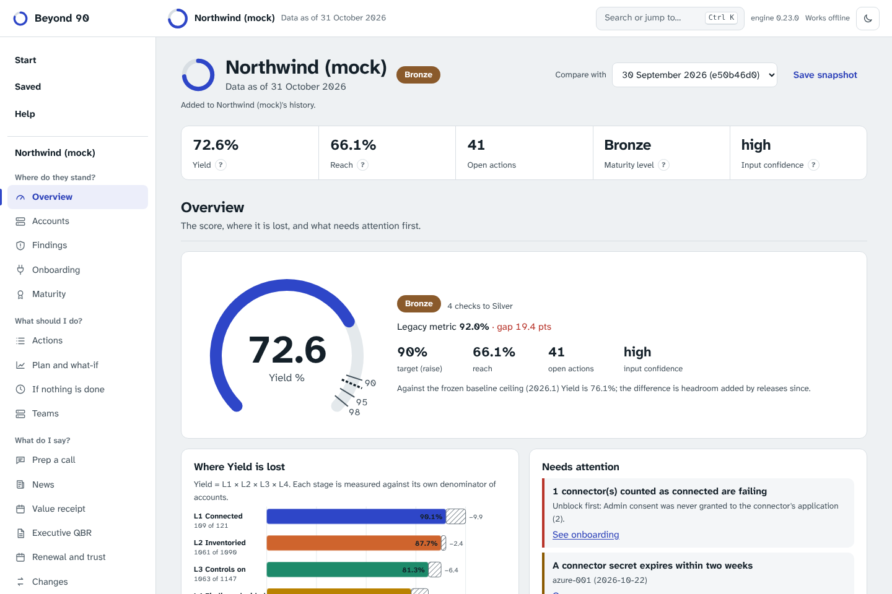
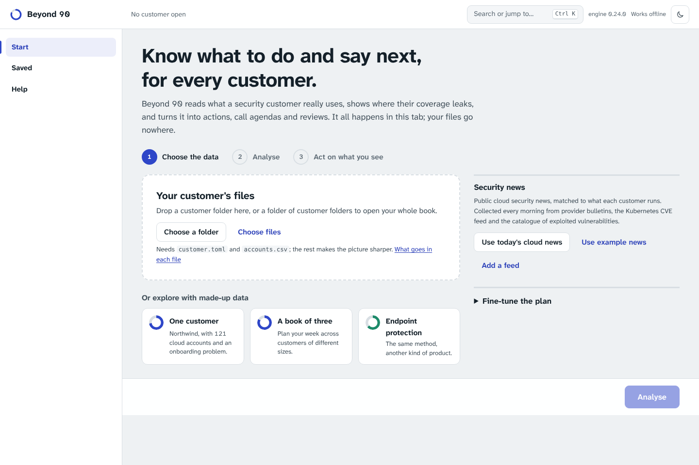

# Beyond 90

[](https://github.com/riccardomenegazzo/beyond-90/actions/workflows/ci.yml) [](https://github.com/riccardomenegazzo/beyond-90/actions/workflows/codeql.yml) [](https://scorecard.dev/viewer/?uri=github.com/riccardomenegazzo/beyond-90)

**An adoption score that cannot be flattered, a roadmap that tells you the dip before it happens, and an honest answer to "did the customer improve, or did the bar move?"**

## In one minute

A customer says "we are at 90%". Usually that means 90% of the accounts someone remembered to list. Beyond 90 checks the whole path from account to fix, with independent counts, and tells you what to do next.

- **What it gives you:** one honest score (Yield), the three actions that move it most, a prepared call, and a quarterly review a security lead will read.
- **Try it:** open the [live page](https://riccardomenegazzo.github.io/beyond-90/) and press the demo button. The customer is invented, and nothing leaves your browser.
- **Use it:** clone the repository, run `pip install .`, then `beyond90 score examples/portfolio/northwind`. For your own customer, start with `beyond90 init acme`.
- **Who it is for:** technical account managers, solutions architects and sales engineers. It is not tied to one vendor.
- **What it is not:** an independent audit. The security review was done by the author. See [Honest limits](#honest-limits).

The rest of this page goes deeper.

Most adoption reporting stops at "90% of accounts connected" (or sites, tenants, organizations: whatever your product connects). That number leaves out units nobody planned for, asset types the product never inventoried, controls that are switched off and findings nobody owns. Beyond 90 measures the whole pipeline against independent denominators, turns every gap into an action, and then goes further than a dashboard can.

**It shows what waiting costs, and where the gap matters.** It scores the same estate on future dates with only what is already dated (secrets, accepted risks, triage windows, deadlines), so every drop has a date and an exact size, and exports them to a calendar. Next to Yield, it weighs coverage by spend and exposure: 90% of accounts connected can still mean a fifth of the spend unwatched. See [docs/outlook.md](docs/outlook.md).

**It shows what the work was worth, and to whom to say it.** Between two snapshots it writes a value receipt: accounts connected and the spend now watched, findings closed, decisions taken, the customer's own points apart from the bar moving, each logged touch next to what followed it (followed, not caused) and what did not move. It splits the estate by the customer's teams, ranked by what is at stake on each side, with a message per team, and drafts the recap after a call. See [docs/value.md](docs/value.md).

**It reads the cloud security news every morning, and says whom it touches.** Provider bulletins, the Kubernetes CVE feed, cloud vulnerability databases and the catalogue of exploited vulnerabilities are read daily, merged into one story per issue, ranked by known exploitation and exploit probability, and matched to each customer's inventory: who is exposed, who is covered, who cannot be assessed. Each customer gets a briefing ready to send. See [docs/news.md](docs/news.md).

**It hands the work over in the shapes people use.** The action plan as a CSV for a ticket tracker, a one-page summary for the CISO that prints to a single page, and a guided mapping for any export whose columns are named differently. A customer health indicator shows its parts, its weights and what it could not measure, and says plainly that it is a hypothesis; record what happens at each renewal and the page compares the parts of the reading between the customers that stayed and the ones that left, and suggests weights only when it has enough to say anything. A screen for the call itself turns the agenda, what was agreed and what is owed into the recap, the actions and the log line.

**It keeps each customer's history and writes the executive QBR when it is due.** Every analysis is kept as a snapshot of the customer's files; when a review is due, pick the quarter and it writes the review a CISO reads: where they were and are, what the quarter delivered, the work done together, exposure today, what happens if nothing is done, next quarter's priorities and the decisions needed, with no internal jargon. See [docs/exec-qbr.md](docs/exec-qbr.md).

**It unblocks onboarding.** With the connector list the platform already has, it shows the stage every account is stuck at, the cause behind the error message, who fixes it and in what order, which connectors are counted as connected but broken, which secrets are about to expire, and whether the connectors themselves are over-privileged. Paste an error to have it explained; generate a pre-flight checklist for a kickoff. See [docs/onboarding.md](docs/onboarding.md).

**It runs the week of a TAM with a book.** Tiers set a cadence; [This week](docs/rhythm.md) orders the customers with the reason for each place; each call has a prepared agenda (what we owe, what changed, the security news that touches them, the questions worth asking); a commercial conversation is offered only when trust has been earned. See [docs/rhythm.md](docs/rhythm.md).

**It answers "what if" and "what would it take".** Tick the changes you would make and see Yield now, right after (connecting dips first) and once it settles; or pick 90% and see the steps that get there, biggest gain first. See [docs/whatif.md](docs/whatif.md). `beyond90 mcp` lets an assistant on your machine ask the same questions of your customers, read only and with no network ([docs/mcp.md](docs/mcp.md)).

**It lets you share without the names, and keep only what you should.** Copy or download with the customer, people, teams and accounts replaced by stable aliases (after a preview), put the real names back on your device, set a keep-until date per customer and erase one customer completely, with a record of what the page could not reach. A pseudonym is not anonymity. See [docs/privacy.md](docs/privacy.md).

**It fits the job you do.** Pick technical account manager, solutions architect or sales engineer and your views come first. There is a risk burn-down (is risk going away, and how fast are fixes made), a proof-of-value planner with success criteria and an honest result, and a ledger of what customers ask the vendor for. See [docs/roles.md](docs/roles.md).

**It keeps your promises.** A ledger across customers of what you and they have promised, with what is late, and a handoff note for whoever picks a customer up next. See [docs/promises.md](docs/promises.md).

**It collects its own data.** A config file points at your sources (REST APIs, cloud CLIs, a drop folder) and `beyond90 run` does the rest on a schedule: collect, score, compare with last time, write the review, alert only on what changed. See [docs/automation.md](docs/automation.md).

**For** Technical Account Managers, customer-success engineers and solutions teams at any security vendor: cloud, endpoint, identity, SIEM or other. One engine, a small catalogue ("profile") per kind of product; two ship today ([docs/profiles.md](docs/profiles.md)).

**It turns the quarter into the slides for the CISO.** The executive review downloads as a PowerPoint deck written by the engine in your browser: the one-minute summary, coverage then and now, what the quarter delivered, exposure, the two futures and the decisions to ask for.

**It shows where the problems meet.** The Connections map puts a customer's security stories, missing protections, stuck connectors, accounts, findings and owning teams on one interactive picture, and says in plain words what it shows: the one capability that closes the most exposures, the threats nobody can check, the single change that unblocks a group of accounts. Compared with an earlier snapshot it shows what was cleared and what is new; across a book it shows what several customers share, so one fix, one campaign or one session serves them all.

**On any device, from anywhere.** It installs as an app on a phone, a tablet or a computer and works offline; it reads Excel workbooks as well as CSV, or starts from a short form; your work moves between devices as one encrypted file; and it runs on your own machine or inside your network with `beyond90 app` or the container image ([docs/self-hosting.md](docs/self-hosting.md)).

**Try it without installing anything:** the [browser app](docs/app.md) runs the same engine in your tab. Drop a customer folder, or a folder of customers, and nothing leaves your machine. It is also a [browser extension](docs/extension.md) for Chrome, Edge and Firefox, with no permissions and no network.


*Mock customer. The legacy metric says 92%; the real score is 73%.*

## What is different

**1. It simulates the plan, and shows the J-curve.** Connecting an account makes Yield *fall* first: the new account enters L2 and L3 with nothing covered. Beyond 90 applies every action to a copy of the estate, with the ramp real connections need, and projects Yield week by week for the hours you actually have. You can tell the customer about the dip before it happens instead of explaining it afterwards.


**2. It separates what the customer did from what the bar did.** When a release adds capabilities, a good quarter can look like a bad one. `beyond90 explain` decomposes the change in Yield exactly (log-mean Divisia index, no residual) and splits L3 into "controls the customer switched on" and "capabilities that shipped since".


**3. It estimates the accounts nobody has seen.** Every adoption number is measured against the accounts you know. Billing, the organization hierarchy and SSO each miss some; how often accounts are seen by exactly one source versus two tells you how many are probably seen by none (capture-recapture, Chao 1987). The report gives a pessimistic L1 and says when the method's assumptions fail.

**4. It forecasts zero critical, and how likely it is to break.** A seeded Monte Carlo of the critical-finding queue, learned from the customer's own history. It flags findings older than anything ever closed instead of assuming they are about to be.

**5. It plans your whole book.** One budget of hours across all your customers, spent where the ARR-weighted gain per hour is highest, compared with an equal split and an ARR-proportional split, so the value of choosing is a number.

**6. It starts from the exports you already have.** `import` reads `aws organizations list-accounts`, `az account list`, `gcloud projects list`, billing and SSO CSVs and the platform's connected list, merges them by account id, and `reconcile` shows who is billed but not in the organization.

**7. A radar for releases and threats.** Which customers should hear about a new capability, and which are exposed and uncovered (or unknown) for a threat from a feed you provide.

**8. A trust layer from *The Trusted Advisor*.** Per-contact trust index, reliability measured from the promises you made, relationship gaps (no sponsor, single-threaded, teams nobody knows), expansion typed as Expand, Broaden or Diversify, a candor ledger of what to say plainly before the customer finds it, and a QBR built as a conversation in five stages. See [docs/trust.md](docs/trust.md).

**9. It says how far to trust the number.** Independent denominators, inventory and activation coverage, stale exports and empty columns are checked and summarised as a confidence level next to the score.

**10. It reads like the tools teams already trust.** A bronze, silver, gold maturity ladder where one failing check holds the level and the roadmap says which week the next level arrives, adoption by use case and by security-framework function, renewal readiness from leading indicators, a check on whether two exports differ in ways that look like artefacts, and a success plan the customer can sign. What was borrowed from existing products, and what was declined, is in [docs/research/landscape.md](docs/research/landscape.md).

**11. It is not tied to one product.** Profiles describe what a product should see and what it offers; the stages, formulas and checks are the same. Cloud security and endpoint protection ship, and the guide shows how to map identity, SIEM, email, vulnerability and application security.

**12. It runs in a browser tab, local-first.** [docs/app.md](docs/app.md): the same engine compiled to WebAssembly, served from GitHub Pages, nothing uploaded. Start, your customer, Saved and Help sit in the same four places; the customer's views are grouped by the question you are asking (where do they stand, what should I do, what do I say), every control explains itself in a tooltip, and Help answers the common questions in plain words. Drop a folder or try an example. Save snapshots of your inputs in the browser, compare with the previous quarter, export and merge between devices, work offline. Every number carries the hash of the inputs it came from. Drop a whole folder of customers to plan one budget of hours across the book.





Plus: ranked actions from a playbook catalogue, a moving bar (the score against today's ceiling and a frozen baseline), Reach, licensed-versus-used, an anti-gaming check for severity downgrades before SLA deadlines, history in SQLite, an ARR-weighted portfolio view that finds patterns worth one-to-many work, and a QBR draft written with the Pyramid Principle.

It runs locally, has no runtime dependencies (Python 3.11+ standard library) and sends no telemetry; only the connectors you configure and the news collector reach the network.

## Quick start

```
pip install .            # or: pip install -e ".[dev]" for development
beyond90 score examples/portfolio/northwind
beyond90 plan examples/portfolio/northwind --hours 8
beyond90 explain examples/portfolio/northwind --since examples/history/northwind-2026-09
beyond90 universe examples/portfolio/northwind
beyond90 forecast examples/portfolio/northwind
beyond90 report examples/portfolio/northwind --since examples/history/northwind-2026-09 --out northwind.html
beyond90 qbr examples/portfolio/northwind --since examples/history/northwind-2026-09 --quarter "Q4 2026"
beyond90 successplan examples/portfolio/northwind --owner "Alex Doe"
beyond90 portfolio examples/portfolio
beyond90 book examples/portfolio --hours 8 --weeks 12
beyond90 radar examples/portfolio --threats examples/threats.json
```

Ready-made outputs from these commands are in [docs/example](docs/example/), generated by the code and checked by a test.

Your own customer:

```
beyond90 init acme --name "Acme"      # scaffolds customer.toml and empty CSVs
# fill in accounts.csv etc., see docs/data-format.md
beyond90 validate acme                # every problem, with file and line
beyond90 score acme --store history.db --format markdown
beyond90 explain acme --store history.db   # what changed since the last stored snapshot
```

`beyond90 score --fail-under 0.9` exits with code 2 when Yield is below the threshold, so it can gate a CI job or a scheduled check.

## Commands

| Command | Purpose |
|---|---|
| `init`, `validate` | Scaffold a data directory; check inputs and report every error |
| `import`, `reconcile` | Merge native exports into `accounts.csv`; see how the lists overlap |
| `score` | Text, JSON, Markdown or HTML; `--store` keeps history |
| `plan` | Week-by-week roadmap with the J-curve, for your hours and horizon |
| `explain` | Exact attribution of a change in Yield: customer versus bar |
| `universe` | Estimate of accounts no source has seen, and a pessimistic L1 |
| `forecast` | Monte Carlo of reaching zero critical and of breaking it |
| `report` | Self-contained HTML report (light and dark, no JavaScript, a table view for every chart) |
| `actions` | Ranked actions, by leak, with playbook steps and effort |
| `run`, `sync` | The automatic pipeline from sources to a finished review; collect only |
| `check-config`, `schedule` | Validate a pipeline config; the GitHub Actions, cron or systemd file that runs it |
| `qbr` | Quarterly business review draft |
| `successplan` | A success plan the customer can sign |
| `history` | Stored snapshots, time to zero critical |
| `portfolio` | Many customers, ARR-weighted Yield, shared patterns |
| `book` | One budget of hours across all customers, weighted by ARR |
| `radar` | Who should hear about a release; who is exposed to a threat |
| `fingerprint` | The hash that names a set of inputs; every report carries it |
| `catalogue` | Modules and expected resource types at a ceiling version |

## For account managers

[The first 90 days with a new customer](docs/first-90-days.md) is a plan you can put in front of a customer, and [Showing Beyond 90 in five minutes](docs/demo-5-minutes.md) is a short script for explaining it out loud. [A worked case](docs/case-northwind.md) follows one customer from "we are at 92%" to a plan.

## Honest limits

- The plan is a model. It rests on the effort figures in `playbooks.json`, the ramp assumptions in `simulate.py` and the realization rate; change them to match how you work.
- The hidden-accounts estimate is a lower bound that needs independent sources. It tells you when that fails.
- The forecast only learns from the history it is given and cannot see what the customer will decide.
- Collection by configuration is tested against fake APIs and commands, not against any real vendor: check a new source with `beyond90 sync` before trusting it. Exports in CSV and TOML remain supported.
- The book planner needs effort figures that fit you; the defaults are estimates.
- Trust ratings (credibility, reliability, intimacy, self-orientation) are your own judgement; the index is a prompt for reflection, not a measurement.
- Input confidence says how far to trust the files, not how healthy the customer is.
- In the browser app, deleting a saved snapshot is local: merging by union brings it back if another device still has it. A 500-account estate takes about 10 seconds there.

## Documents

- [docs/guide.md](docs/guide.md): how it fits into a TAM's month
- [SPEC.md](SPEC.md): formulas and rules; the contract for the code
- [docs/data-format.md](docs/data-format.md): input files
- [docs/profiles.md](docs/profiles.md): one engine for any security product (cloud, endpoint, and how to map others)
- [docs/research/](docs/research/): the research behind the design
- [docs/architecture.md](docs/architecture.md): how the data is treated (system of record, snapshots, compatibility, sync)
- [docs/exec-qbr.md](docs/exec-qbr.md): the customer's history kept automatically, and an executive QBR built from it for any quarter
- [docs/news.md](docs/news.md): the daily cloud security news, merged, ranked and matched to each customer, with a briefing to send
- [docs/value.md](docs/value.md): a value receipt between two snapshots, one digest per customer team, a recap after the call
- [docs/outlook.md](docs/outlook.md): what breaks if nothing is done, with dates and exact effects; coverage weighted by spend and exposure
- [docs/onboarding.md](docs/onboarding.md): connector stages, causes and fixes, waves, healthy versus counted, secrets, connector security, pre-flight
- [docs/rhythm.md](docs/rhythm.md): tiers, cadence, the week, call prep, advisories, growth only when earned
- [docs/threat-model.md](docs/threat-model.md): what is protected, from what, and what is not claimed
- [docs/automation.md](docs/automation.md): collect data from APIs and CLIs by configuration, run on a schedule, alert on change
- [docs/operations.md](docs/operations.md): what happens when inputs, sources or disks misbehave; retention, locks, size limits
- [docs/app.md](docs/app.md): the browser app and how to publish it on GitHub Pages
- [docs/self-hosting.md](docs/self-hosting.md): install it as an app, run it on your machine or in your network, Excel and the form as inputs, moving between devices
- [docs/extension.md](docs/extension.md): the same app as a browser extension, what it can and cannot do, how to build it
- [docs/trust.md](docs/trust.md): the relationship layer and what it takes from the book
- [docs/research/reading-list.md](docs/research/reading-list.md)
- [docs/design.md](docs/design.md): visual direction and validated palette

## Status

Version 0.12, alpha. Tests: Python 3.11 to 3.13 (`python -m pytest`, including seeded random estates and hostile input), Node tests for the browser data model (`node --test site/test/*.test.mjs`), and a Chromium end-to-end test with an accessibility audit (`python site/e2e.py`). All example data is invented and generated by `examples/generate_examples.py`.

## Contributing

See [CONTRIBUTING.md](CONTRIBUTING.md). Never include customer data in issues or pull requests.

## License

Apache License 2.0. See [LICENSE](LICENSE). Software bundled in the browser app is listed in [THIRD_PARTY.md](THIRD_PARTY.md).
