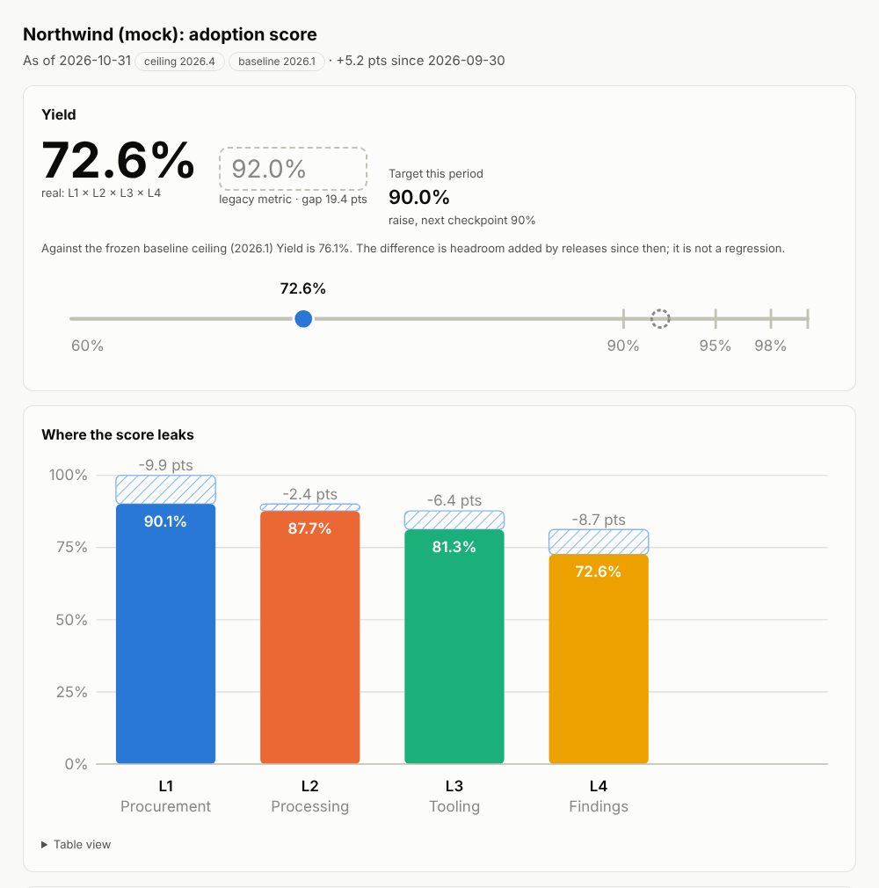
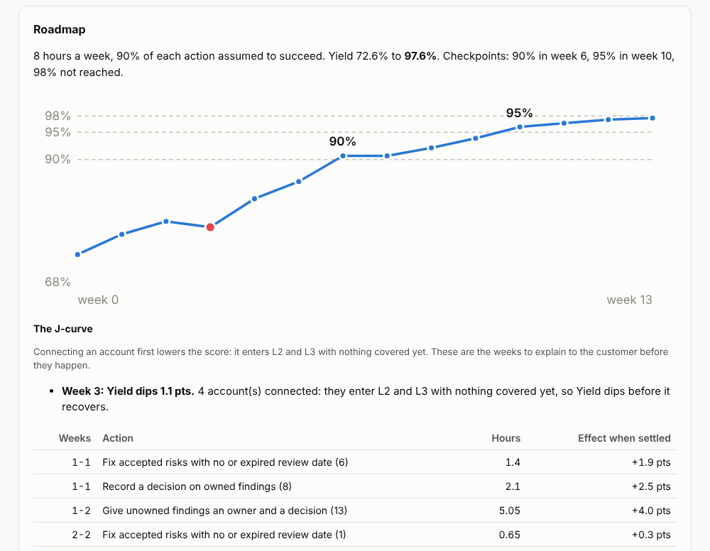
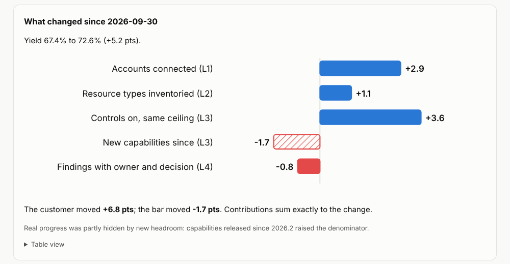

# Beyond 90

**An adoption score that cannot be flattered, a roadmap that tells you the dip before it happens, and an honest answer to "did the customer improve, or did the bar move?"**

Most adoption reporting stops at "90% of accounts connected". That number leaves out accounts nobody planned for, resource types the platform never inventoried, controls that are switched off and findings nobody owns. Beyond 90 measures the whole pipeline against independent denominators, turns every gap into an action, and then goes further than a dashboard can.



*Mock customer. The legacy metric says 92%; the real score is 73%.*

## What is different

**1. It simulates the plan, and shows the J-curve.** Connecting an account makes Yield *fall* first: the new account enters L2 and L3 with nothing covered. Beyond 90 applies every action to a copy of the estate, with the ramp real connections need, and projects Yield week by week for the hours you actually have. You can tell the customer about the dip before it happens instead of explaining it afterwards.



**2. It separates what the customer did from what the bar did.** When a release adds capabilities, a good quarter can look like a bad one. `beyond90 explain` decomposes the change in Yield exactly (log-mean Divisia index, no residual) and splits L3 into "controls the customer switched on" and "capabilities that shipped since".



**3. It estimates the accounts nobody has seen.** Every adoption number is measured against the accounts you know. Billing, the organization hierarchy and SSO each miss some; how often accounts are seen by exactly one source versus two tells you how many are probably seen by none (capture-recapture, Chao 1987). The report gives a pessimistic L1 and says when the method's assumptions fail.

**4. It forecasts zero critical, and how likely it is to break.** A seeded Monte Carlo of the critical-finding queue, learned from the customer's own history. It flags findings older than anything ever closed instead of assuming they are about to be.

Plus: ranked actions from a playbook catalogue, a moving bar (the score against today's ceiling and a frozen baseline), Reach, licensed-versus-used, an anti-gaming check for severity downgrades before SLA deadlines, history in SQLite, an ARR-weighted portfolio view that finds patterns worth one-to-many work, and a QBR draft written with the Pyramid Principle.

It runs locally, has no runtime dependencies (Python 3.11+ standard library), makes no network calls and sends no telemetry.

## Quick start

```
pip install .            # or: pip install -e ".[dev]" for development
beyond90 score examples/portfolio/northwind
beyond90 plan examples/portfolio/northwind --hours 8
beyond90 explain examples/portfolio/northwind --since examples/history/northwind-2026-09
beyond90 universe examples/portfolio/northwind
beyond90 forecast examples/portfolio/northwind
beyond90 report examples/portfolio/northwind --since examples/history/northwind-2026-09 --out northwind.html
beyond90 qbr examples/portfolio/northwind --since examples/history/northwind-2026-09 --quarter "Q4 2026"
beyond90 portfolio examples/portfolio
```

Your own customer:

```
beyond90 init acme --name "Acme"      # scaffolds customer.toml and empty CSVs
# fill in accounts.csv etc., see docs/data-format.md
beyond90 validate acme                # every problem, with file and line
beyond90 score acme --store history.db --format markdown
beyond90 explain acme --store history.db   # what changed since the last stored snapshot
```

`beyond90 score --fail-under 0.9` exits with code 2 when Yield is below the threshold, so it can gate a CI job or a scheduled check.

## Commands

| Command | Purpose |
|---|---|
| `init`, `validate` | Scaffold a data directory; check inputs and report every error |
| `score` | Text, JSON, Markdown or HTML; `--store` keeps history |
| `plan` | Week-by-week roadmap with the J-curve, for your hours and horizon |
| `explain` | Exact attribution of a change in Yield: customer versus bar |
| `universe` | Estimate of accounts no source has seen, and a pessimistic L1 |
| `forecast` | Monte Carlo of reaching zero critical and of breaking it |
| `report` | Self-contained HTML report (light and dark, no JavaScript, a table view for every chart) |
| `actions` | Ranked actions, by leak, with playbook steps and effort |
| `qbr` | Quarterly business review draft |
| `history` | Stored snapshots, time to zero critical |
| `portfolio` | Many customers, ARR-weighted Yield, shared patterns |
| `catalogue` | Modules and expected resource types at a ceiling version |

## Honest limits

- The plan is a model. It rests on the effort figures in `playbooks.json`, the ramp assumptions in `simulate.py` and the realization rate; change them to match how you work.
- The hidden-accounts estimate is a lower bound that needs independent sources. It tells you when that fails.
- The forecast only learns from the history it is given and cannot see what the customer will decide.
- Live connectors to platform APIs are not included: they need a real tenant to verify. Input is CSV and TOML for now.

## Documents

- [SPEC.md](SPEC.md): formulas and rules; the contract for the code
- [docs/data-format.md](docs/data-format.md): input files
- [docs/research-wiz-tam.md](docs/research-wiz-tam.md): how a vendor TAM motion works and what platforms already measure
- [docs/reading-list.md](docs/reading-list.md)
- [docs/design.md](docs/design.md): visual direction and validated palette

## Status

Version 0.3, alpha. 98 tests (`python -m pytest`). All example data is invented and generated by `examples/generate_examples.py`.

## Contributing

See [CONTRIBUTING.md](CONTRIBUTING.md). Never include customer data in issues or pull requests.

## License

Apache License 2.0. See [LICENSE](LICENSE).
