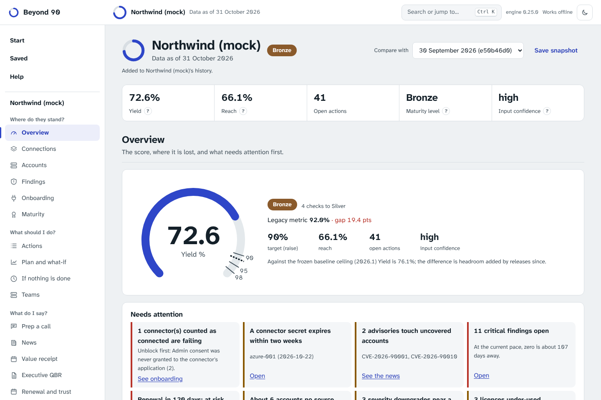
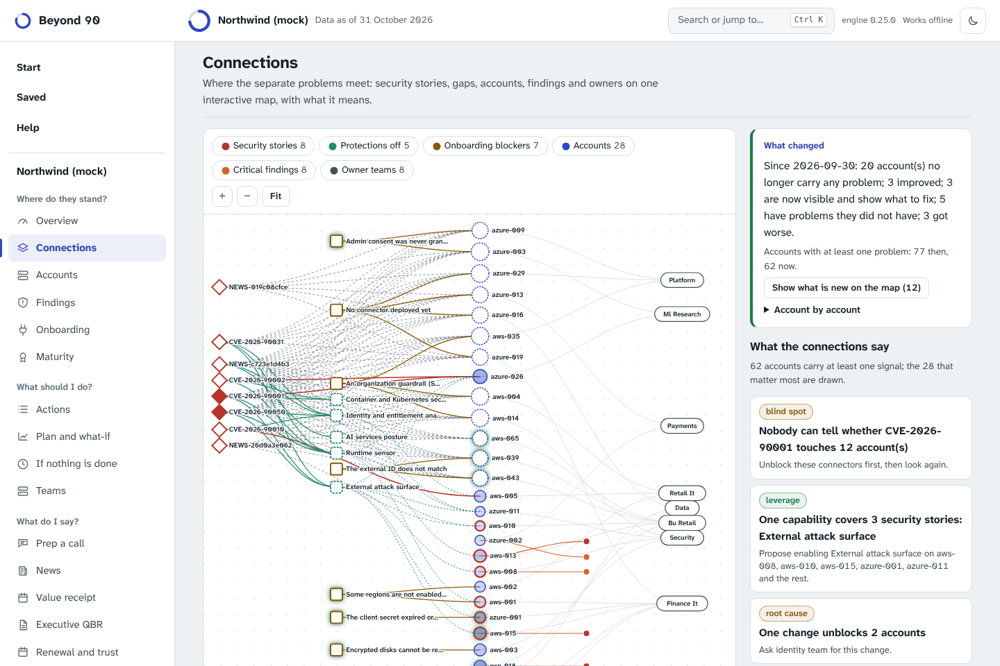
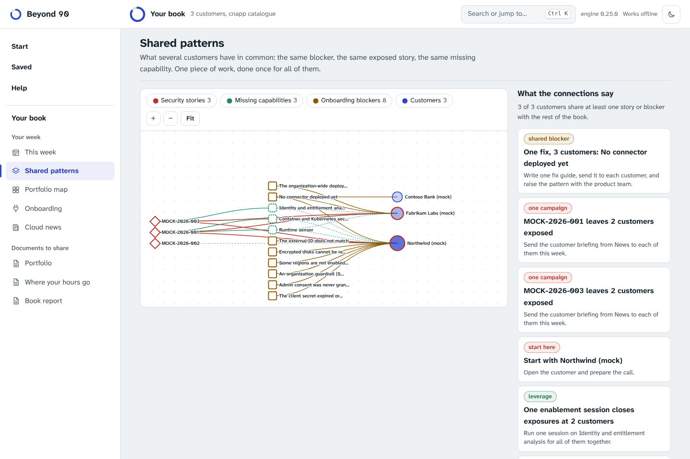

# The browser app

`site/` is a static web app: the same Python engine, running in the browser through [Pyodide](https://pyodide.org) (WebAssembly). It exists so that anyone can try Beyond 90 on a laptop with nothing installed, and so a team can share one link.

## How it is laid out

Four places on the left, always in the same spot:

- **Start.** Drop a customer folder (or a folder of customer folders for your whole book), or open one of the examples, then press **Analyse**. The three steps across the top say where you are. Customers you analysed before are listed under **Pick up where you left off**: one click opens them again.
- **The open customer, or your book.** Its views are grouped by the question you are asking: *Where do they stand?* (overview, connections, accounts, findings, onboarding, maturity), *What should I do?* (actions, plan and what-if, if nothing is done, teams), *What do I say?* (prep a call, news, value receipt, executive QBR, renewal and trust, changes) and *Documents to share*. Each view opens with one sentence saying what it is for.
- **Saved.** The history of every analysis, protection with a passphrase, and moving your work between devices.
- **Help.** Answers to the questions people ask, written plainly and searchable; what each term means; the keyboard; and the privacy check.

Every control explains itself: hover it, or reach it with the keyboard, and a short tooltip says what it does (screen readers hear the same text). The small question marks next to numbers such as Yield open their definition. After the first analysis, **Take the one-minute tour** walks through the screen; it is also in Help. **Search or jump to…** (Ctrl or Cmd + K) finds any view, action, answer or term.



## What you see

- **Overview.** The Yield gauge with the legacy figure marked, where each stage loses points, what needs attention, the best opportunities and the planned curve.
- **Connections.** One map of where the customer's separate problems meet: the security stories that reach them, the protections that are off, the onboarding blockers that keep accounts out of view, the accounts themselves, their worst findings and the teams that own them, left to right. Beside it, in plain words, what the picture shows: the one capability that would close the most exposures, the stories nobody can check because the accounts are not connected, the team that holds most of the risk, the single change that unblocks a group of accounts, the accounts where several problems converge. Click an insight and its part of the map lights up; click or press Enter on anything to see what it is linked to and jump to its view; drag, zoom and hide kinds from the legend. The layout is the same every time for the same data, so two people looking at one customer see one picture.



With an earlier snapshot to compare with, the map also says **what changed**: accounts that no longer carry any problem, accounts that improved, accounts that became visible (connected at last, and now showing what to fix, which is progress), accounts with new problems or worse ones, and the patterns that appeared or were resolved. "Show what is new on the map" lights those items up.

- **Shared patterns** (in a book). The same idea across customers: the security stories, onboarding blockers and missing capabilities several customers share. Each shared pattern is one piece of work done once: a fix guide for everyone stuck on the same blocker (and feedback for the product team), one campaign for a story that leaves several customers exposed, one enablement session for the capability that would cover them, and the customer to start with. Click a customer to open its own map.



- **Actions, Accounts, Findings.** Searchable, filterable, sortable tables. Open a row for the steps, the question to ask the customer or the gaps behind an account. Every table exports to CSV.


- **Plan and what-if.** Move the sliders for hours a week, horizon and success rate; the engine recomputes and draws the new curve against the original.


- **Maturity, Renewal and trust, Changes.** The ladder and every check, renewal signals, licences, the unseen-units estimate, contacts, and what changed since an earlier snapshot.
- **Executive QBR.** The review for a CISO, built from the customer's history, downloadable as PowerPoint slides, a page that prints to PDF, or Markdown. See [exec-qbr.md](exec-qbr.md).
- **Help, This build.** The version, the source commit and a check that fingerprints every file the page is running against the signed manifest.
- **Documents to share.** The written report, the QBR draft, a success plan the customer can sign, the roadmap, a summary and the JSON, each with Copy and Download.

**Keys.** Ctrl or Cmd + K searches everything; outside a text field, 1 to 9 switch between the first views; Esc closes a dialog, a tooltip or the tour. The theme follows your system and can be switched; printing gives a clean page.

## As a browser extension

The same app is packaged for Chrome, Edge and other Chromium browsers, and for Firefox: one click on the toolbar opens it in a tab of its own, and it works with no connection at all. It asks for no permissions, has no content scripts (it cannot see the pages you visit), and its policy allows nothing beyond its own files, so not even the news feed is fetched: the extension carries the news collected when it was built. Saved snapshots live in the extension's own storage, separate from the website's. Download it from Help or see [extension.md](extension.md).

## A whole book

Choose a folder that contains several customer folders (each with a `customer.toml`), or open the example book. The page shows each customer's Yield now and after the plan, the patterns that recur across customers, and where one budget of hours per week does the most good, optimised for revenue-weighted or equal-weighted Yield. A customer with invalid data is reported and the rest carry on. The **Portfolio map** is a heat map of every customer by stage, with ARR, level and where to look first. **Open** jumps to one customer's own dashboard.


## Saving and comparing

Every analysis is added to the customer's history (Saved, "What is kept"); **Save snapshot** does the same on demand. Only input files are kept (not results), in IndexedDB. Contacts and commitments are left out unless you tick the box, because they are personal data. Saving the same files twice changes nothing. With an earlier snapshot of the same customer saved, the next run compares with it automatically and the report explains what changed; the menu lets you pick another or none. **Export workspace** writes one JSON file; **Import workspace** merges it, so importing the same file twice, or files from two devices in any order, gives the same result. Imports whose content does not match their name are rejected. The app works offline once loaded. See `docs/architecture.md`.

## What it does not do

- It does not upload anything. A button in the footer checks it: the page and the worker both try to reach another site and the browser blocks them. Files are read with the browser's File API and handed to Python in memory. The page has a Content Security Policy that allows requests to its own origin only (`connect-src 'self'`), so even a bug could not send your data elsewhere. Nothing is stored: close the tab and it is gone.
- It keeps no history unless you save snapshots (and then only inputs, in this browser), and it does not run `book`, `radar` or `import`. Those need many folders or native exports and stay in the CLI.
- No third party is contacted. Pyodide (about 14 MB) is copied into the site at build time and served from the same origin; the first visit downloads it, later visits use the browser cache.

## Publish it on GitHub Pages

1. The repository must be allowed to use Pages. Public repositories can on every plan; **private repositories need a paid plan** (Pro, Team or Enterprise).
2. In *Settings, Pages*, set *Source* to **GitHub Actions**.
3. Push to `main` (or run the *Pages* workflow by hand). The workflow installs Pyodide, builds `_site/`, runs the browser smoke test (`site/e2e.py`) and deploys. The address is `https://<user>.github.io/beyond-90/`.

A Pages site from a public repository is public. Do not put customer data in the repository; the demo is a made-up customer.

## Licences

The site bundles Pyodide (MPL-2.0) and the Python standard library (PSF); see [THIRD_PARTY.md](../THIRD_PARTY.md), which is also served with the page.

## Build and test locally

```bash
npm ci --ignore-scripts --prefix site/npm      # pinned in site/npm/package-lock.json, with integrity hashes
python site/build_site.py --out _site --pyodide site/npm/node_modules/pyodide
python -m http.server --directory _site 8000          # then open http://localhost:8000
node --test site/test/*.test.mjs                       # the workspace model, no browser needed
pip install playwright && python -m playwright install chromium
python site/e2e.py _site                               # the whole app in Chromium, including offline
```

`file://` does not work: browsers do not let a page load WebAssembly from disk. Serve the folder.

## Design notes

- `beyond90.web` is the only module the page calls (`analyze_json`, `summarize_json`, `fingerprint_json`); `tests/test_web.py` checks it returns the same Yield as the CLI.
- The Markdown viewer escapes everything before it adds markup, and the report is shown in a sandboxed iframe with no scripts.
- The same palette and light and dark themes as the report; no vendor assets.
