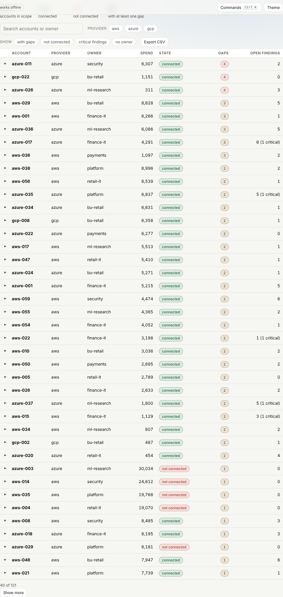
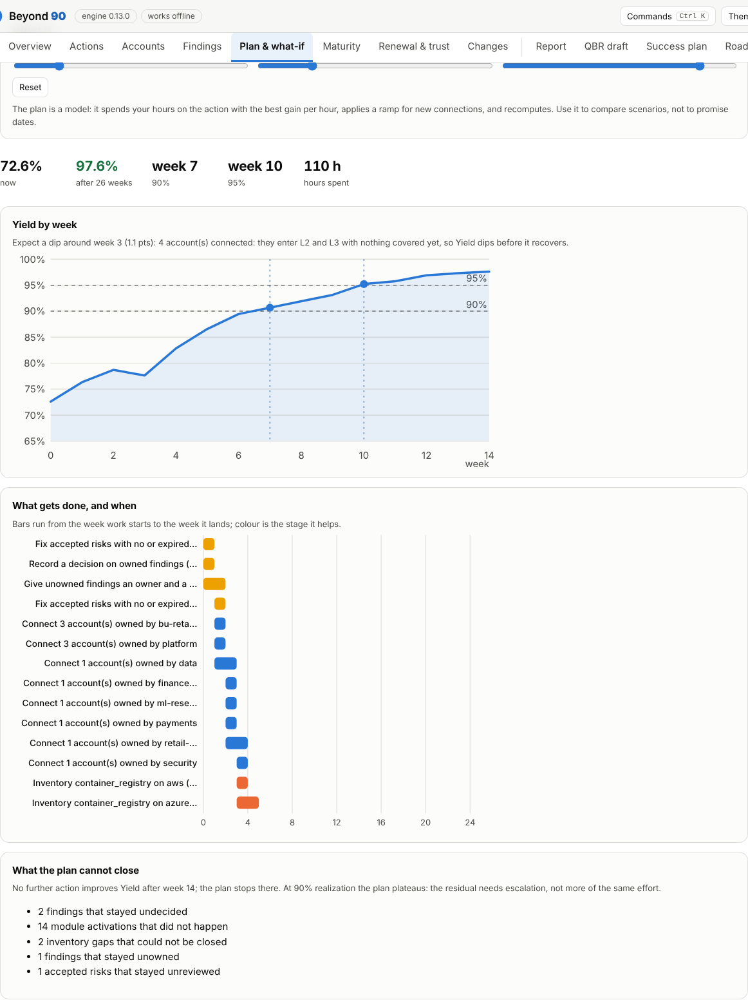
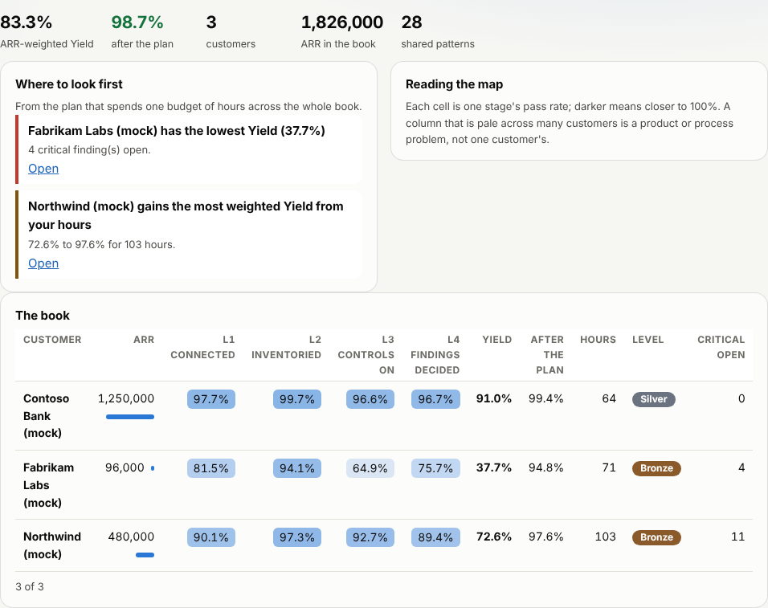

# The browser app

`site/` is a static web app: the same Python engine, running in the browser through [Pyodide](https://pyodide.org) (WebAssembly). It exists so that anyone can try Beyond 90 on a laptop with nothing installed, and so a team can share one link.

## What it does

Drop a customer folder (or pick the files), or press **Try the demo**, then **Run analysis**. You get the report, the QBR draft, the roadmap, the summary and the JSON, each with Copy and Download. Validation shows every problem at once, by file and line.

## What you see

A strip of tiles (Yield, Reach, open actions, maturity level, confidence, profile), then views you work in:


- **Overview.** The Yield gauge with the legacy figure marked, where each stage loses points, what needs attention, the best opportunities and the planned curve.
- **Actions, Accounts, Findings.** Searchable, filterable, sortable tables. Open a row for the steps, the question to ask the customer or the gaps behind an account. Every table exports to CSV.



- **Plan & what-if.** Move the sliders for hours a week, horizon and realization; the engine recomputes and draws the new curve against the original.



- **Maturity, Renewal & trust, Changes.** The ladder and every check, renewal signals, licences, the unseen-units estimate, contacts, and what changed since an earlier snapshot.
- **Documents.** The written report, the QBR draft, a success plan the customer can sign, the roadmap, a summary and the JSON, each with Copy and Download.

**Keys.** Ctrl or Cmd + K opens the command palette (run, load a demo, go to a view, save, copy a five-line summary for chat, print, switch theme). Outside a text field, 1 to 9 switch views. The theme follows your system and can be switched; printing gives a clean page.

## A whole book

Choose a folder that contains several customer folders (each with a `customer.toml`), or press **Try the book demo**. The page shows each customer's Yield now and after the plan, the patterns that recur across customers, and where one budget of hours per week does the most good, optimised for ARR-weighted or equal-weighted Yield. A customer with invalid data is reported and the rest carry on. The **Portfolio map** is a heat map of every customer by stage, with ARR, level and where to look first. **Open** jumps to one customer's own dashboard.



## Saving and comparing

**Save snapshot in this browser** keeps your input files (not results) in IndexedDB. Contacts and commitments are left out unless you tick the box, because they are personal data. Saving the same files twice changes nothing. With an earlier snapshot of the same customer saved, the next run compares with it automatically and the report explains what changed; the menu lets you pick another or none. **Export workspace** writes one JSON file; **Import workspace** merges it, so importing the same file twice, or files from two devices in any order, gives the same result. Imports whose content does not match their name are rejected. The app works offline once loaded. See `docs/architecture.md`.

## What it does not do

- It does not upload anything. A button in the footer checks it: the page and the worker both try to reach another site and the browser blocks them. Files are read with the browser's File API and handed to Python in memory. The page has a Content Security Policy that allows requests to its own origin only (`connect-src 'self'`), so even a bug could not send your data elsewhere. Nothing is stored: close the tab and it is gone.
- It keeps no history unless you save snapshots (and then only inputs, in this browser), and it does not run `book`, `radar` or `import`. Those need many folders or native exports and stay in the CLI.
- No third party is contacted. Pyodide (about 14 MB) is copied into the site at build time and served from the same origin; the first visit downloads it, later visits use the browser cache.

## Publish it on GitHub Pages

1. The repository must be allowed to use Pages. Public repositories can on every plan; **private repositories need a paid plan** (Pro, Team or Enterprise).
2. In *Settings, Pages*, set *Source* to **GitHub Actions**.
3. Push to `main` (or run the *Pages* workflow by hand). The workflow installs Pyodide, builds `_site/`, runs the browser smoke test (`site/e2e.py`) and deploys. The address is `https://<user>.github.io/beyond-90/`.

A Pages site from a public repository is public. Do not put customer data in the repository; the demo is a made-up customer.

## Licences

The site bundles Pyodide (MPL-2.0) and the Python standard library (PSF); see [THIRD_PARTY.md](../THIRD_PARTY.md), which is also served with the page.

## Build and test locally

```bash
npm ci --ignore-scripts --prefix site/npm      # pinned in site/npm/package-lock.json, with integrity hashes
python site/build_site.py --out _site --pyodide site/npm/node_modules/pyodide
python -m http.server --directory _site 8000          # then open http://localhost:8000
node --test site/test/*.test.mjs                       # the workspace model, no browser needed
pip install playwright && python -m playwright install chromium
python site/e2e.py _site                               # the whole app in Chromium, including offline
```

`file://` does not work: browsers do not let a page load WebAssembly from disk. Serve the folder.

## Design notes

- `beyond90.web` is the only module the page calls (`analyze_json`, `summarize_json`, `fingerprint_json`); `tests/test_web.py` checks it returns the same Yield as the CLI.
- The Markdown viewer escapes everything before it adds markup, and the report is shown in a sandboxed iframe with no scripts.
- The same palette and light and dark themes as the report; no vendor assets.
