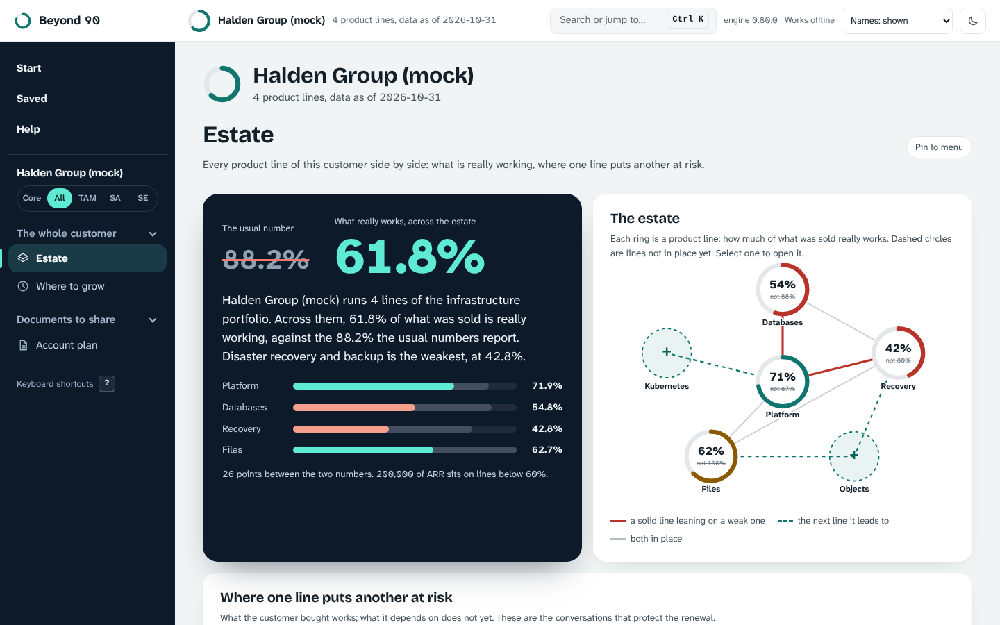

# One customer, every product line

A team that sells a portfolio meets the same customer on several lines: the platform, its databases, its files, its recovery, its containers. The estate view puts those lines side by side. Each line is scored on its own profile, in its own units, and the estate answers three questions:

1. **How much of what was sold really works?** Yield for each line, and across the estate weighted by ARR, next to the usual number (licences deployed, features enabled) that hides the gap.
2. **Where does one line put another at risk?** A solid line that leans on a weak one: the platform is adopted, but losing a site would still mean rebuilding it by hand. These are the conversations that protect a renewal.
3. **Which line comes next, and how do you open it?** The lines of the same family the customer does not run yet, in the order they follow from what it already runs, each with the reason, the first question to ask and a proof to offer.



## How to open one

Put one folder per product line in a parent folder. Each line's `customer.toml` names its profile:

```
halden-group/
  hci/            customer.toml with profile = "hci"
  dbaas/          profile = "dbaas"
  file-storage/   profile = "file-storage"
  dr-backup/      profile = "dr-backup"
```

In the browser, drop the parent folder: folders on different profiles open as one customer's estate, folders on the same profile open as a book of customers. On the command line:

```
beyond90 estate examples/estates/halden-group            # the account plan, in Markdown
beyond90 estate examples/estates/halden-group --format json
```

The start page has the example, "One customer, every line": Halden Group, an invented customer on a platform, databases, file storage and disaster recovery.

## What you get

- **Estate:** the headline, the usual number struck through next to what really works, one bar per line; the map, with the first line of the family in the middle and the others around it; red links where a solid line leans on a weak one, dashed links to the lines that could come next; the next action on each line; the four stages of every line in one table.
- **Where to grow:** each missing line with why it follows, the opening question (from that profile's discovery questions) and a proof to offer (from its proof-of-value criteria).
- **Account plan:** all of it as a document to paste into a CRM, a shared drive or an email.

Select a line, on the map or in the table, to open its own report: Today, actions, call prep, proof of value.

## How it decides

- **Families.** `infrastructure` (platform, databases, file storage, object storage, Kubernetes platform, disaster recovery) and `security` (cloud, identity, SaaS, monitoring, endpoint, AI). The estate is compared with the family most of its lines belong to.
- **Links.** A short list of statements true of any vendor, in `src/beyond90/estate.py`: "point-in-time recovery protects a database, not the site it runs on". A link is a **risk** when its source line is at 70% or more and its target is below 60%, and a **next line** when its target is not in place.
- **Order of the next lines.** A missing line that several solid lines lead to comes first; a missing line nothing leads to still shows, last, as a question rather than a proposal.
- **The estate figure** weights each line's Yield by its ARR. Lines are never added up in units: clusters and database environments do not mix.

No vendor or product is named anywhere: the families and links describe kinds of product.
