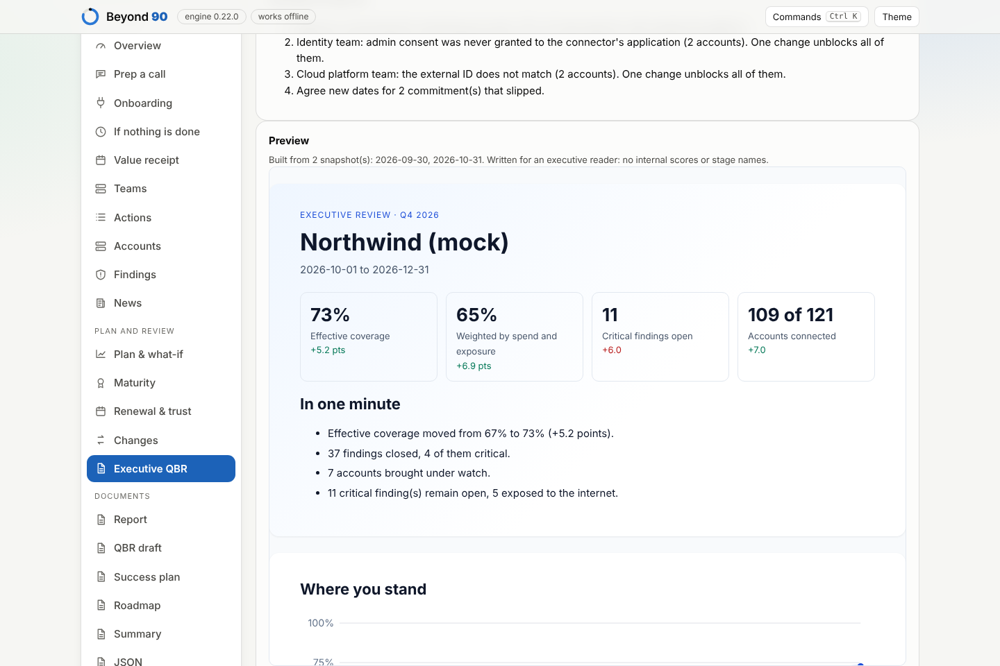

# The customer's history and the executive QBR

A TAM reviews each customer with its executive sponsor, usually a CISO, every quarter. The review should show where the customer was, where it is, what the quarter was worth, and what has to be decided next. It should be built from what was recorded along the way, not reconstructed the night before.

## A history that keeps itself

Every analysis of a customer is added to that customer's history in the browser (step 1, "Keep every analysis in the customer's history", on by default). Only the input files are kept, never results; the same data twice is kept once. Contacts, commitments and interactions are left out unless you tick "Keep contacts and commitments when I save": the review takes them from the latest analysis instead. With a passphrase set, the history is sealed, and nothing is added while it is locked. Export the workspace to keep it elsewhere or move it between devices.

## A review when you need it

In **Executive QBR**, pick a quarter (or custom dates) and build. The period is compared with the last snapshot saved before it began; if there is none, with the first one inside it. The page says which snapshots it will use before you build.



The review has six parts, one printed page each:

1. **Cover and the minute that matters.** Effective coverage, coverage weighted by spend and exposure, critical findings open, accounts connected, each with its change; three or four sentences that say the quarter.
2. **Where you stand.** The trend across every snapshot in the period and the four parts of coverage: connected, visible, protected, handled.
3. **What the quarter delivered.** Accounts brought under watch, findings closed (and how many critical), findings given an owner or a decision, protections switched on, our commitments kept, and what is still to do.
4. **Working together.** The touches recorded in the period and the moments that mattered (workshops, reviews, escalations, agreed next steps); what is still open on our side.
5. **Exposure today.** Critical findings and those exposed to the internet, spend not yet connected, the threats of the period that touched the customer (with the cloud news loaded), and what happens if nothing is done.
6. **Next quarter and the decisions we need.** Four priorities with owners and dates, and up to four decisions to ask for: connecting the rest of the spend, owners for critical findings, the one change that unblocks a group of connectors, new dates for what slipped.

It is written for an executive: "effective coverage" and its four parts instead of internal stage names, no maturity labels, no internal score. Download it as HTML (it prints to PDF, one page per section) or Markdown.

```
beyond90 exec-qbr examples/portfolio/northwind examples/history/northwind-2026-09 --out review.html
beyond90 exec-qbr DIR1 DIR2 DIR3 --from 2026-07-01 --to 2026-09-30 --threats advisories.json --format markdown
```

The command takes the data directories of the same customer in any order; automated runs keep one per day under the state directory's `snapshots/`.

## Limits

- The review is as good as the history: a quarter with one snapshot can show where the customer is, not how it moved.
- Interactions and commitments come from the latest analysis; a touch recorded only in an older snapshot is not shown.
