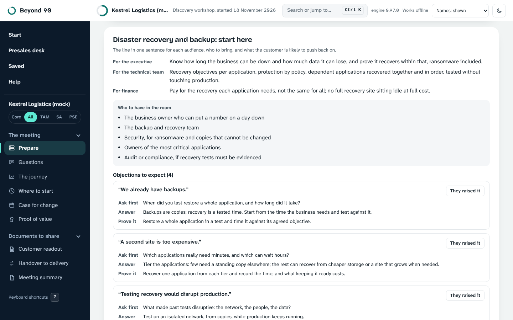
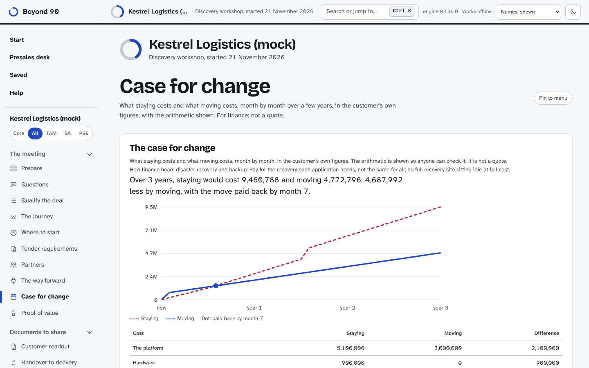
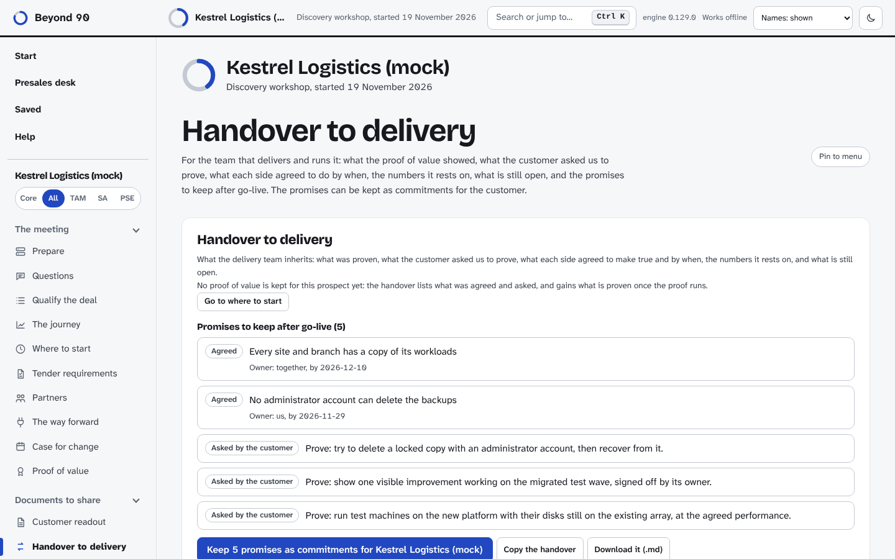
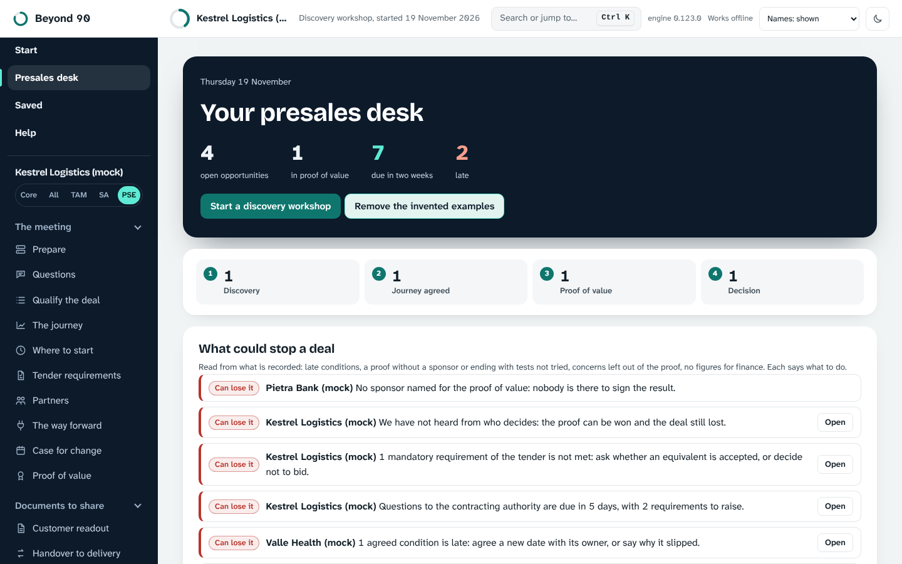
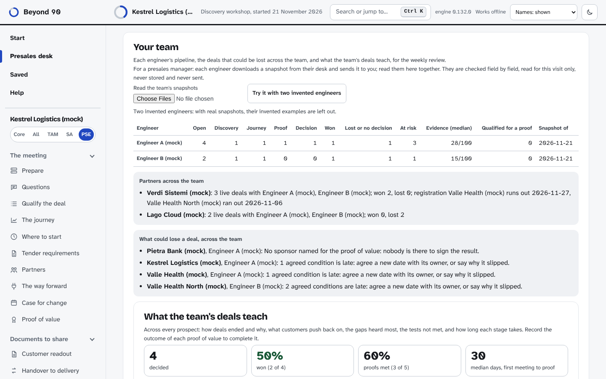
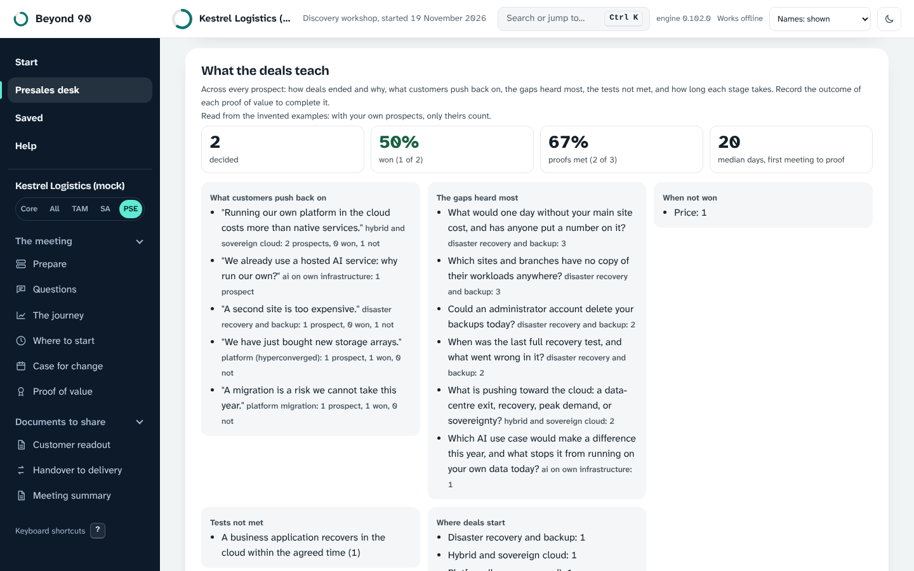

# For presales leaders

What a presales team gets from Beyond 90, and what its leader sees, without a new system to buy, a server to run or a CRM to integrate. Everything here runs in each engineer's browser; nothing about a customer leaves it unless the engineer chooses to send a file.

## What changes for the team

**Every engineer runs discovery the same way.** Each product line comes with its own questions, each saying who to ask, what a strong or a worrying answer sounds like and the follow-up that goes deeper, with the essential ones for a first meeting marked. Ten questions qualify the deal the same way on every line and say whether it is ready for a demo built for the customer, a proof of value or a date in the forecast. The way forward says, for every prospect, which phase it is in, what must be true to move on and how to run the next step, down to a demo planned from the customer's own words. Each line also brings the message for the executive, the technical team and finance, who to bring, and the objections to expect, each with the question to ask before answering and how to prove the answer. The customer's answers become a journey ("yes, this is possible; this is what would need to be true"), a readout the customer can keep, and a proof of value that starts with that line's own criteria and with what the customer asked to see proven.

**Every deal carries its numbers, with the arithmetic shown:**
- from a VM inventory read in the page: a sizing sketch with the rules of distributed storage, and a plan in waves with dates;
- a GPU sketch for AI on the customer's own infrastructure;
- a recovery design per tier;
- a backup capacity sketch;
- a case for change in the customer's own figures.

Each says what decided the result and what to check before relying on it. None is a quote.

**Every handover carries its promises.** What was proven, what the customer asked to see proven and what each side agreed to do go to the delivery team in one note. The promises become the customer's commitments, so what presales promised is still followed after the sale.

## What a leader sees

**Each engineer's desk.** Every prospect at its stage, what is due and what is late, how much evidence of a technical win each deal holds (a checklist out of 100, with what would raise it), and what could stop each deal, read from what is recorded: conditions gone late, a proof without a sponsor or ending with tests not tried, concerns left out of the proof, no figures for finance. A Monday note for the account team, and the pipeline as a sheet.

**The team, read together.** Each engineer downloads a snapshot of their desk: stages, risks, outcomes, what customers pushed back on, the gaps heard. It carries no notes, no figures and no names of people, and prospect names can be swapped for aliases. The leader reads the snapshots together: each engineer's pipeline and the median evidence of their open deals, the deals that could be lost across the team, and a team review in Markdown for the weekly meeting. The files are checked field by field, read for that visit only, and never stored.

**What the deals teach.** How deals ended and why, the share won and the share of proofs met. Then three lists, each useful to a different team:
- what customers push back on, for enablement;
- the gaps heard most and the tests not met, for the product team;
- the median days of each stage and where deals start, for planning.

## Selling with partners

In most territories the deal comes through a partner. Every deal records:

- who is on it and who leads;
- the partner's registration and when it runs out;
- the route to purchase;
- who does what, from discovery to support.

A registration about to lapse is a risk on the desk, next to a proof without a sponsor. A partner asked to deliver a line it has no skills for is an enablement gap, named per partner. The partner review gathers each partner's live deals, registrations, wins and losses for the meeting with the partner or the channel manager. The discovery kit lets a partner's engineers run the same discovery as yours, without any customer's data ([docs/partners.md](partners.md)).

## Why it can be adopted tomorrow

- **Nothing to install or approve.** It runs in the browser, works offline, and installs as an app on a laptop or a phone. Customer data stays on the engineer's device, under a strict content security policy. Sending anything is an explicit act, through a preview that can swap names for aliases.
- **Fits your portfolio.** Product lines are described as kinds of product, in plain JSON: questions (`discovery.json`), proof-of-value criteria and first-day checklist (`pov.json`), messages, people and objections (`story.json`). Write your own, or adapt the ones shipped for platform, migration, disaster recovery, hybrid cloud, databases, file and object storage, Kubernetes, AI, desktops and microsegmentation.
- **One engineer first, then the team.** It is useful to one engineer on day one, and the team view needs nothing but the files they already download.
- **Open and tested.** Open source, with automated tests on the engine, the page and every view, accessibility audited in light and dark themes, and dependency and code scanning on every change.

## A five-minute tour

1. Open **[the presales desk at work](https://riccardomenegazzo.github.io/beyond-90/?start=presales)**. On a first visit it opens with invented prospects at every stage, two of them already decided. A browser that already holds real work only opens the desk, adding nothing to it.
2. Read **What could stop a deal** and **What the deals teach**.
3. Under **Your team**, press **Try it with two invented engineers**.
4. Open Kestrel Logistics. Go through **Prepare**, **Qualify the deal** and **The way forward** (the demo planned from what the customer said), then the inventory, sizing sketch, plan in waves and recovery design under **Questions**, then **Case for change**.
5. Finish with **Handover to delivery** and the **Customer readout**.

## What it is not

It is not a CRM, a sizer or a pricing tool. The sketches settle the order of magnitude with the customer; the vendor's sizing tool, a benchmark on the customer's workload and the product's own calculators have the last word. The team view reads what engineers choose to share and keeps nothing; it is not a reporting system with history. The lessons are only as good as the outcomes recorded.
