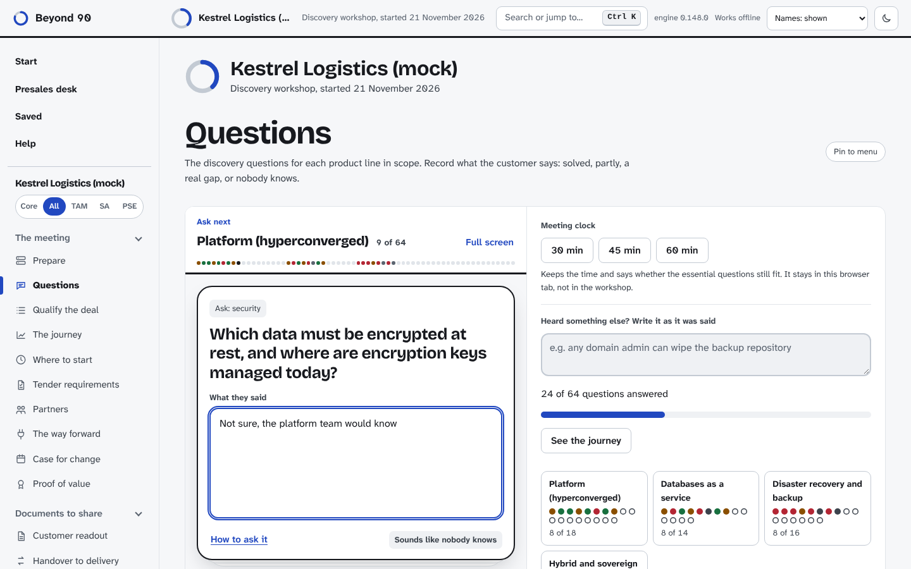
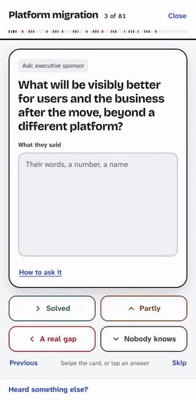
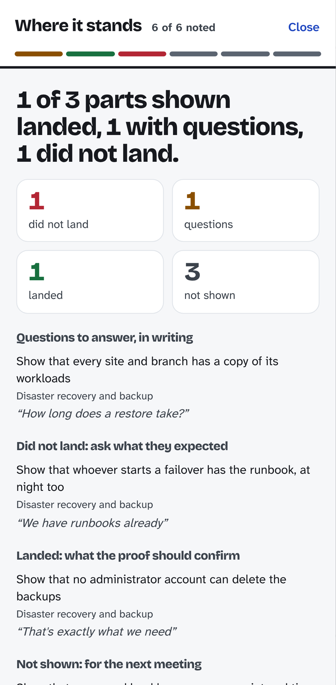
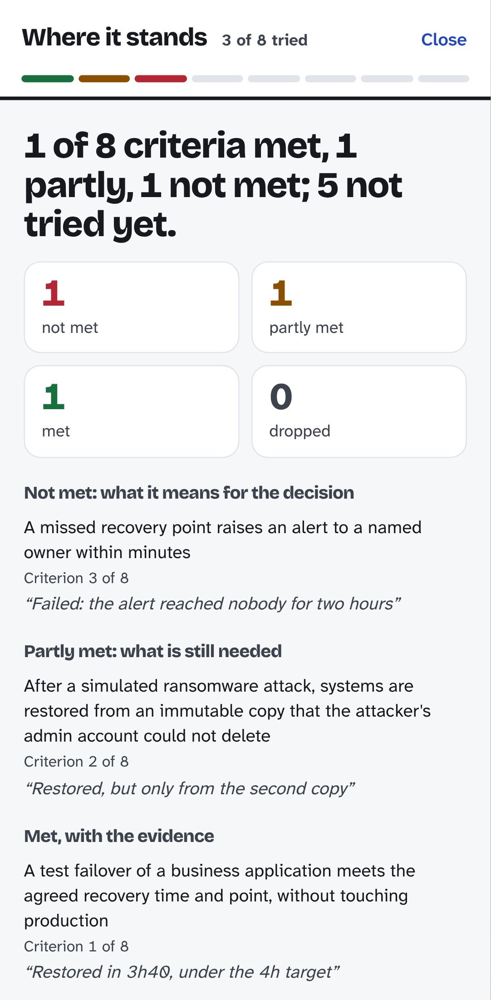

# Running the meetings: discovery, demo, readout

A page for the hours with the customer: the discovery meeting first (what to set up before, what to do while they talk, what to send after), then the demo built from it, then the readout of the proof of value. Everything here runs in the browser; nothing said in the meeting leaves it.

## Before: ten minutes

1. **Start a workshop** with the customer's name and the product lines in scope. A preset fills the scope for the usual cases, and an inventory export, when there is one, answers part of the questions before anyone asks them.
2. **Say who is in the room.** The role chips (executive sponsor, architect, operations, security, application owner and the others) keep the questions those people can answer. With **Essential questions only**, a first meeting keeps the few not to leave without.
3. **Turn on Most useful first.** The card then asks the essential questions first, on the lines you know least or have not touched, and says why ("Nothing asked on this line yet").
4. **Read the first cards over.** **How to ask it** turns a card over: why it matters, what to listen for, what to ask next, what would need to be true and a first step towards it.

5. **Rehearse the objections** (on Prepare): what the customer would say, one card each, the ones they already raised first, then the ones your other prospects raised most. Say your answer aloud, turn the card to check it (the question to ask first, the answer, how to prove it), and swipe right if you had it, left to practise it again. Nothing of it is kept.

## During: the card, the box, the clock

- **Start the meeting clock** (30, 45 or 60 minutes). It shows the time left, on the card too, and says whether the essential questions still fit: "Behind: 6 essential questions in 15 minutes, about 2 minutes each", with **Ask only the essentials** one tap away.
- **Ask the card's question, and write what they said on it**, in their words. The words suggest an answer ("Sounds like a real gap"); you decide.
- **Swipe it:** right solved, left a real gap, up partly, down nobody knows. Or tap the answer, or press an arrow or 1 to 4. A gap says, under the next card, what it puts **On the journey**.
- **Something said out of turn?** Write it in **Heard something?** as it was said. It finds the question it answers, technical or about the deal ("the CIO signs off anything above 500k" goes to who decides and signs), with the answer the words suggest, and money in it ("about 2 million a day") goes in as the figure on a question about value. A tap, or Ctrl+Enter, files it; **Undo** puts back what was there. A figure a first sketch starts from ("about 1,500 users, 1,200 at the same time", "45 databases", "300 TB of file shares", "30 applications", "200 TB of backups", "the second site is 3 ms away", "a 70B model in 4-bit, 200 requests at once") is offered for that sketch, and what is said about the price and the renewal ("the renewal would triple the cost", "1.4 million a year for licences and support", "an hour down costs 50k") for the case for change, and with a line that counts it in scope, what runs and what it costs ("500 VMs", "3 people run the platform", "licences cost 240,000 a year", "20% of the VMs are idle") for the cost per machine: **Use it in the sketch** puts it there, and the sketch's card follows; **Undo** puts it back. Notes taken in Italian work the same way: "il rinnovo della licenza scade a marzo" finds the question about the renewal, "300 mila al giorno" is a figure per day, "abbiamo già i backup" is the concern it voices.
- **A concern, as it is said.** When what you write is one of the concerns the line expects ("we already have backups", "automation will break production"), it shows first: the question to ask before answering, the answer, and how to prove it. **Mark it raised** sends it to the customer readout and into the proof of value.
- **Full screen** gives the card the whole screen, with Heard something as a sheet under it.
- **Qualify the deal** works the same way: ten questions that are the same on every line, swiped right if known, up if partly, left if not yet.

 

## After: the same day

- **Where it stands**, at the end of the deck: how many gaps, how many nobody could answer, the gaps with what was said. It ends with **For the next meeting**: who to invite for the essential questions still open. **Copy the recap** or **Email the recap** gives the account team the same in plain text, opened in your own mail app.
- **The journey**: "Yes, this is possible", what would need to be true, the first step towards each condition and the test that proves it. It is built from the answers; nothing to write.
- **The meeting summary**, for the account team, and the **customer readout**, for the customer: what we heard, what would need to be true, the first steps, and how each is proven, with no internal scores. Both download as a file.
- **The way forward** says what the next meeting is for: a demo built from what they said, a proof of value, or a decision.

## The second meeting: the demo

**The way forward** plans the demo from what they said. **Run the demo** gives it the same cards: one per part of the plan, swiped as it landed (right landed, up questions, left did not land, down not shown), with what they said written on it. Keep it on a phone beside you while the screen is shared; **Heard something?** is under the cards here too, for an answer, a concern or a figure said during the demo. The plan is timed for the meeting's length, and with the meeting clock running each card says whether you are on time ("2 minutes behind: keep this part to its point"). At the end: the questions to answer in writing, what did not land, what landed for the proof to confirm, a recap for the account team, and a note for the customer (what we showed against what they told us, their questions with room for the answers, the proof we propose). What landed becomes criteria of the proof of value; the next meeting's agenda opens with their questions.

 

## The readout: criterion by criterion

Before it, **Copy the readout agenda** and **Readout invitation (.ics)** (on the day the mutual plan proposes, three days after the window) give the sponsor what we set out to prove, each criterion with how we will know, what it means and the decision with its dates, and who should be there; no result is in it. At the end of a proof of value, **Go criterion by criterion** (under Success criteria) gives the readout the same cards: one per criterion, swiped by what was seen (right met, up partly met, left not met, down dropped with the sponsor), with the evidence written on it. It ends with what was not met and what it means for the decision, what is only partly there, and what was met, with the evidence; **Mark the readout as held** closes the proof, and the way forward moves to the decision.

 

## What it is not

It does not record the meeting, listen to it or transcribe it: you write what matters, in a few words. The suggestions are a few word patterns read in the browser, never a model in the cloud. The meeting clock stays in the browser tab, never in the workshop or in a file.

See also: [the workshop guide](workshop.md), for every view of a workshop in full.
