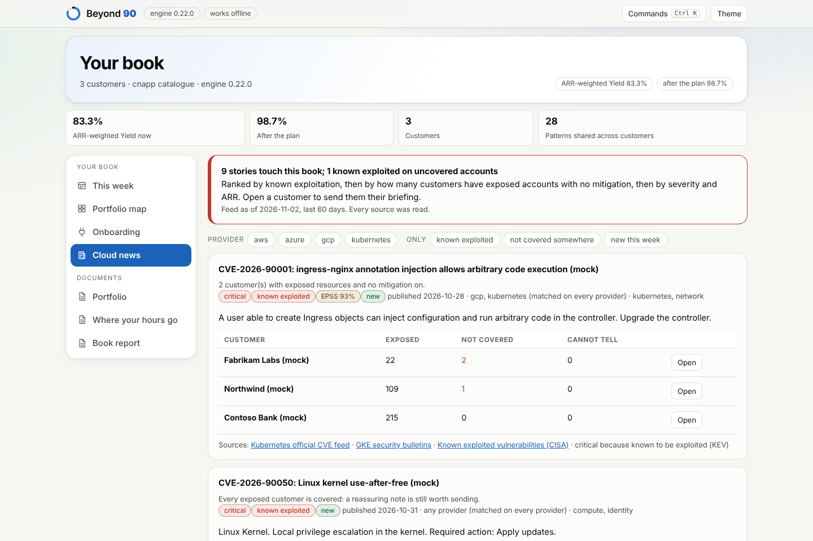

# Cloud security news

A TAM earns trust between reviews by being the first to tell a customer about a new cloud vulnerability, with the answer to the question they will ask: does it touch us? Beyond 90 reads public sources every day, keeps what is about the cloud, and matches each story to every customer's inventory.

## Where the news comes from

`beyond90 feeds` reads the sources in `src/beyond90/data/feeds.json`:

| Source | What it adds |
|---|---|
| Kubernetes official CVE feed | Every CVE announced by the Kubernetes security committee |
| AWS security bulletins | Issues in AWS services and tools |
| GKE security bulletins | Issues in managed Kubernetes on Google Cloud, often with the upstream CVE |
| Open Cloud Vulnerability Database | Cloud provider security issues that usually get no CVE, with what customers can check |
| Microsoft security update guide | Kept only where it names something cloud (Azure, Entra, AKS and similar) |
| Known exploited vulnerabilities (CISA) | Which CVEs are exploited in the wild; kept where they name a provider or software that cloud workloads run (kernel, containers, databases, serverless); network appliances and desktop software are left out |
| Exploit prediction (EPSS) | The probability that each CVE is exploited in the next 30 days |

To follow more, such as the research blogs of security vendors and independent researchers, copy the file, add any RSS, Atom or JSON Feed over https and pass it with `--sources`. A source can say it is cloud by nature (`"cloud": true`: every item is kept), that a resource type is enough to keep an item (`"keep": "provider_or_type"`, optionally limited to `keep_types`), and give default `providers` and resource `types`. Each run reports, per source, how many items it read, kept and dropped (no date, too old, not cloud, over the cap) and the newest date it saw, so a source that changed its format shows up at once.

## What happens to each item

1. **Read safely.** https only; redirects only to a configured host; 16 MB and 25 seconds per source; XML that declares a DOCTYPE or an entity is refused; HTML becomes plain text; only http(s) links are kept.
2. **Kept if cloud and recent.** Whole-word terms in `data/cloud_terms.json` tie the text to providers (AWS, Azure, Google Cloud, Kubernetes, OCI) and to the catalogue's resource types (identity, object storage, databases, Kubernetes, registries, compute, serverless, network, AI services). Items older than the window (60 days by default; "new this week" marks what is recent) are dropped.
3. **One story, several sources.** Items that share a CVE, a link or a long title are merged; the story lists every source that carries it.
4. **Severity with a reason.** Known exploited: critical. EPSS of 0.9 or more: critical; 0.5 or more: at least high. Otherwise words in the text ("cross-tenant" is critical, "privilege escalation" or "container escape" is high). Every story says why it has its severity.
5. **Matched to the right estates.** A story about one provider's service is matched only to that provider's accounts. Kubernetes software runs on every cloud, so a Kubernetes CVE read in one provider's bulletin is still matched to every cluster. A story that names no resource type is kept under "Also worth reading" and not matched.
6. **What mitigates it.** The capabilities of the catalogue that cover the resource types (for example container security for Kubernetes, data security for databases), plus posture for misconfigurations and detection for exploitation and incidents.
7. **First seen.** With `--previous`, each story keeps the date it first appeared, so "new this week" is exact.

The output is an advisory feed in the format every other command already reads (see the radar in `docs/guide.md`), with the extra fields `kev`, `kev_due`, `ransomware`, `epss`, `cves`, `sources`, `platforms`, `kind`, `severity_why` and `first_seen`.

## Where it shows up



- **The site.** The Pages workflow collects the feed every morning and publishes it next to the app as `feed/advisories.json`. "Use today's cloud news" loads it; once chosen, it updates itself on the next visit. Your customers' data still never leaves the browser.
- **One customer: News.** Each story with its badges (known exploited, EPSS, new, ransomware), its sources, how many accounts are exposed, covered or cannot be assessed, a note to copy, and a **security briefing** for the customer: the stories that touch them, worst first, with what to do and links to read more, without internal scores.
- **The book: Cloud news.** Every story against every customer, ranked by known exploitation, then by how many customers have exposed accounts with no mitigation, then severity and ARR. Filter by provider, known exploited, not covered, or new this week; open a customer on their news.
- **Call prep and the week.** A known exploited story on uncovered accounts moves the customer up the week and leads the "News that touches them" part of the call.
- **Automation.** A run with a feed alerts once per known exploited or critical story that lands on uncovered accounts, and can write `security-briefing.md`.

```
beyond90 feeds --out advisories.json                  # today's feed
beyond90 feeds --format markdown                      # read it
beyond90 radar examples/portfolio --threats advisories.json
```

## Limits

- Matching is by provider and resource type, not by version: a story about ingress-nginx touches every customer with clusters, whether or not they run that controller. The note says "in scope", not "vulnerable".
- Severity from words in the text is a heuristic; known exploitation and EPSS are the strong signals.
- The default sources are public and change their formats from time to time. A source that cannot be read is listed in the feed and on the page; the others still count.
