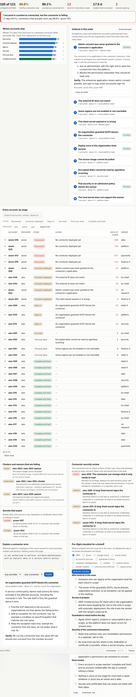

# Onboarding: where connectors stall, and how to unblock them

Most of the distance between what a customer bought and what it uses opens in the first weeks, while connectors are being deployed into each cloud account, subscription, project and cluster. The failures are few and they repeat: a guardrail denies the read role, a trust policy carries the wrong external ID, nobody granted admin consent, an API is disabled, a pod security level blocks the sensor, a secret expires. Each has a cause, an owner and a fix, but the message the customer sees rarely says which. This page describes how Beyond 90 turns those messages into a plan.

## What it shows

**Onboarding** (one customer) places every account on a stage:

| Stage | Means |
|---|---|
| Discovered | Known from billing, the organization or SSO; no connector yet |
| Connector deployed | The role, application, service account or chart is in place |
| Signs in | The platform can authenticate |
| Can read | It has the read permissions it needs |
| First scan done | At least one scan finished |
| Complete and fresh | Every region or project in scope scanned, recently |

It then gives, for every account stuck before the last stage, the **cause**, the **owner** (cloud platform team, identity team, network team, platform team, vendor support), the **steps** and **how to verify** the fix. The causes come from a catalogue of about thirty, for AWS, Azure, Google Cloud, Kubernetes clusters and runtime sensors (`src/beyond90/data/connector_issues.json`). Each is written in plain words and should be checked against your vendor's documentation.



Other parts of the view:

- **Healthy versus counted.** L1 counts an account as connected when the account list says so. A connector that worked and then broke (a secret expired, a role was removed, a guardrail changed) still counts. The view shows both rates and lists the accounts in between. This is the most common reason a customer's dashboard and the TAM's number disagree.
- **Unblock in this order.** Blocked accounts are grouped by cause and ordered by accounts unblocked per hour. A cause that is fixed once for the whole organization (a guardrail exception, consent for the directory, a role assignment at the management group, a stack set with trusted access) comes first when it holds several accounts back. When three or more accounts of one provider have no connector at all, the plan proposes **one deployment at the organization level** instead of a ticket per account, so that accounts created next month are covered too. Each wave copies as a ticket.
- **Time to connect.** The median and 90th percentile days from discovery to a deployed connector, and from deployment to the first scan. An account stuck at one stage for more than a week (`onboarding_stall_days`) is flagged.
- **Clusters and sensors.** Kubernetes connectors and runtime sensors are diagnosed the same way: private API servers, missing RBAC, pod security or admission policies blocking a privileged DaemonSet, egress proxies and TLS inspection, image pulls, unsupported kernels or serverless nodes.
- **Secrets that expire.** Client secrets and keys with an expiry date within a month, or already expired. This is the classic connector that worked and stopped one morning.
- **Connector security review.** The connectors hold standing access to every account, so they are an attack surface of their own. Each finding is labelled with its STRIDE category: administrative rights where reading is enough (elevation of privilege, critical at organization scope), a long-lived secret (spoofing), an AWS role trusted without an external ID (the confused deputy problem).
- **Explain a connector error.** Paste the message the customer sees; the page names the cause, the owner, the fix and how to verify. The text never leaves the page. The same thing works on the command line: `beyond90 triage "AADSTS65001: ..." --provider azure`.
- **Pre-flight checklist.** Before any connector exists: which clouds, at the organization level or account by account, guardrails, customer-managed keys, clusters, sensors, private API servers, pod security, an egress proxy. It answers who must be in the room and what to prepare, so that blockers are found in the kickoff and not on deployment day. `beyond90 preflight --providers aws,azure --kubernetes --pod-security`.

In book mode, **Onboarding** lists every customer's completion, healthy versus counted rate, stuck accounts, expiring secrets and the first thing to unblock, plus the **causes several customers share**, which are worth one write-up used many times.

The call brief gets an **Unblock onboarding** item when something is blocked, and the week plan moves a customer up when a connector that worked is failing or a secret expires within two weeks.

## connectors.csv

Optional. One row per connector, as the platform reports it. Without the file, onboarding is read from `accounts.csv` alone (discovered or connected).

```csv
account_id,kind,status,name,error,deployed_at,first_scan_at,last_success_at,scope,regions_expected,regions_scanned,permissions_missing,auth,secret_expires_on,privilege
aws-001,cloud,partial,,OptInRequired: region me-central-1,2025-03-21,2025-03-21,2026-10-31,organization,17,16,,role_external_id,,readonly
azure-004,cloud,error,,AADSTS65001: The user or administrator has not consented,2026-10-12,,,management_group,,,,federated,,readonly
aws-021,kubernetes,error,prod-eks,admission webhook denied the request: privileged containers are not allowed,2026-10-01,,,cluster,,,,agent,,readonly
```

| Column | Required | Values |
|---|---|---|
| `account_id` | yes | must be in `accounts.csv` |
| `kind` | yes | `cloud`, `kubernetes`, `sensor`, `registry`, `code`, `logs` |
| `status` | yes | `ok`, `partial`, `pending`, `error`, `disabled` |
| `name` | | e.g. the cluster name |
| `error` | | the message the platform shows, as is |
| `deployed_at`, `first_scan_at`, `last_success_at` | | dates, not after `as_of` |
| `scope` | | `account`, `organization`, `management_group`, `folder`, `project`, `cluster` |
| `regions_expected`, `regions_scanned` | | counts (regions, projects or subscriptions in scope) |
| `permissions_missing` | | semicolon-separated actions |
| `auth` | | `role`, `role_external_id`, `access_key`, `sp_secret`, `sp_certificate`, `federated`, `sa_key`, `sa_impersonation`, `token`, `agent` |
| `secret_expires_on` | | date |
| `privilege` | | `readonly`, `custom`, `admin` |

Settings: `connector_stale_days` (default 2) and `onboarding_stall_days` (default 7) under `[settings]` in `customer.toml`.

With automation, `connectors` is a target like the others: map the platform's connector list to these columns in `beyond90.toml` and every run diagnoses onboarding. Alerts fire when a connector that worked starts failing, when a secret expires within 14 days, and when a connector has administrative rights at the organization level.

## Limits

The catalogue is matched against error text, so a message the catalogue does not know is reported as unclassified, with the advice to collect the full error and open a support case. Patterns were written from public provider error formats and common onboarding practice, not from any one vendor's product. The stage model assumes one cloud connector per account; additional connectors (clusters, sensors) are diagnosed alongside it. Nothing here changes Yield.
