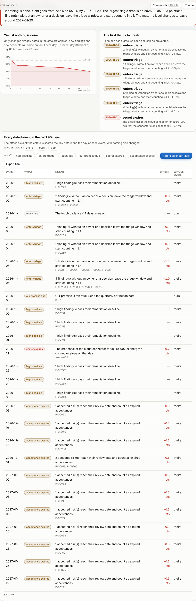

# If nothing is done, and what is at stake

Two questions a score does not answer by itself, and that most tools leave to intuition.

## If nothing is done: the outlook

A score describes today. Much of what will lower it next month is already in the data, and already dated:

- a connector's client secret or key expires, and the connector stops on that day;
- an accepted risk reaches its review date and becomes an expired acceptance;
- findings that have no owner or decision age past the triage window and start counting in L4;
- critical and high findings pass their remediation deadline;
- a promise to the customer falls due; the touch cadence runs out; the renewal arrives.

None of these needs a forecasting model. They happen by the calendar unless somebody acts. **If nothing is done** moves the date forward and scores the same estate again, applying only those dated changes (a connector whose secret expires stops counting as connected). For every day on which the score moves, it scores the day before and the day itself, so each event carries its exact effect in points. The result:

- a curve of Yield over the next 90 days, with the maturity level at 30, 60 and 90 days;
- every dated event, with whose move it is (theirs, ours, both), filterable, exportable as CSV, and as a calendar file (`.ics`) so the dates land where work is planned;
- one sentence for the call: "If nothing is done, Yield goes from 72.6% to 65.0% by 29 January; the largest single drop is on 5 November."

It never invents findings or accounts. The real future adds new ones on top, so this is the floor of what waiting costs, not a prediction. That is exactly what makes it usable with a customer: every line can be checked.

The week plan moves a customer up when points are lost within seven days, the call brief gets a **What breaks if we wait** item, and the customer's onboarding status page lists what is coming up on their side.

## Weighted by what is at stake

Yield counts accounts, resource types, capabilities and findings as equals. A sandbox weighs as much as production; a low internal finding as much as an internet-facing critical one. **Weighted by what is at stake** asks the same four questions with weights the customer already pays for or is exposed by:

- L1, L2 and L3 weighted by each account's last billed spend (equal weights when no spend is known);
- L4 weighted by severity (critical 8, high 4, medium 2, low 1), doubled when the finding is internet-facing.

The weighted Yield sits next to the count, never instead of it. When the two disagree, the weighted one says where the gap matters. In the demo, 90% of accounts are connected, but only 79% of spend: the four production accounts held back by a change freeze are few and expensive. The view names the accounts and findings that carry the most weight, and the call brief says it in one sentence.

The weights are plain and printed on the page; they are a lens, not a model of risk.
