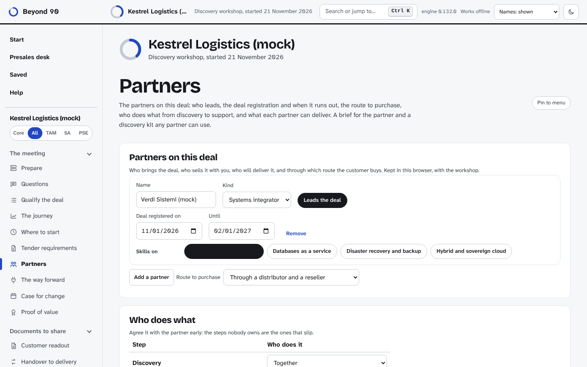
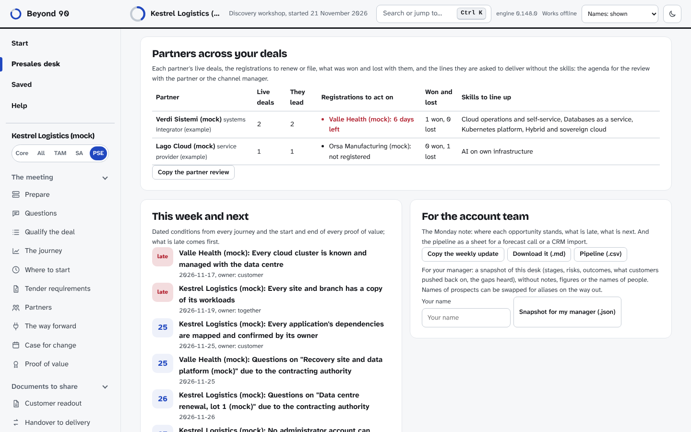

# Working with partners

Most infrastructure deals reach the customer through a partner: a reseller, a systems integrator, a service provider, a distributor or a consulting firm. The presales engineer sells with them. The partner brought the deal, or will run discovery with you, host the proof, write the proposal, deploy, migrate, and support after go-live.

Beyond 90 keeps that collaboration with the deal, in the same browser as the workshop. It answers four questions:

- Who is on the deal, and who leads it?
- Is the partner's deal registration still protecting it?
- Who does what, from discovery to support?
- Can the partner deliver what it is asked to, on every line in scope?

## On a deal: Partners

Open a workshop and choose **Partners** under "The meeting".

**Partners on this deal.** Add up to four partners. For each one, give:

- its name;
- its kind: reseller, systems integrator, service provider, distributor or consulting partner;
- whether it leads the deal;
- the dates of its deal registration;
- the lines in scope it has skills on: certified engineers, services it is recognised for.

Then set the **route to purchase**:

- direct from the vendor;
- through a reseller;
- through a distributor and a reseller;
- through a public framework or marketplace;
- as a service from a service provider.

**Who does what.** One owner for each step: discovery, demo, sizing, proof of value, proposal and price, deployment and migration, support after go-live. The owner is "Us", "Together" or a partner. Agree it early: the steps nobody owns are the ones that slip.

**What to settle with the partners** is read from what is recorded:

- The lead partner's registration has run out, or runs out within two weeks. It is flagged "Now", because a lapsed registration leaves the deal open to anyone.
- There is no registration, unless the deal only goes through a distributor.
- Nobody owns discovery, the proof of value or the deployment.
- A partner is down to run the proof, deploy or support lines it has no skills on. Plan its enablement, or bring a specialist.
- The route to purchase is not set.

## Share with the partners

**Brief for the partner (.md)**, or **Copy the brief**, gives the people working the deal at the lead partner:

- the route to purchase and the registration dates;
- who does what;
- the line to start with and what would need to be true;
- what a proof would have to show;
- the concerns the customer raised, with the answer and how to prove it;
- what the deal still needs, and the skills to line up.

The customer's own words go in only when **Include what the customer said** is ticked.

**Discovery kit for partners (.md)** lets any partner's engineers run the same discovery as yours. For every line in scope, it has:

- the essential questions, each with who to ask, what to listen for and what to ask next;
- what customers raise, with the question to ask first, the answer and the proof;
- what a proof would have to show;
- the checklist for the proof's first day.

It ends with the ten questions that qualify a deal. It holds no customer's data, so it can go to any partner, for enablement or before a joint call.

## Across the desk: the partner review

On the presales desk, **Partners across your deals** shows each partner over every deal:

- its live deals and how many it leads;
- the registrations to renew or to file;
- what was won and lost with it;
- the lines it is asked to deliver without the skills.

**Copy the partner review** turns it into the agenda for the review with the partner or with the channel manager, one section per partner. It names your customers and every partner, so share each partner's section only with that partner.

A registration that runs out within two weeks, or has run out, is also on the desk's list of what could stop a deal.

## Everywhere else the deal goes

- **The desk's agenda** lists the day a registration runs out, two weeks ahead, next to the dated conditions and the proofs of value.
- **Each prospect** on the desk says who it is sold with, and the Monday note does too.
- **The pipeline CSV** has columns for the partner, its kind, the route to purchase, the end of the registration, the qualification and the phase.
- **The handover to delivery** opens with who deploys and who supports. It lists each partner and its skills, and the lines to line up before go-live.
- **What the deals teach** counts how deals ended by route to purchase and by the kind of partner leading them.
- **The team view** reads, from each engineer's snapshot, the lead partner's company name, the end of its registration, the kind of partner and the route to purchase. It shows the partners across the team: which engineers each works with, their live deals, wins and losses, and the registrations to act on. The other partners on a deal stay on the engineer's desk.

## In the way forward

When a deal has partners, [the way forward](workshop.md#the-way-forward) asks three more things:

- in discovery, that the partner's registration is in place;
- in the proof of value, that who runs it with the partner is agreed;
- at handover, that delivery has an owner with the skills for every line.

A deal without partners is never asked these.

## What is kept, and what leaves

The partners are part of the workshop and are kept with it, sealed when a passphrase is set. Each one has:

- a name, of up to 80 characters;
- a kind;
- whether it leads;
- two registration dates;
- a list of lines.

The record is checked field by field, and a stray field refuses it. Nothing goes to a partner unless you download the brief or the kit and send it. The customer readout never mentions partners.
