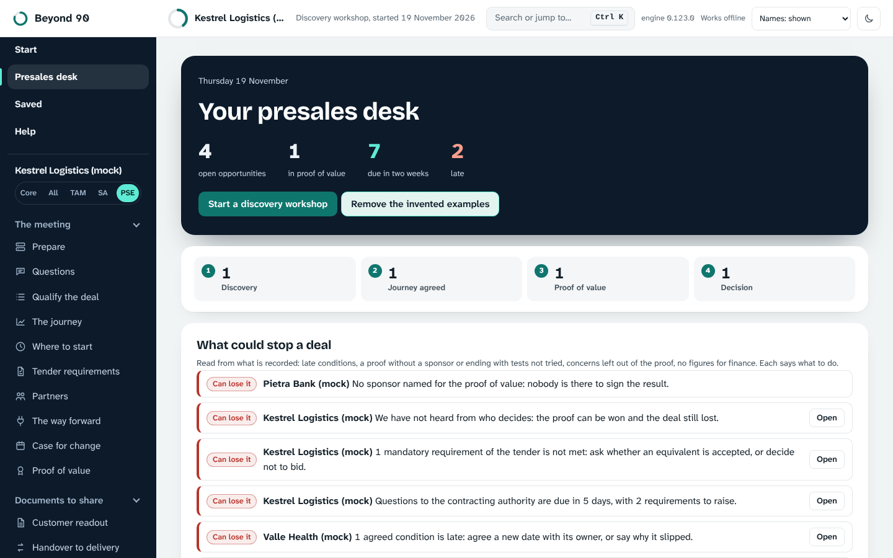
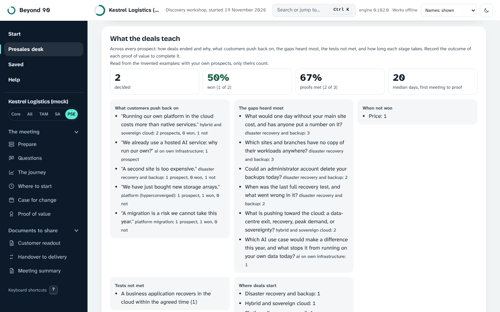
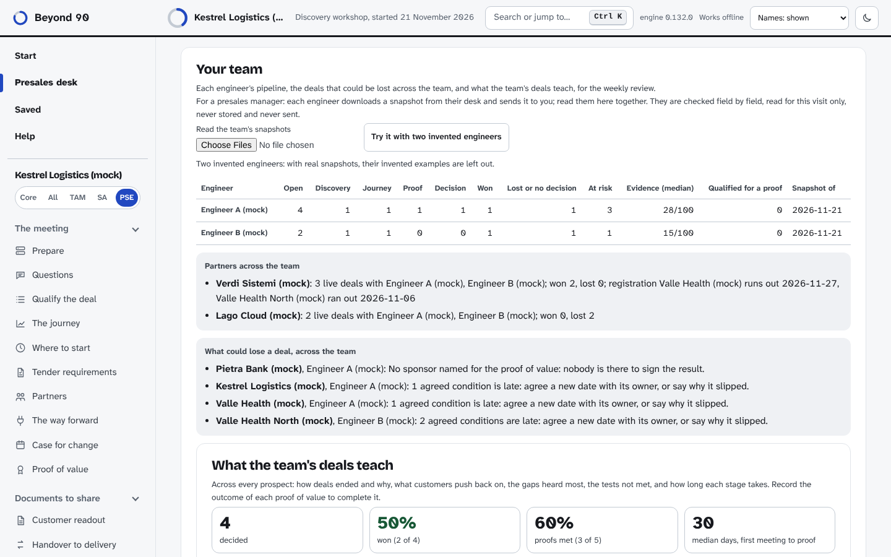
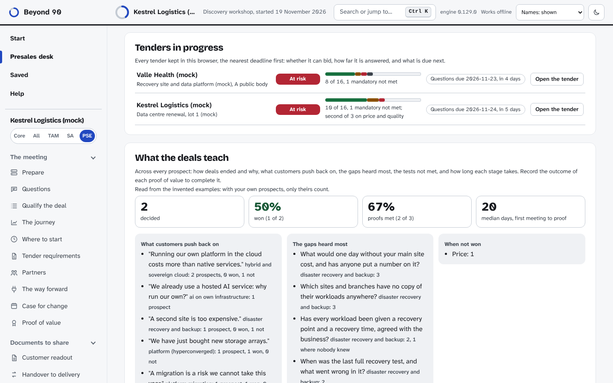

# Working as a pre-sales engineer

A pre-sales engineer carries many prospects at once, each at a different point: still listening, a journey agreed, a proof of value running, a result with the customer. Choose **Pre-sales engineer** under "I work as" on the start page and Beyond 90 gives you a desk of your own, and opens on it the next time.

## The desk

- **Where each prospect stands.** Every discovery workshop and every proof of value kept in this browser becomes an opportunity, placed at its stage: discovery (still listening), journey agreed (we know where to start and what would need to be true), proof of value (planned or running), decision (the result is with the customer). Stopped ones are set apart.
- **Evidence of a technical win, per deal.** A checklist out of 100, read from what is recorded. It is not a probability:
  - the line to start with (10);
  - what is at stake in the customer's words (10);
  - conditions with owners and dates (10), none of them late (10);
  - a sponsor for the proof of value (10);
  - at least three criteria agreed (5), and the share of criteria met (25);
  - every concern the customer raised is in the proof (10);
  - a case for change for finance (10).

  The opportunities table shows it as a bar and a number, and its tooltip says what would raise it. The Monday note and the CSV carry it, and the team view shows each engineer's median.
- **What could stop a deal.** Read from what is already recorded, the risks that can lose a deal on their own first:
  - conditions agreed and now late;
  - a proof of value with no sponsor to sign it;
  - a proof ending within a week with tests not yet tried;
  - concerns the customer raised that are not in the proof;
  - a proof that ended not met.

  Then what to watch: a proof with no end date or with its first-day checklist open, nothing at stake in the customer's words, no case for change for finance, a sizing sketch still on the defaults, questions nobody could answer, a prospect not touched for three weeks. Each says what to do, and opens the prospect where it stands. The Monday note lists the risks that can lose a deal; the CSV carries them all.
- **What the deals teach.** Across every prospect:
  - how deals ended (won, lost, no decision) and why, with the share won and the share of proofs of value met;
  - what customers push back on, with how many of those deals were won;
  - what did not land in the demos, part by part (named by what it was to show, never by what was said), with how those deals ended;
  - the gaps heard most (questions answered "a real gap" or "nobody knows");
  - the tests not met;
  - what the deals not won had not established: the qualification questions still open when they ended (for example, "Economic buyer: 2 of 3");
  - how deals ended by route to purchase and by the kind of partner leading them;
  - the median days from first meeting to proof, of the proof itself, and from its end to the decision;
  - where deals start.

  **Copy for enablement and leadership** gives it as Markdown, for a pipeline review, the enablement team or the product team. Record how each deal ended on its proof of value (outcome, main reason, date, a sentence) to complete it; a decided deal leaves the live pipeline and shows as won or lost. Only what the lessons need is read: no notes, no figures.

- **Your team (for a presales manager).** Each engineer downloads a **snapshot** of their desk from "For the account team": stages, risks, outcomes, what customers pushed back on, the gaps heard. It has no notes, no figures and no names of people; prospect names can be swapped for aliases on the way out. The manager reads several snapshots together in "Your team":
  - each engineer's pipeline by stage, with deals won, lost and at risk;
  - the deals that could be lost across the team;
  - what the team's deals teach;
  - a team review to copy or download for the weekly meeting.

  The files are checked field by field (a forged or edited one is refused whole), read for that visit only, and never stored. **Try it with two invented engineers** shows it at once.

- **Tenders in progress.** Every tender kept in this browser, the nearest deadline first:
  - whether the bid can go ahead (a mandatory requirement not met puts it at risk), or that the team decided not to bid;
  - who issues it;
  - a bar of the answers, and how many are answered;
  - where we stand on price and quality, once a comparison is filled in ("second of 3 on price and quality");
  - the next deadline, questions or bid, with the days left;
  - **Open the tender**, which opens it where the bid stands. See [tender requirements](workshop.md#tender-requirements).

- **This week and next.** The dated conditions from every journey, the start and end of every proof of value, and the day a partner's deal registration runs out, for the next two weeks; what is late comes first.
- **Opportunities.** One row per prospect: its stage, the partner it is sold with and the phase it is in on [the way forward](workshop.md#the-way-forward), the line to start with, how much of the discovery is done, what is at stake in the customer's own figures, how the proof is going, and the next thing to do (what is late first, then what the proof needs, then the next dated condition; with nothing dated, the first thing still to do in the phase the prospect is in, from [the way forward](workshop.md#the-way-forward)). Open one to carry on where it stands: its questions, its journey or its proof of value.
- **For the account team.** The Monday note, in Markdown: where each opportunity stands, who it is sold with and how far it is qualified, what is late, what is next. And the pipeline as a CSV for a forecast call or a CRM import, with the partner, its kind, the route to purchase, the end of the registration, the qualification and the phase; cells a spreadsheet would run as formulas are defused.
- **Invented examples.** "Fill it with invented examples" adds made-up prospects at every stage, one of them with a public tender half answered, dated around today, so the desk can be shown at work; "Remove the invented examples" takes them away without touching real work.

## The path through one prospect

1. **Prepare:** for each line in scope, the message for the executive, the technical team and finance, who to bring, and the objections to expect, each with the question to ask first, the answer and how to prove it. **Rehearse the objections** deals them as cards, the ones customers raise most first, to say the answers aloud before the meeting.
2. **[Discovery workshop](workshop.md)** ([in the meeting](meeting.md)): the questions for each product line in scope, each saying who to ask, what to listen for and what to ask next, narrowed to the essential ones or to the people in the room, the customer's answers in one click, their words and figures, their VM inventory read in the page, a first sizing sketch with the assumptions agreed in the room, and a plan in waves with dates, a test wave first.
3. **Qualify the deal:** the same ten questions on every line (pain, a date, the measured result, who decides and how, budget and purchasing, the proof that would convince, a champion, the alternatives). They say whether the deal is ready for a demo built for the customer, for a proof of value, or for a date in the forecast, and what the next gate needs. **What else they weigh** (renewing, a public cloud, another platform, waiting) opens each alternative with what to ask, when the proposal fits, when the other choice is the better one, and how to prove it.
4. **Tender requirements:** when there is a tender, its requirements pasted from the document, read as mandatory or scored and matched to the product line, then answered. Whether to bid, the questions for the contracting authority, the points likely won and the compliance matrix ([workshop.md](workshop.md#tender-requirements)).
5. **Partners:** who is on the deal and who leads, the deal registration and when it runs out, the route to purchase, who does what from discovery to support, and the lines each partner can deliver. A brief for the partner and a discovery kit any partner can use ([partners.md](partners.md)).
6. **The way forward:** where the prospect is from discovery to handover, what must be true to move on, how to run each phase and what to avoid, and the demo planned from what the customer said: their situation, the result first, only their gaps, the proof to agree, timed for the meeting and with who should be there. The agenda and the invitation go to the customer; **Run the demo** gives one card per part, swiped as it landed, and ends with the questions to answer, a recap for the account team and a note for the customer. What landed goes into the proof of value.
7. **The case for change:** staying and moving side by side over a few years, in the customer's own figures, with the payback month and the arithmetic shown.
8. **The journey:** "yes, this is possible", what would need to be true, the first step for each condition and who does it by when; a readout for the customer and a calendar file for the plan.
9. **Proof of value:** opened with the first line's own criteria, what landed in the demo, what the customer asked us to prove, and the checklist for its first day (addresses, DNS and NTP, switch ports, supported hardware, the failures to test); sessions, results and the mutual plan. For the readout, an agenda and an invitation for the sponsor, then **Go criterion by criterion**: met, partly, not met, with the evidence, and what it means for the decision.
10. **Handover to delivery:** what was proven, asked and agreed, the numbers it rests on, and the promises to keep after go-live, kept as the customer's commitments in one click.
11. **After the sale:** the [estate](estate.md) shows, line by line, what really works and where to grow, and starts a new workshop on the next line.

Everything stays in this browser, sealed when a passphrase is set, and erased with the customer.
