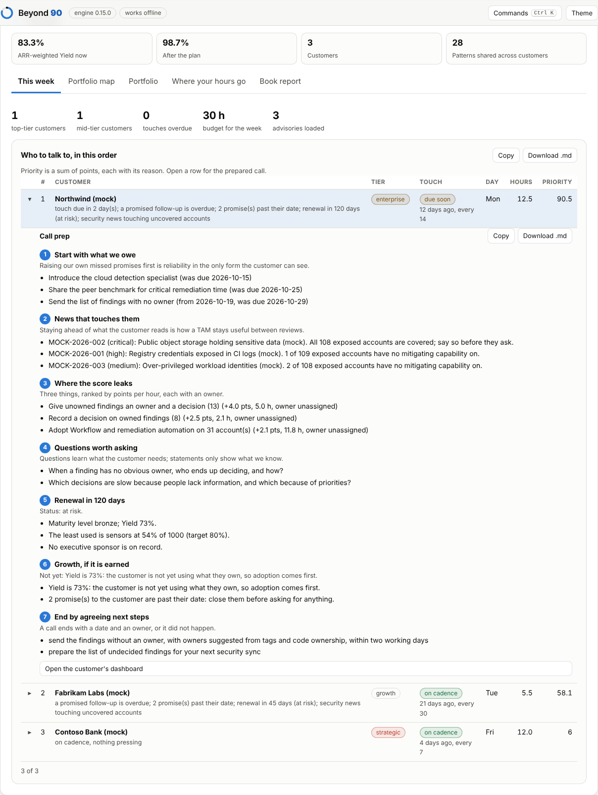
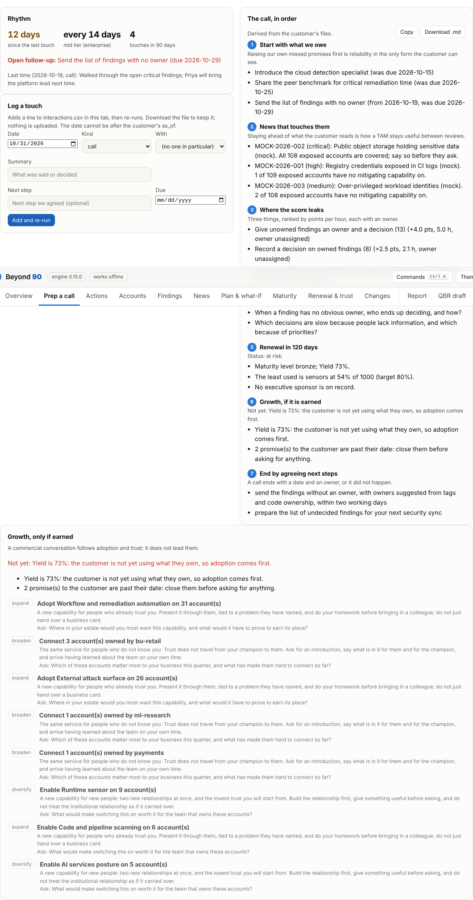

# The weekly rhythm: a book of customers, week after week

A TAM may look after a handful of top-tier customers and a dozen mid-tier ones. Each needs a regular touch, a clear answer to "what changed", the security news that matters to them, and a commercial conversation only when it has been earned. This page describes how Beyond 90 supports that week. Everything is derived from files you already keep; nothing is invented.

## Tiers and cadence

Set `tier` in `customer.toml`. These names are recognised (case does not matter); any other value is the lowest class.

| Class | Names | Default cadence | Weight in the week |
|---|---|---|---|
| top | `elite`, `strategic`, `key`, `platinum`, `top`, `tier 1` | every 7 days | 3 |
| mid | `premium`, `enterprise`, `gold`, `tier 2` | every 14 days | 2 |
| other | anything else, or empty | every 30 days | 1 |

A customer can set its own cadence with `cadence_days` under `[settings]`. A touch is a line in `interactions.csv` or a contact's `last_contact`; the state is **on cadence**, **due soon** (two days or fewer), **overdue** or **no touch on record**.

## interactions.csv (personal, optional)

```csv
date,kind,contact_id,summary,next_step,next_due
2026-10-19,call,n-01,Walked through the open critical findings,Send the list of findings with no owner,2026-10-29
```

`date` and `kind` are required. Kinds: `call`, `meeting`, `email`, `qbr`, `workshop`, `support`, `advisory`, `escalation`, `other`. `contact_id` must exist in `contacts.csv`. A date after `as_of` is refused: it is a log of what happened (put plans in `next_due`). Only the latest line's `next_step` counts as open, until a later line is logged. In the browser app, **Prep a call → Log a touch** adds a line and re-runs; download the file from the command palette to keep it. Like contacts and commitments, this file is personal data: it is left out of saved snapshots unless you tick the box.

## The week (book mode)

Open a folder of customers. **This week** lists them in order, with a day, an estimate of hours, and the reason for each place. Open a row for the prepared call.



Priority is a plain sum of points, and every term is printed:

- a touch that is overdue (up to 50 points, growing with how late), due soon (20), or missing (40);
- a promised follow-up that is overdue (12), and promises past their date (15 each, up to 30);
- a renewal within 120 days that is at risk (25) or on watch (12);
- security news touching units that are not covered (critical 20, high 12, medium 4);
- critical findings with no owner (10);
- multiplied by 1, 0.85 or 0.7 for top, mid and other, plus a small bonus for the higher tiers.

Hours: preparation and the call are budgeted first (top 2.5 h, mid 1.5 h, other 0.75 h); the rest of the weekly budget (the "hours per week" field for the book) is shared by tier weight and priority. If the calls alone exceed the budget the page says **the week does not fit** instead of squeezing it.

## Preparing a call

For each customer the engine writes an agenda in the order that earns attention:

1. **What we owe**: overdue promises and the open follow-up from last time.
2. **What changed**: the move in Yield since the earlier snapshot, split into the customer's own work and the moving bar.
3. **News that touches them**: advisories matched to what is inventoried, with how many units are covered, uncovered or cannot be assessed.
4. **Where the score leaks**: the top three actions, each with effect, effort and owner.
5. **Questions worth asking**, from the playbooks.
6. **Renewal**, when it is close and not healthy.
7. **Growth, if it is earned**.
8. **Next steps to agree**, so the call ends with a date and an owner.

Copy it, or download it as Markdown.



## News and advisories

Add a JSON feed in step 1 (the format of `docs/radar.md`, with optional `summary` and `url`). Nothing is fetched from the internet by the page. Each advisory is matched with the same logic as the threat radar: units with an affected resource type inventoried, how many already have a mitigating capability on, and how many cannot be assessed because the type was never inventoried (a gap in inventory is also a blind spot, and it is not counted as safe). **News** lists them per customer with a note you can copy and send, written in plain words and including what is *not* needed when everything is already covered. A feed for a different catalogue (say, endpoint advisories for a cloud customer) is skipped with a warning, not an error; a malformed feed is an error. Links are shown only if they are http(s); text is cleaned of control characters and markup-looking breaks.

To keep the feed current without anyone pasting it, point the automation at it: a `file` or `http` source can write the feed into the state directory, and `beyond90 run` loads it (see `docs/automation.md`).

## Growth only when earned

Expansion signals are real: a licence above 90% of capacity, a capability that applies and is off (typed as expand, broaden or diversify by whether you already have a relationship with the people involved), and an advisory that a product they do not run would address. But they are shown as a conversation to have, never as a quote, and only when **the trust gate** is open: Yield at least 75%, no promise past its date, no critical finding without an owner, and a relationship that is not fragile. When it is closed the page names the first thing to fix, because a customer who is not using what they own will not buy more, and one whose promises were missed will not hear the pitch.
