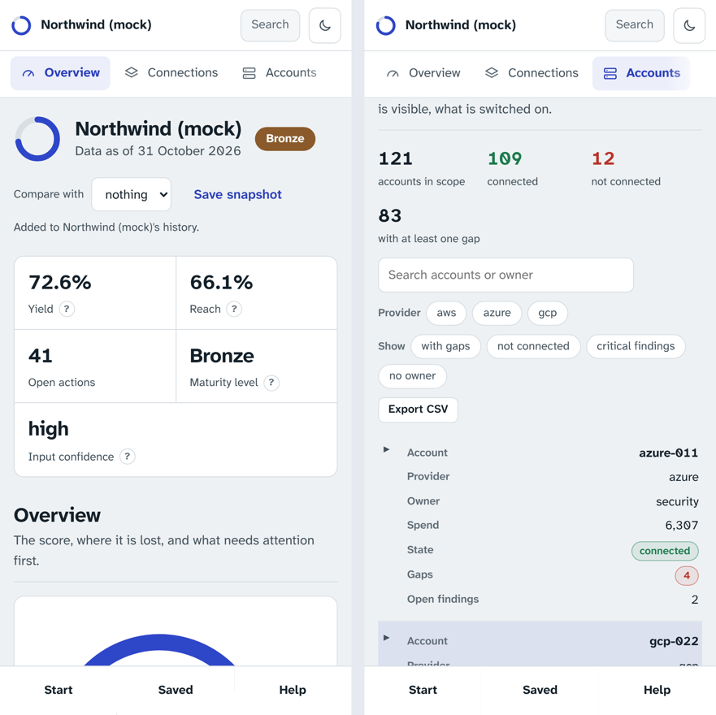

# Run it anywhere

Beyond 90 is one set of static files: the page, its engine compiled to WebAssembly, and the data it ships with. The public site is one way to reach them. These are the others, for teams that cannot use a public address or want the app inside their own network. In every case the data never reaches the server: it only hands out files, and the page talks to nothing else.

## Install it as an app

On a phone, a tablet or a computer, the site installs like an app: its own icon, its own window, offline. Chrome and Edge show an install icon in the address bar (or Help, "Install the app"); on Android it is in the browser menu; on iPhone and iPad, Safari's Share button, "Add to Home Screen". Firefox on a computer cannot install web apps: use the [extension](extension.md).



## On your own machine: `beyond90 app`

Every build publishes `download/beyond90-site.zip`, listed in the signed `SHA256SUMS` like every other file. With the package installed (`pip install beyond90`, no dependencies):

```bash
beyond90 app --site beyond90-site.zip           # http://localhost:8090, this machine only
beyond90 app --site _site --port 9000           # a folder built with site/build_site.py
```

The server is read-only (GET and HEAD), confines paths to the site, sends the page's Content Security Policy as a header too, with `frame-ancestors 'none'`, `nosniff`, `no-referrer` and isolation headers, and refuses requests addressed to a host name it was not told about, which defeats DNS rebinding. It listens on 127.0.0.1 unless you say otherwise.

## In your network: the container image

```bash
docker build -t beyond90 .
docker run --rm -p 8090:8090 beyond90
```

The image builds the site from source and serves it as an unprivileged user (uid 10001). To reach it from other machines, put it behind HTTPS (browsers allow offline use and passphrase protection only on HTTPS or localhost) and pass the names it is reached by:

```bash
docker run --rm -p 8090:8090 beyond90 --name beyond90.example.internal
```

CI builds the image on every push and checks that it serves the app with its headers, refuses other host names and writes, and runs as that user.

## Data in

Anything that produces the files works: exports from the platform, the importers of the command line, or by hand.

- **Excel.** Drop a workbook instead of CSV files. A workbook named like a file (`accounts.xlsx`) becomes that file; otherwise each sheet named like a file (`customer`, `accounts`, `findings`, `inventory`, ...) does. The `customer` sheet has two columns, field and value; `settings.triage_window_days` goes in the settings. Date cells become dates, text stays text.
- **No exports at all.** Start, "Start from a form": the customer and its accounts, and the two files every analysis needs are made in the page, to analyse or to download and complete.

## Between devices

Saved, "On another device": scan the code with the phone to open the app there, then "Send my work to another device". Everything saved travels as one file sealed with your passphrase (AES-256-GCM), through the system's share sheet (AirDrop, Nearby Share, mail, your cloud drive) or as a download; without a passphrase nothing is sent. On the other device: Saved, Import workspace, then the passphrase.
