# Discovery workshop: before there is any data

The rest of Beyond 90 reads what a customer runs. The first meetings with a prospect have nothing to read yet: what you have is the conversation. The discovery workshop turns that conversation into the same picture, from the start page, with no files.

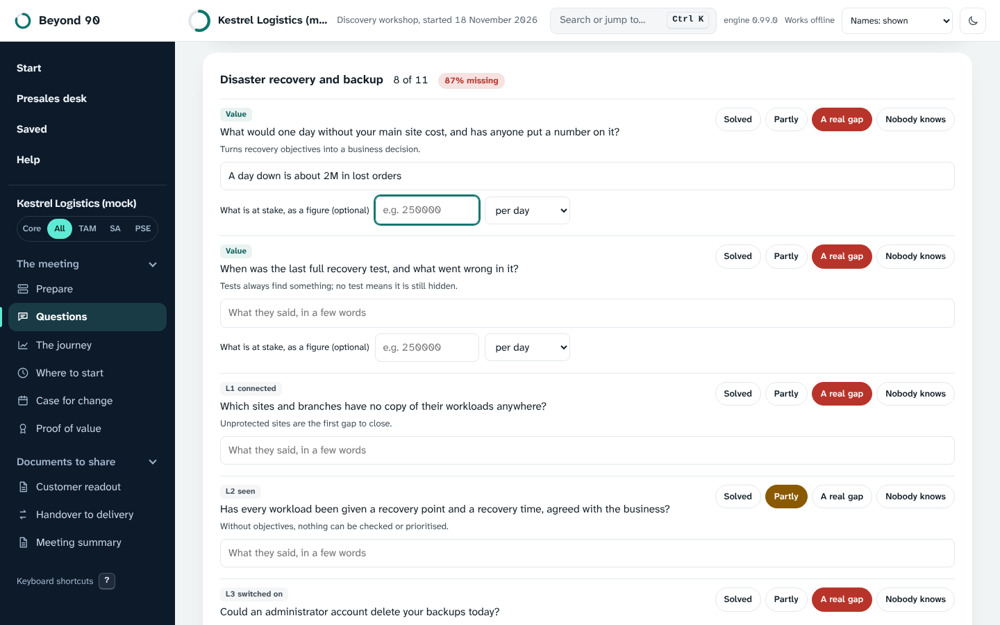

For the hour with the customer itself, the short version is [Running the meetings](meeting.md): discovery, the demo and the readout.

## How it works

1. **Start a discovery workshop** on the start page (or, from an estate, on a line the customer does not run yet), or **See a filled-in example** (an invented logistics company leaving its virtualisation platform, with its inventory, owners and dates, the concerns it raised and its case for change) to show the method in thirty seconds. Give the prospect a name (and yours, to sign the readout) and choose the product lines in scope, or start from a conversation (resilience and ransomware, leaving a virtualisation platform, modernising applications, securing the cloud) that sets the usual lines for you: platform, databases, disaster recovery, object storage, file storage, Kubernetes platform, or the security lines (cloud, identity, SaaS, monitoring, endpoint, AI). Once chosen, the lines in scope read as one line; **Change them** opens the whole choice.
2. **Ask the questions.** Each line has its discovery questions from its profile (the infrastructure lines carry between 11 and 20), in the order of a conversation: business value first, then the stages (connected, seen, switched on, decided), each with why it matters. Record what the customer says in one click (**Solved**, **Partly**, **A real gap**, **Nobody knows**). Each question is one line, its answer in line:
- a strip above the lines shows every line in scope, with a dot per question coloured by its answer; a tile opens its line;
- after each answer the next question is selected, so the keys 1 to 4 keep up with the conversation;
- a question opens on its own, one at a time, for why it matters, who to ask, how to ask it, and the customer's words in a short note; Escape closes it;
- closed, an answered question shows what they said in one line, and a question their inventory already answers shows what it says.

**The questions open on a card.** With lines in scope, the first thing in the view is the next question to ask, as a card, beside a strip of every line with a dot per answer. It starts at the first question with no answer and follows the filters of the meeting (essential only, who is in the room, not answered yet, asked by the tender). **Full screen** opens the same deck on the whole screen, where it was.
- Write what they said on the card, in their words: it is saved with the answer as the question's note. The words suggest an answer ("Sounds like a real gap") and light its button; the suggestion never answers on its own, and it is read in the browser from a few word patterns.
- Answer by swiping the card: right for **Solved**, left for **A real gap**; up for **Partly** and down for **Nobody knows** (on a touch screen, in the page, a drag up or down scrolls it instead: use Full screen or the buttons). While it moves, the answer it is heading for is stamped on it. The buttons under the card, the arrow keys and 1 to 4 do the same.
- **How to ask it** turns the card over: why it matters, what to listen for, the question that goes one level deeper, what would need to be true and a first step towards it. Answered anything but solved, the next card opens with what the answer put **On the journey**. **Previous** goes back to a card and its answer; **Skip** leaves one for later. An answer given in the list moves the card on too.
- At the end, **Where it stands**: how many gaps, unknowns, partial and solved answers, the gaps and the unknowns with what was said, and the journey and the meeting summary one tap away. On a phone that can, a swipe that answers gives a short buzz.
- **Most useful first.** Among the filters, this orders the card, not the list: the questions not answered first, the essential ones before the others, then those of the lines known least (most questions open or answered "nobody knows") and of lines nothing was asked on yet. The card says why it comes now ("Nothing asked on this line yet", "Least known line").
- **Meeting clock.** Beside the card, 30, 45 or 60 minutes start with a tap. It shows the time left, on the card too, and whether the essential questions in scope still fit: "On pace: 7 essential questions left, 30 minutes to go", or "Behind: 6 essential questions in 15 minutes, about 2 minutes each", with **Ask only the essentials** one tap away. The clock is the meeting's, not the customer's: it stays in this browser tab, outlives a change of view or a reload, and is never saved in the workshop.
- **Heard something else?** Beside the card, write what was said out of turn, as it was said ("any domain admin can wipe the backup repository"). The best three questions it answers, among every question in scope, are offered with the answer the words suggest; a tap files it, the words added to that question's note (on a keyboard, Ctrl+Enter files it under the first match, as suggested). Full screen, it is a sheet under the card. The qualification questions are matched too: "the CIO signs off anything above 500k" is filed in Qualify the deal, under who decides and signs, as Known, Partly or Not yet. On a question about value, money in what was heard ("about 2 million euros", "€40,000 per hour") is read with what it is counted per and filed as the figure too; **Undo** puts back what was there. The matching weighs the words of each question, what to listen for, why it matters and the follow-up, folds words that mean the same here (a backup and a copy, a restore and a failover), and runs in the browser.

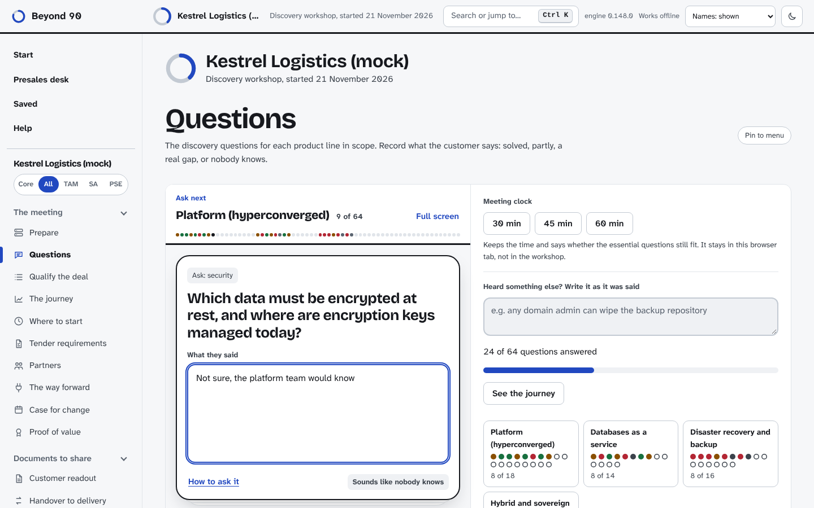

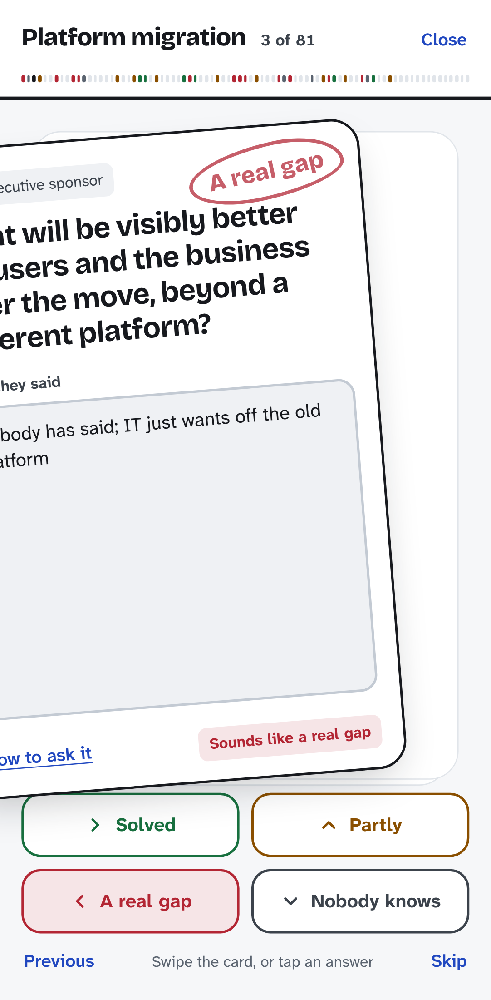

On a business-value question you can also put a figure on what is at stake, counted per hour, day, week, month, year or incident; it heads the journey and the readout. The sketches from their numbers (inventory, sizing, waves, disaster recovery and the others) come after the questions.
3. **Where to start** updates as you go:
   - **Start here:** the line that hurts most, once at least three questions were answered on it, with the questions and the customer's own words that point there.
   - **The map:** each line in scope filled by how much is still missing there; lines not discussed yet are dashed; dashed links show where the first line leads.
   - **Then:** the path after the first line, from the links between kinds of product ("immutable copies need a target that an administrator cannot delete from"), and the other lines where pain was heard.
   - **Find out before the next meeting:** every question nobody in the room could answer. Often that is the real gap.
   - **The next meeting:** an agenda from what is still open: what slipped, the questions nobody could answer, the concerns to prove and how, what is due soon, and who it helps to have in the room. Copy it, or download an invitation (.ics) for the chosen day that carries it.
4. **The journey.** "Yes, this is possible": the answers turned into a path from where the customer is today to where it could be. Every gap and every "nobody knows" becomes a condition, *what would need to be true*, with where the customer is today (in their words when you noted them) and the first step towards it. The steps are in order: agree what success looks like (the business-value questions), prove it on the first line (validated by that line's proof-of-value criteria), then each line it leads to and why. What is already true is shown too, and what is at stake, from the customer's own notes, heads the page. Each condition can be given an owner (us, the customer, or together) and a date, so the journey becomes a plan both sides can hold each other to; the owners and dates travel to the readout and the summary. Dated conditions are listed by month under **The plan by date**, and **Add to a calendar** downloads them as an .ics file (one all-day event each) for Outlook, Google Calendar or Apple Calendar.

   

5. **Start the proof of value** in one click: a plan for the prospect with the first line's own success criteria and how to test each, a problem statement made from the gaps heard, and the readiness checklist. From there it is the same [proof of value](app.md) as for any customer: sessions, results, the mutual plan.
6. **Customer readout:** a page for the customer, in their language (no scores, no stage codes): what would need to be true, where they are today, the first steps, how each step would be proven, what we heard and what to settle at the next meeting. Download it to send or print, or show it on screen. It loads nothing and has no scripts; everything typed is escaped.
7. **Meeting summary:** what was heard line by line, the journey as a checklist (each condition with its first step and where the customer is today, what is already true ticked, how each step is validated), and the open questions. Copy it into the follow-up email or the CRM.

## How to ask: the essential questions, who is in the room, what to listen for

The infrastructure questions are written to be asked, not read out. Each one says:

- **who to ask:** the executive sponsor, an architect, operations, security, the application owner, the data team or finance;
- **whether it is essential:** five to seven per line, value first, that a first meeting should not end without;
- **what to listen for:** what a strong answer and a worrying one sound like, and what each means for the design or the deal ("under about five milliseconds allows zero-loss copies; beyond that, plan near-continuous or scheduled copies");
- **then ask:** the follow-up that goes one level deeper, where the real figure or the real owner usually is.

Open a question, then **How to ask it**, to see the last two. Above the lines, **This meeting** narrows the list:

- **Essential questions only** turns a 60-question workshop into a 30-minute first call;
- **Not answered yet** shows only what is left to ask;
- **Who is in the room** shows only the questions for the people there: a session with the database team gets the database questions, and the security review gets the security ones.

**Copy the questions to send ahead**, under the lines in scope, gives a short note for the customer before the meeting: the few factual questions of each line their team can answer in writing (how many clusters, how old the servers, how much data changes a day, which backup software), not answered yet, grouped by who would answer them. The meeting is then spent on what hurts and what it is worth. No answer or note is in it. The question guide marks them "(can be sent ahead)", and the partners' discovery kit lists them per line, so a partner can send them too.

**Copy the question guide** or **Question guide (.md)** gives the narrowed list with who to ask, why, what to listen for and what to ask next, for the meeting or for a colleague who will run it. The questions already answered say so. **The next meeting** lists the essential questions not asked yet, and the roles that can answer what is still open.

The questions are built from how presales teams run discovery: the situation first, then the problems, what they cost and what a fix would be worth (the order of SPIN and of gap selling). What the customer must be able to do becomes the condition to prove (Command of the Message's required capabilities). The sizing inputs come from what a sizing needs: a week of performance data with its peaks, switched-off machines that still hold data, licences per core, the busy part of each database, the round-trip time between sites, peak concurrent users. The migration risks come from what makes moves fail: hard-coded addresses, licence servers tied to hardware, tools that call the old platform's management interface, and rollbacks never tried.

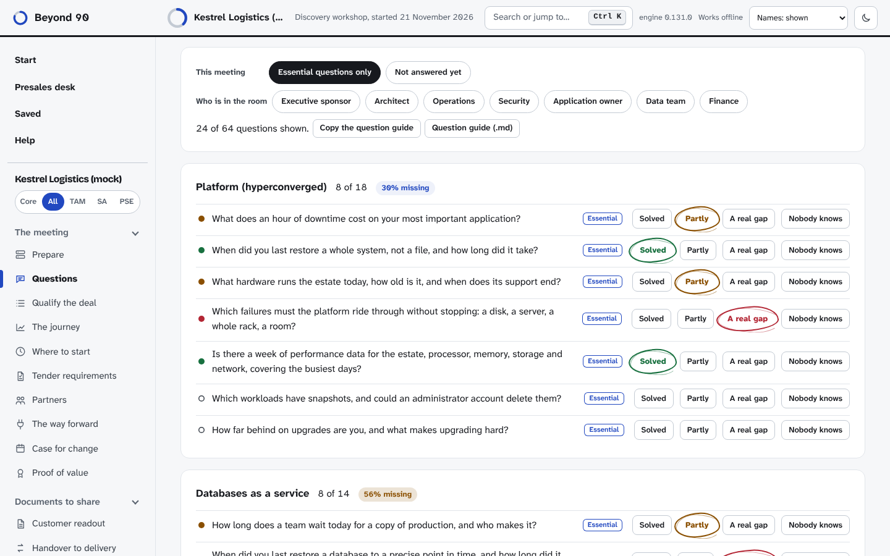

## Qualify the deal

The questions above ask whether the customer needs this. **Qualify the deal** asks whether they will buy it, with ten questions that are the same on every line:

- **Pain:** what happens if nothing changes, and who feels it.
- **Event:** which date makes it a decision for this year.
- **Metrics:** the result the sponsor would show, and how it is measured.
- **Economic buyer:** who decides and signs, and whether we have heard from them.
- **Decision criteria:** how the options will be compared, and which criteria weigh most.
- **Decision process:** the steps to a choice, who takes part, and when.
- **Paper process:** budget, procurement and legal, and how long each takes.
- **Technical validation:** what would convince them, and who must see it.
- **Champion:** who inside gains if it succeeds, and makes the case where we are not.
- **Competition:** the alternatives, staying as they are among them.

Each one is **Known**, **Partly** or **Not yet**, with what was heard, and has the same **How to ask it** as the technical questions. The tags are the words most sales methods use (MEDDPICC among them), so the seller and the engineer read one list.

They open on a card, as the discovery questions do: **Find out next** shows the first question not answered, with room to write what they said. Swipe it right if it is known, up if partly, left if not yet, or tap the answer; the keys are the arrows and 1 to 3, and **Full screen** gives the card the whole screen. Beside the card they are also a compact list, as in bid or no bid, and an answer given in one shows in the other at once:
- three tiles group them as a deal is won: why they would buy (pain, event, metrics), how they decide (economic buyer, criteria, process, paper), how we win it (technical validation, champion, competition), with a dot per question;
- each question is one line: its tag, what was heard (or the question, until something was), the answer in line;
- opened, it shows the whole question, why it matters, how to ask it and the note; the keys 1 to 3 answer it and open the next one still open.

The answers open three gates, each including the one before:

1. **Ready for a demo built for them:** the pain, the result and what would convince them are at least partly known.
2. **Ready to propose a proof of value:** the pain, the date, the result, the criteria and the proof are known, and the decider and a champion at least partly.
3. **Ready to put a date in the forecast:** everything is known, and the alternatives at least partly.

The page says what to do at the gate reached and what the next gate still needs, each with the follow-up question to ask. The deal goes into the meeting summary for the seller, never into the customer readout. On the presales desk, a deal in a proof or a decision without the decider known is flagged as a risk that can lose it, and one without a date as a watch.

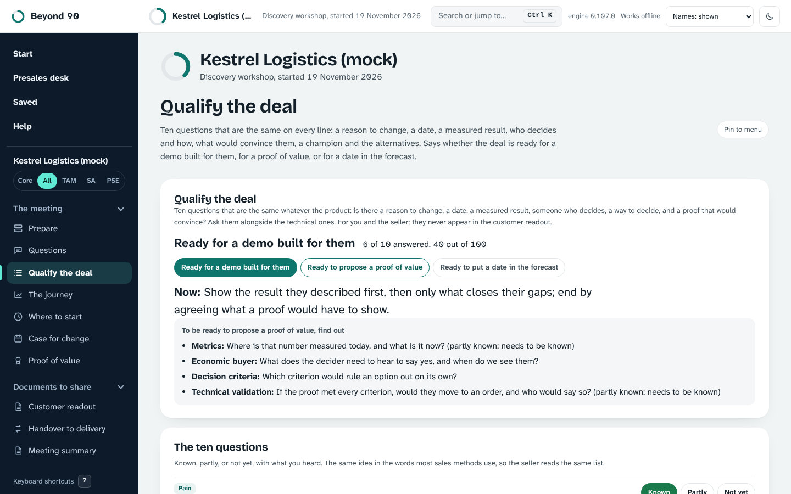

### What else they weigh

Above the ten questions, **What else they weigh** lists the alternatives a deal is measured against for the family of the lines in scope. For infrastructure:
- renewing the current platform;
- moving everything to a public cloud;
- another hyperconverged or private-cloud platform;
- separate servers and storage arrays;
- building it with open-source virtualisation;
- doing nothing for now.

Each line in scope then adds what is particular to it. A few examples:
- for disaster recovery: keeping the backup product, or recovery as a service;
- for object storage: a public cloud, or a backup appliance;
- for desktops: desktops from a cloud, or laptops and nothing central;
- for edge sites: a server per site, or running the sites from the cloud;
- for a service provider: reselling a public cloud.

Mark the ones the customer mentions or is likely to weigh. Each one opens with:
- why customers consider it;
- the questions to ask;
- when the proposal fits;
- **when the other choice is the better one**;
- how to prove it.

They are written to be fair. Saying when the other choice wins is what makes the rest believable, and it tells you when to stop.

What is marked:
- goes into the meeting summary, never into the customer readout;
- adds a check before the decision on [the way forward](#the-way-forward): how we compare is known;
- counts in what the deals teach, with how often those deals were still won.

On the presales desk:
- doing nothing, with no date that makes the deal urgent, is a risk that can lose the deal;
- other options without knowing how we compare are a watch.

The same list is available outside the page:
- `beyond90 alternatives --profile <line>` prints it as Markdown or JSON;
- an assistant gets it from the `what_else_they_weigh` tool ([mcp.md](mcp.md)).

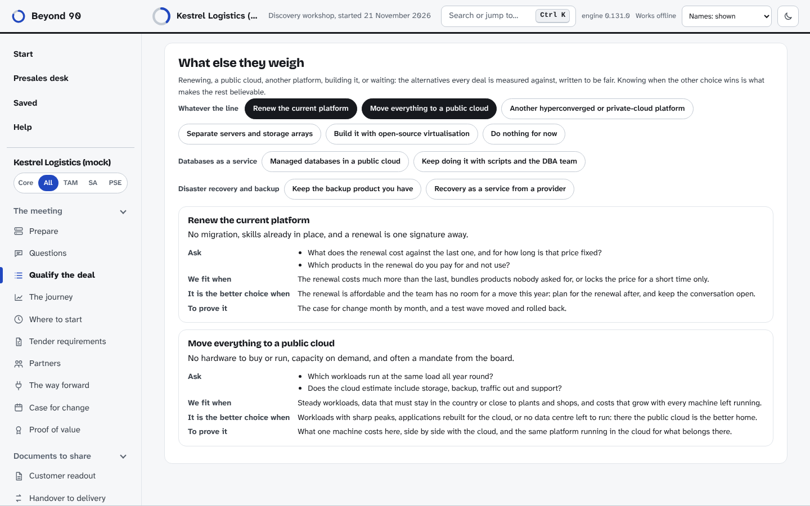

## Tender requirements

When the customer issues a tender or a request for proposal, **Tender requirements** answers it requirement by requirement.

**Paste the requirements** as they are in the document:
- numbered lines (`3.2.1 The solution must...`), where lines without a number are joined to the one before;
- bullets;
- rows copied from the tender's spreadsheet, where the longest cell is the requirement, a short cell with digits its reference, a number its points, and a yes or no whether it is mandatory.

Each requirement is read and matched:
- **mandatory or scored:** "must", "shall", "mandatory" and the same words in Italian, French, German and Spanish make it mandatory. Words such as "should", "desirable" or "optional", or points in the text, make it scored. When nothing says, it counts as mandatory: better to treat one too strictly than to miss it.
- **its points,** when the text gives them ("(8 points)", "punteggio max 6").
- **the product line it asks about,** from the words it uses, in English and in the wording of Italian tenders. Lines in the conversation come first. The platform line counts half, since nearly everything touches it.

An open requirement shows the words it was matched on, so the match can be trusted or fixed in one click. **Try it with an invented tender** loads sixteen requirements. Once requirements are loaded, the loader folds away into one line ("16 requirements loaded, 11 mandatory, 41 points. Add more").

The page reads top to bottom as the work goes: **Where the bid stands**, then **Load the tender**, then **Answer the requirements**, then **Deliver the bid**.

**Or read the tender's own file.** **Read from a file** takes:
- a workbook (.xlsx): the sheet holding the requirements is the one with the most rows carrying a long cell, and header rows, Italian ones included ("N.", "Requisito", "Tipologia"), are skipped;
- a CSV, whatever its delimiter;
- plain text.

The file is read in the page and never leaves it.

**Who issued it** decides where questions go:
- a **public body** takes questions only through the tender's formal channel, by its deadline. The questions are drafts for it, and nothing of the tender goes on a meeting agenda.
- a **company** can be asked in a meeting: the requirements marked to check go on the next meeting's agenda, under "Your requirements we want to understand well".
- until it is said, nothing goes on an agenda.

**The tender meets the discovery questions.** A requirement leads to the discovery question of its line that it touches most: by the words they share, two at least, a rare word counting more than a common one. Nothing is forced when none fits.
- In the tender, each requirement links to its question.
- In the questions, "The tender asks" shows under each question a requirement touches.
- **Asked by the tender** narrows the meeting to those questions: what to understand before answering the bid.

**Answer the requirements.** The list is compact: one row per requirement. Each row shows:
- its reference and its text;
- mandatory or its points;
- its line;
- "no note" when it is answered without saying how;
- its answer as a coloured pill.

Open a row to answer it:
- **Met**, **Partly**, **Not met** or **To check**. The keys **1** to **4** answer, and the next requirement still open opens by itself, as in a meeting. **Escape** closes it.
- how it is met, or what is offered instead;
- who answers it: presales, a specialist, the partner, the product team, or commercial and legal;
- whether it is mandatory, its points and its line, to correct.

Finding your way:
- chips narrow the list: all, mandatory, not answered, not met, to clarify, and **not explained** (met or partly with no note). Each chip carries its count.
- a search finds a requirement by its words or its reference;
- a line can be picked;
- **Group by line** sorts the rows under each line, with a small bar of how far each is answered. Lines in the conversation come first.

**What to write.** Under each requirement without a note, two offers appear:
- **from the answer kit:** a neutral answer for its line or for any line, with the evidence to attach and what to check before using it. Square brackets mark what to fill in for the customer.
- **answered before:** the note written for the most similar requirement in another tender in this browser, with the customer and the date. Similar means sharing most of their meaningful words.

**Use it** puts either in the note, to adapt. **Use the kit's answers where there is no note yet** fills every empty note at once; notes already written are kept. Once a requirement is met or partly, its line shows what to attach.

The kit covers:
- the platform: node failures, upgrades without stopping, moving running machines, growing the cluster;
- recovery: recovery points and times, copies nobody can delete, test failover, recovery plans, retention;
- object and file storage, cloud operations, edge sites, desktops, migration, Kubernetes, AI, databases, segmentation and providers;
- for any line: data kept in the country or the EU, certifications, training, support and service levels, encryption and keys.

It is in `src/beyond90/data/answers.json`. `beyond90 answers --profile <line>` prints it, and an assistant gets it from the `tender_answer_kit` tool.

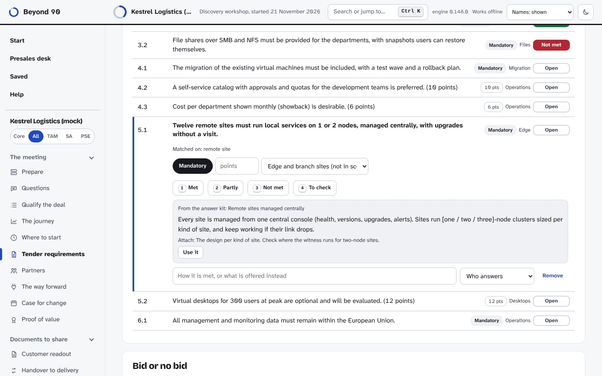

**Where the bid stands** says, at the top of the page:
- whether to bid: a mandatory requirement not met can exclude the bid; partly met or unclear ones are to clarify;
- **two bars,** one for the mandatory requirements and one for the scored ones, coloured by answer, with the counts beside them;
- **the points likely won** out of the total; the deadline for questions to the contracting authority and the bid's due date, flagged when within a week;
- **Do next:** at most three things, most urgent first, each with the button that does it. For example:
  - a mandatory requirement not met ("See them");
  - questions due within a week ("Copy the questions");
  - mandatory requirements still open ("Answer them" opens the first);
  - requirements answered without saying how;
  - and, when all is done, the matrix to download.
- who still owes answers. **Copy for the partner** (or a specialist, the product team, commercial and legal) gives a message for that person:
  - their requirements still open or to check, with mandatory or points;
  - what has been written so far for each;
  - the date to answer by, three days before the next deadline;
- the lines the tender asks about that the conversation has not covered yet, which can be added in one click.

**Deliver the bid** starts with **Before it leaves**, a check of the response, each item passed or with the button that fixes it:
- every requirement answered;
- every answer met or partly says how;
- nothing left in square brackets: the kit's answers carry them for what must be filled in for this customer, and **To fill in** narrows the list to them;
- no other customer named: an answer reused from another tender in this browser that still names that customer is caught here, and in Do next, before the bid leaves;
- about how many pages the technical response takes, against the **page limit** when the tender sets one.

Then, side by side:
- the coverage by product line, with a small bar for each;
- the questions for the contracting authority, as drafted;
- the evidence to gather.

**The technical response** follows the tender's own structure:
- **sections** come from the references (2.3.1 belongs to section 2, RT-05 to RT);
- each section is named after the line most of its requirements ask about, until the bid team types the title the tender uses (**Sections of the technical response**);
- under each section, every requirement with its text quoted, mandatory or its points, the answer as a coloured label, how it is met, and what is attached;
- the attachments are listed at the end.

It downloads:
- **as a page to print or save as PDF** (.html): a cover, the contents, the sections and the attachments, with anything still in square brackets highlighted so nothing unfinished leaves unseen. Every piece of text is escaped; the page has no scripts, loads nothing, and carries its own security policy.
- **as Markdown** (.md), to paste into the bid's own template.

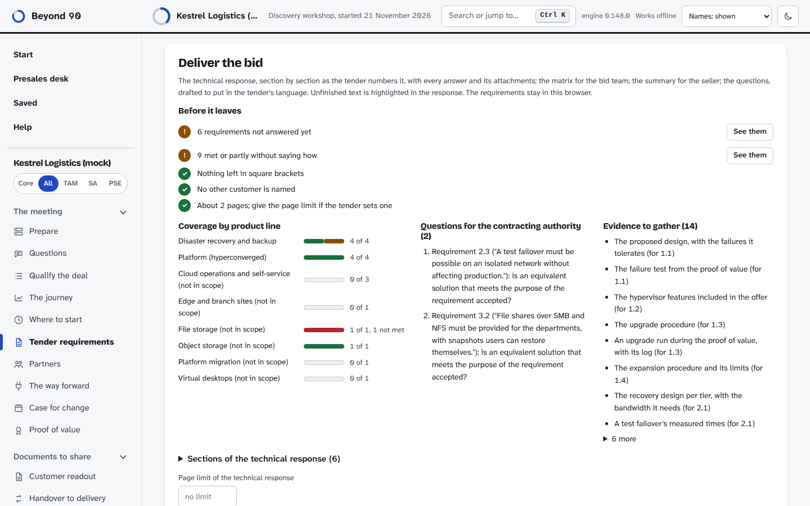

The other buttons give:
- **the compliance matrix** (.csv), for the bid team, with the evidence to attach for each requirement met or partly. Cells a spreadsheet would run as formulas are defused.
- **the bid summary** (.md), for the seller, with the evidence to gather and the requirements each backs.
- **the questions for the contracting authority:**
  - whether an equivalent is accepted, where a mandatory requirement is not met or only partly, with what is offered;
  - what is expected, where its meaning is unclear.

  They are drafts, to put in the tender's language.

**Bid or no bid.** Whether the tender is worth answering, decided before the work starts and reviewed as it goes. Eleven questions bid teams ask, in four groups:
- **Can we take part:** the standing the tender asks of the bidder (turnover, certifications, registrations, references); every mandatory requirement can be met; there is time to write a good response.
- **Can we win:** we knew of it before it was published; it is not written around a rival; we can come first on price and quality; we have the references and evidence it rewards.
- **Is it worth it:** its value, and what it opens next, justify what answering costs; the contract terms are acceptable.
- **Can we deliver:** a partner able to deliver is on the deal and leads it; we and the partner have the people for the dates the tender sets.

The questions are a short list:
- a tile per group counts its answers with a dot each, and narrows the list to that group;
- filters show all, those not answered, or those answered partly or no, with their counts;
- each question is one line with its answer in line; opened, it shows the whole question and why it matters;
- in an opened question, the keys 1 to 3 answer it (yes, partly, no) and open the next one still open; Escape closes it.

Each is answered yes, partly or no. Four are read from the tender unless answered by hand, each saying what it read:
- the mandatory requirements, from the answers;
- the time left, from the bid's date and the requirements still open;
- price and quality, from What wins it;
- the partner, from Partners.

Three can exclude the bid: the standing, the mandatory requirements, the terms. The review then advises:
- **Do not bid** when one of those is no, saying which;
- **Find out first** while questions are not known;
- **Think twice** when much is against it;
- **Bid** otherwise, saying what is against it.

**The team's call** is separate: "We bid" or "We do not bid", dated, with why in a sentence. The review advises; the team decides. When the call is not to bid:
- the tender leaves the desk's risks and agenda, the way forward and the next meeting's agenda;
- **Tenders in progress** shows it as not bidding;
- **Do next** offers a short, polite letter declining it, to adapt.

**Copy for the bid review** gives the review in Markdown, and the bid summary carries it.

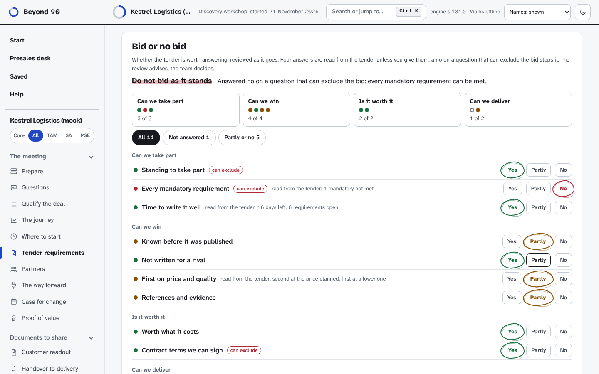

**What wins it: price and quality.** When the tender goes to the best ratio of quality to price, the card compares our bid with the rivals' guessed ones:
- **How the tender scores**, as the tender states it:
  - the points for quality and for price (70 and 30, say);
  - how price is scored, among the formulas public procurement platforms publish for contracting authorities:
    - lowest price over each price: the cheapest bid gets every price point;
    - each discount over the largest discount, on the base amount;
    - two slopes around the average discount: a share X (0.80, 0.85 or 0.90) of the points up to the average, the rest above it;
    - the discount over the largest, raised to a power below one;
    - from the dearest (no points) to the cheapest (every point);
  - the base amount the discounts are taken from;
  - whether quality is rescaled so the best bid gets every quality point.
- **Our bid:** our price, and our quality points. Left empty, the quality points are read from the scored requirements as answered (met counts in full, partly half), on the tender's scale.
- **The rivals, guessed:** up to four, each with a name, quality points and a price.

It shows:
- a bar per bid, quality and price stacked, the highest total first;
- who comes first, and by how much;
- the price at which that changes: below which we would come first, or up to which we stay first. When half our price would still not do it, it says the gap is in quality;
- what one point of quality is worth in price, at this offer;
- a warning when our price is above the base amount, or far below the rivals' (an abnormally low bid may have to be justified).

**Copy for the bid review** gives it in Markdown, and the bid summary carries it. A rival ahead is one of the things **Do next** can list, with **See what wins it**. The rivals' figures are guesses: the result is only as good as they are.

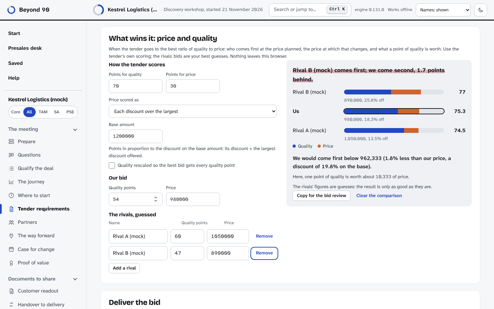

The tender also reaches other places:
- **On the presales desk:**
  - a mandatory requirement not met is a risk that can lose the deal;
  - so are questions due within a week with requirements to raise, and a bid due within ten days with requirements still open;
  - both deadlines go in the agenda;
  - **Tenders in progress** lists every tender in this browser, the nearest deadline first: whether the bid can go ahead, a bar of the answers, where we stand on price and quality, the next deadline, and a button that opens the tender.
- **On [the way forward](#the-way-forward),** the decision waits until every mandatory requirement is answered and none fails.
- **In the [handover to delivery](#handover-to-delivery):** the mandatory requirements answered met or partly, with how. These are what the bid committed to, and delivery has to keep them.

The requirements are kept with the workshop in this browser, sealed with it and erased with the customer. They never appear in the customer readout.

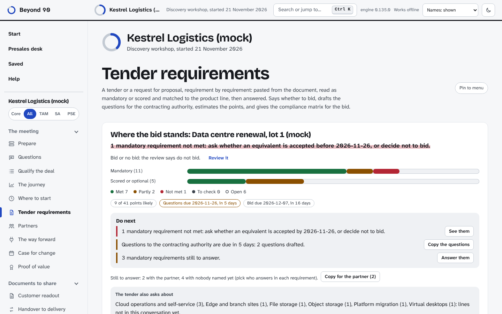

## Partners

**Partners** records who is on the deal: the reseller, integrator, service provider or distributor working it, which one leads, the deal registration and when it runs out, the route to purchase, and who does what from discovery to support. It says what to settle, and gives a brief for the partner and a discovery kit any partner can use. See [partners.md](partners.md).

## The way forward

**The way forward** places the prospect on the path from the first meeting to the handover: **Discovery**, **Demo built for them**, **Proof of value**, **Decision**, **Handover to delivery**. Each phase says what it is for, what must be true to move on (read from what is recorded, each with what to do and a link to where to do it), how to run it and what to avoid:

- **Discovery:** the line to start with is known, the essential questions are answered, something is at stake in their words, and the deal is ready for a demo.
- **Demo:** the demo was given, how each part landed is noted, and the deal is ready for a proof of value.
- **Proof of value:** it is planned, ready to start (criteria signed off, sponsor and champion, a realistic window, scope), every concern raised is a criterion, and every criterion has been tried.
- **Decision:** the readout is done, the decider is known and has heard from us, finance has the case for change, and the outcome is recorded.
- **Handover:** won.

The phase now is the furthest one started. A phase passed with something still open says so, and does not pull the prospect back to it: a proof started before the deal was fully qualified still shows what qualification is missing.

**The demo, built from what they said** follows the "last thing first" order that demo coaches teach:

1. their situation in their words, with the figures they gave;
2. the result they want, shown first;
3. only the gaps on the line to start with, at most four, each with who it is for and what they said;
4. the concerns they raised, with how to prove each;
5. the proof to agree at the end, from the line's own criteria and their concerns.

The plan opens with **who should be there**: the executive sponsor, then the people each part is for (the architect, the security team, operations), as one would invite them.

**Copy the agenda for the customer** and **Demo invitation (.ics)**, on the day chosen, give them what will be shown and for how long, in their order, and who should be there; nothing from the discovery notes is in it.

**The meeting** sets its length (30, 45 or 60 minutes; the meeting clock's when it runs). The plan is timed for it: two minutes for their situation, three for the result, three for each concern, five to close, and the rest shared among the gaps, three to ten minutes each. What does not fit waits for the next meeting, the last gaps first, and is struck through; what is left over is time for their questions. The plan as text and the cards of **Run the demo** carry the same minutes.

What they already have is listed under **Leave out**. A note says what to keep for a fifteen-minute version for the executive. Copy the plan or download it (.md) for the seller and the champion, and **Mark the demo as given** to move on.

**Run the demo** opens the plan as a deck, full screen, the same as the questions: one card per gap it closes ("Show that no administrator account can delete the backups", for the security team, with what they said in discovery on the back), then one per concern they raised. Swipe each as it landed: right **landed**, up **questions**, left **did not land**, down **not shown**; or tap, or press an arrow or 1 to 4. Write what they said on the card: "how long does a restore take?" suggests questions, "we already have that" suggests it did not land; you decide. It is meant for a phone beside you while your screen is shared, or for a colleague taking notes.

At the end, **Where it stands** says how many parts landed out of those shown, and lists:

- the questions to answer, in writing;
- what did not land, to ask what they expected before planning a proof;
- what landed, for the proof to confirm;
- what was not shown, for the next meeting.

**Copy the recap** and **Email the recap** give the account team the same in plain text. **Copy the note for the customer** gives the follow-up to send them: what we showed against what they told us in discovery, their questions with a line for each answer, the concerns with how we propose to prove them, and the proof of value we propose to confirm what landed. It names no reaction: what did not land stays with the account team. **Mark the demo as given today** closes the deck and ticks the phase. Afterwards:

- what landed goes into the proof of value as criteria, after the line's own: "Landed in the demo. Now on their own systems";
- the next meeting's agenda opens with **Back from the demo**: their questions, and what to show again, closer to their case. What they said where it did not land stays with the account team.

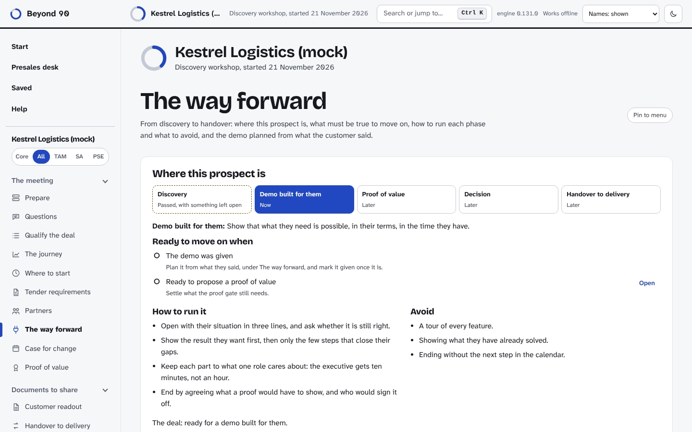

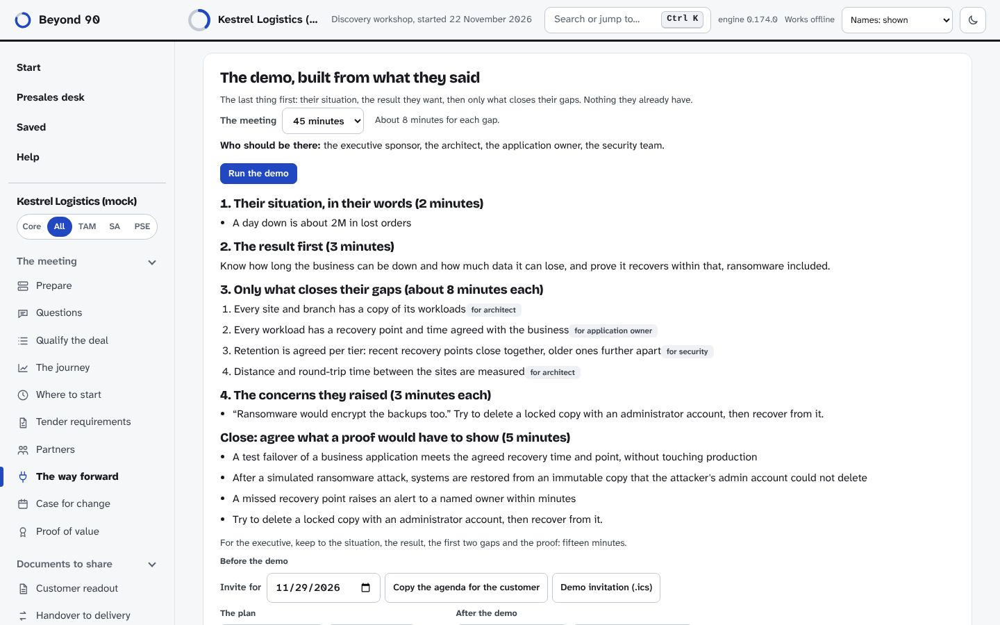

## Prepare: the message, the people, the objections

**Prepare** gives each line in scope, the line to start with first:

- **The line in one sentence for each audience:** the executive (what changes for the business), the technical team (how it works and is run), and finance (what it costs and saves, and when).
- **Who to have in the room:** the roles whose work, budget or risk the line touches.
- **The objections to expect,** each with the question to **ask first** (an objection is often about something else: an investment just made, a team's role, a test that went badly), the **answer**, and how to **prove** it.

When the customer raises one, mark it. It goes to the customer readout under "What you asked us to prove", to the meeting summary under "Concerns they raised", and into the proof of value as a success criterion when it starts from the workshop. The meeting summary also tells the first line's story for each audience, for the account team.

The messages, people and objections come with the product profiles (`story.json`) and are written for kinds of product, with no vendor named. Which objections were raised is kept with the workshop, like the answers.

## Their inventory

In a conversation about moving off a virtualisation platform, the first numbers come from an inventory export. Under **Their inventory**, read the CSV of the sheet that lists one virtual machine per row (the vInfo sheet of a common inventory tool saved as CSV, or a hand-made sheet with columns such as name, vcpus, memory_gb, disk_gb, os, cluster). Columns are matched by name and units read from them (MiB or GiB); templates are left out.

It shows the machines and how many run, vCPU and memory in use, storage used or provisioned, hosts and clusters, the largest clusters with the data on each, machines powered off (candidates to retire rather than move), operating systems past general support, and a first wave: a small cluster with the least past support, which teaches the most for the least risk. It also brings the migration line into scope and puts what the export says under the questions it answers, and into the journey, the readout ("Where you start from") and the summary.

It is a starting point for a sizing tool, not a sizing. The file is read in the page and not kept: only totals and cluster names are stored with the workshop, never machine names. "Try it with an invented export" loads a made-up one.

## A first sizing sketch

Once the inventory is read, **A first sizing sketch** turns it into a server count with assumptions agreed in the meeting: growth over the platform's life, vCPU per physical core, memory overcommit, how data is protected, the share of data no longer written to, data reduction counted, how full storage may get, spare servers, and what one server holds. Each step of the arithmetic is shown, with what decided the count (compute, memory or storage) and how full each would be with the spare servers out. The last step counts the physical cores, spare servers included: what a subscription priced per core would count (some count a minimum per processor, so the product's own rules have the last word).

How data is protected follows the rules of distributed storage:

| Protection | Raw capacity per usable TiB | Survives | At least |
|---|---|---|---|
| Two copies | 2x | one failure | 3 servers |
| Three copies | 3x | two failures | 5 servers |
| Erasure coding, 4 data + 1 parity on cold data, two copies on the rest | 1.25x on cold data | one failure | 6 servers |
| Erasure coding, 4 data + 2 parity on cold data, three copies on the rest | 1.5x on cold data | two failures | 8 servers |

Erasure coding applies only to data that is no longer written to, so its cost is blended with the share of cold data; a parity strip needs one server more than its width, so it can be rebuilt after a failure. Storage is kept below 75% of the capacity left after losing a server by default: that is where a platform should warn, well before it would stop accepting writes.

Design notes follow the assumptions: keep the servers alike (the capacity left after a failure is set by the largest one), spread copies across racks only with at least three of them, evenly filled, measure data reduction on the customer's own data before counting it, and check a high vCPU ratio against the CPU ready time the current platform shows.

It is a sketch, to agree the order of magnitude and the assumptions with the customer, not a sizing: the vendor's sizing tool, with the measured workload, has the last word. The assumptions are kept with the workshop and shown in the meeting summary.

What the customer says about the servers in the meeting ("we plan for 30% growth, on servers with 64 cores and 1.5 TB of memory, N+2", "three copies of the data", or in Italian "una crescita del 25 per cento, server da 32 core") is offered under Heard something for the sizing sketch: **Use it in the sketch** puts it in the assumptions, the count follows, and **Undo** puts it back.

## A first recovery design

With disaster recovery in scope, **A first recovery design** takes the protected data (from the inventory, or typed in), how much of it is written each day, how much busier the busiest hour is, and the round trip between the sites. For three tiers of applications, each with its share of the data, recovery point and recovery time, it gives:
- **the replication the recovery point calls for:** synchronous with a witness in a third place for zero data loss, which needs sites closer than about 5 ms (the design says so when they are not); near-continuous for a few minutes; scheduled snapshots otherwise;
- **the bandwidth it needs** to keep up with its busiest hour, and the total between the sites before compression;
- **a retention to agree:** recent points close together, older ones further apart.

Notes that hold whatever the product: recover dependent applications together and in order, test on an isolated network, keep a copy nobody can delete, write the power-on order when the recovery time is short. The replication product's own calculator has the last word.

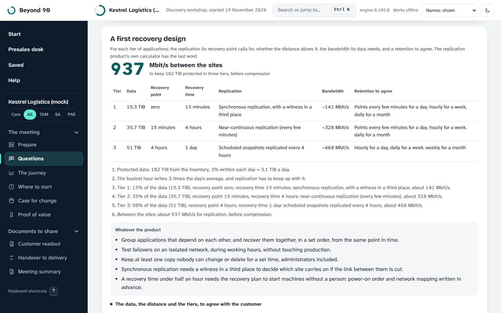

## A first backup capacity sketch

With object storage in scope, **A first backup capacity sketch** works out what a retention scheme holds:
- one full, the daily points, the weekly and the monthly fulls (each kept full adds only what changed since the one before, as with synthetic fulls);
- then the data reduction counted, room to grow, how full the store may get, and the protection overhead (erasure coding about 1.3x to 1.5x, three copies 3x);
- the result in usable and raw TiB, and the bandwidth the nightly window needs.

Notes that hold whatever the product: lock the backups for as long as an attack could go unnoticed, time a full restore of the largest system, measure a high reduction on the customer's own backups, and ask what rule asks for years of monthly copies. The backup product's own calculator, on the customer's data, has the last word.

## A first GPU sketch

With AI on the customer's own infrastructure in scope, **A first GPU sketch** works out how many GPUs serving a model takes:
1. the memory for the weights (parameters × bits per weight);
2. the memory for the conversations in flight (tokens kept per request × the cache per token from the model card × requests in flight);
3. how many GPUs one copy of the model takes (1, 2, 4 or 8 in one server, leaving at least a fifth for conversations);
4. how many copies the load needs, and, if there is a measured figure, the speed each user should see;
5. at least two copies, for availability.

What decided the count is said, and every step is written out. The notes say what to check before relying on it: tokens per second measured on the customer's own prompts, a copy's GPUs in one server, the answers checked on the customer's tasks at fewer bits.

It is a starting point for a benchmark, not a sizing. The assumptions are kept with the workshop, in the meeting summary and in the handover to delivery.

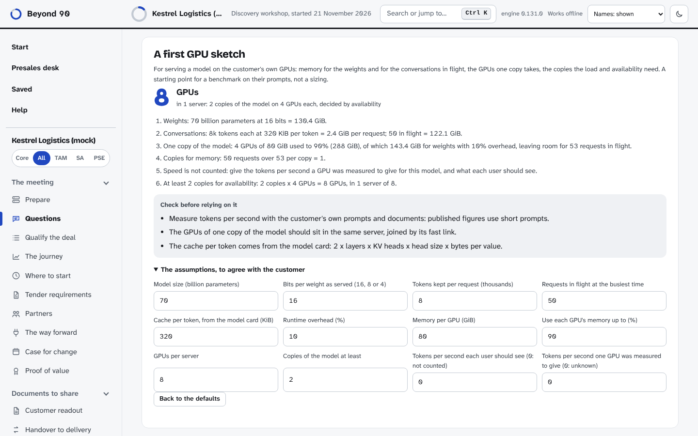

## A first edge design

With edge and branch sites in scope, **A first edge design** works kind of site by kind of site, up to four kinds ("small shops", "large stores", "plants"). Three or four standard designs are what make hundreds of sites manageable. For each kind, typed in from the conversation:
- how many sites, the machines at each, the data kept there, how much of it is written each day and the link to the core;
- what the site must ride through: wait for a replacement (one server is enough), keep running through a server failure with a witness (two servers), or keep running without one (three servers).

It gives:
- **the servers each site needs:** enough for the load, plus one spare where the site must keep running, and the total;
- **the witness:** the two-server sites need one in a third place they can all reach;
- **whether the daily copy to the core fits the night** over each link, at the share of the link the copies may use;
- **how long a whole site would take to come back over its link**, which is why each site keeps a local copy;
- **the upgrade waves:** one site of each kind first, then waves of the agreed size, and the weeks it takes to reach every site;
- **what trips to sites cost today**, when the number of trips and the cost of one are known.

Notes that hold whatever the product: keep a few standard designs, ship servers ready to join the central plane, encrypt every site's disks, keep a spare where one server is all there is. The product's own sizing tool has the last word.

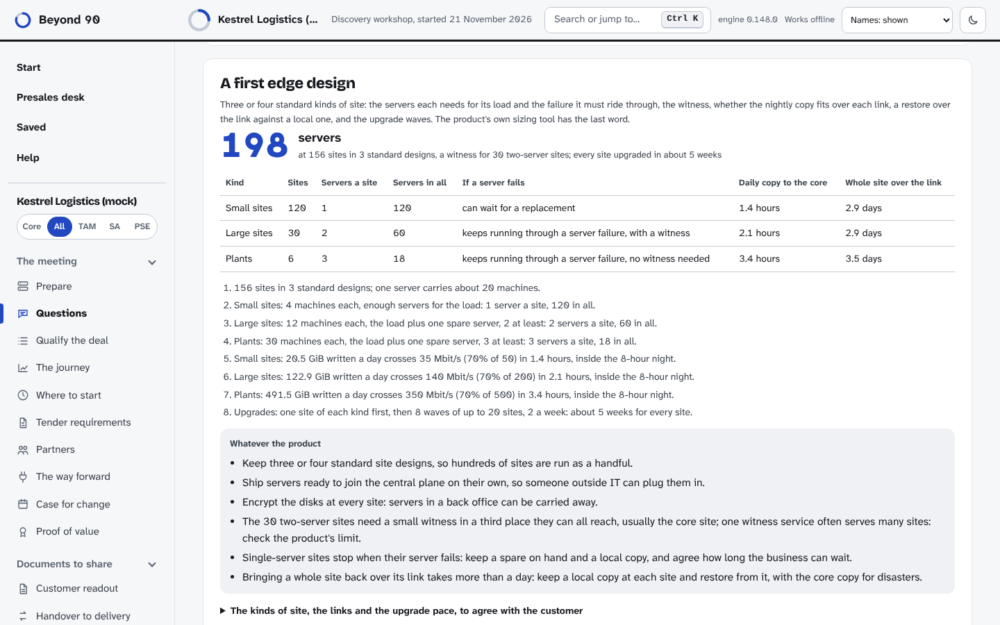

## The sketches in the proof of value

A sizing nobody tested is a guess the customer pays for later. Each sketch worked out with their figures adds a test to the proof of value, with the figure it would confirm as its target: a pilot week for the desktop sizing, the requests read from a running cluster for the container platform, a week of busy-hour data for the database licences, a scan of last-access times for the file shares, a week of their own backups for the capacity sketch, a test failover of one tier for the recovery design, a benchmark on their prompts for the GPUs, one site of each kind for the edge design. They are offered with the line's own criteria when the proof is started, and among the suggestions after.

## The sketches in the customer readout

Each sketch says, beside its title, whether it was worked out **With their figures** or is still **At the defaults**: a figure changed in the card or put in from Heard something marks it, **Back to the defaults** takes the mark away.

Under **Sketches from their numbers**, **Show the sketches worked out with their figures in the customer readout** adds a section to the readout, **First orders of magnitude**: one line for each sketch whose figures were changed with the customer, on a line in scope ("Virtual desktops: about 8 hosts for 800 desktops at once, 1 of them kept free, and 35.1 TiB of storage"). It says what it is: the order of magnitude from the figures they gave, not a quote and not a final sizing. A sketch left at its defaults was not discussed, and stays out.

## A first desktop sizing sketch

With virtual desktops in scope, **A first desktop sizing sketch** works out the hosts a desktop pool needs at the busiest hour. Typed in from the conversation:
- how many users will have a desktop, and how many connect at once at the busiest hour;
- the mix of workers: task workers, knowledge workers, power users and graphics users, and how many desktops keep their changes;
- what each kind of desktop is given (virtual processors, memory) and how many virtual processors share a physical core;
- the hosts: cores, memory, what the platform keeps for itself, and how many are kept free for a failure or maintenance.

It counts the hosts twice, by processor and by memory, says which one decides, and adds the hosts kept free. Storage: the full disks of the desktops that keep their changes, what fresh desktops write while they run, the golden images and a copy of each being prepared, and every user's profile, kept below a fill level.

Notes that hold whatever the product: measure a week of real use on a pilot group of each kind before fixing the ratios, plan for the busiest half hour of logons, give graphics users hosts with GPUs sized from their applications, and ask which users truly need a desktop that keeps its changes. The sketch goes in the journey and in the handover; a week of real use on a pilot group has the last word.

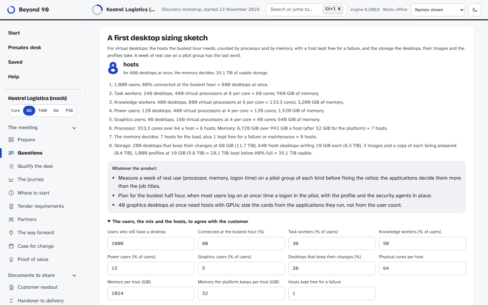

## A first container platform sizing sketch

With the Kubernetes platform in scope, **A first container platform sizing sketch** works out the nodes the applications call for. Typed in from the conversation with the teams:
- how many applications run in production, how many pods each, and what a pod asks for (processor in millicores, memory in MiB);
- test and development as a share of production, and the persistent volume each application keeps;
- the nodes: their size, the share their own platform pods take, how full their requests may be planned, the pods a node may run, a node kept to drain, and the control plane.

For production and for test and development apart, it counts the workers three ways (processor, memory, pods per node), says which decides, adds the node to drain and the control nodes, and gives the virtual processors and memory the platform must host, and the persistent volumes with their copies.

Notes that hold whatever the platform: read the requests the teams actually set from a running cluster, keep production apart with its own control plane, three or five control nodes, and room on each node for a rolling update. The sketch goes in the journey and in the handover.

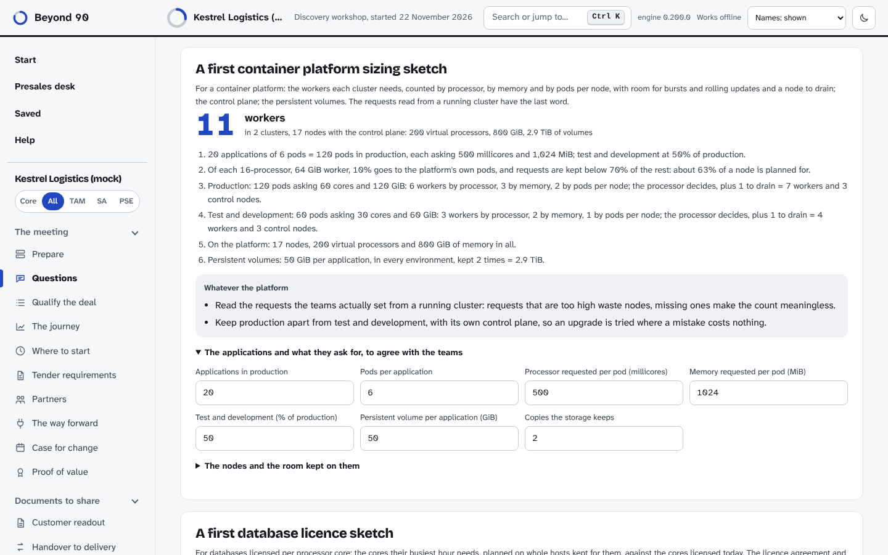

## A first database licence sketch

With databases in scope, **A first database licence sketch** works out the processor cores databases licensed per core would need on hosts kept for them. Typed in from the conversation:
- how many databases, the processors each is given today, and how busy those are at the busiest hour;
- how busy the hosts kept for them may run at the busiest hour, the cores per host and the hosts kept free for a failure, and whether the agreement asks for those to be licensed too;
- the cores licensed today and, when known, what a licensed core costs a year.

It turns the busy processors at the planned peak into whole hosts, counts the cores to license, and compares them with today's. Notes that hold whatever the engine: the licence agreement decides what must be licensed (check it with the customer's licensing specialist), take the busy share from a week of data at the busiest hour database by database, and sketch each engine and edition as its own pool. The sketch goes in the journey and in the handover.

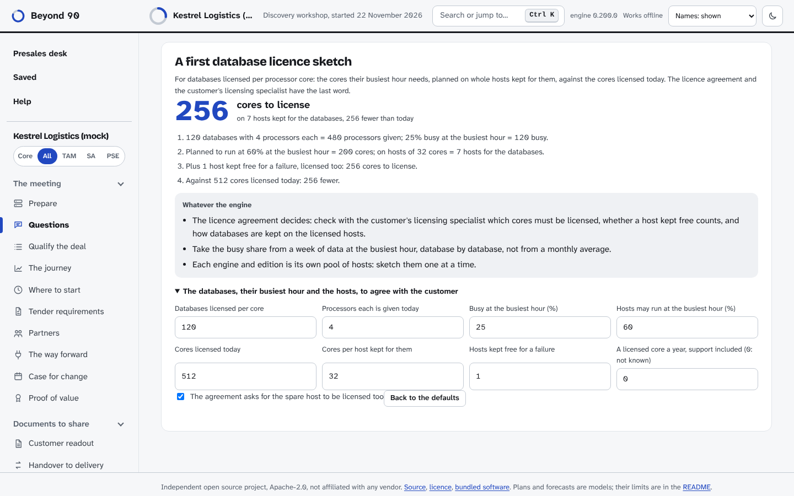

## A first file storage sketch

With file storage in scope, **A first file storage sketch** works out the capacity of the file shares. Typed in from the conversation: the file data today, its growth a year and the years the storage is sized for; the share nobody has opened in a year, moved to a cheaper tier; how much changes each day and the daily and weekly snapshots kept; the data reduction, the protection and the fill level; and how many file servers there are today.

It gives the usable and raw capacity of the fast tier and what the cheaper one holds, each step written out. Notes that hold whatever the product: measure the cold share with a scan of last-access times, snapshots are not a backup, ask who would see a ransomware attack on a share and how fast it can be rolled back, and map every share and its permissions before bringing file servers together. The sketch goes in the journey and in the handover.

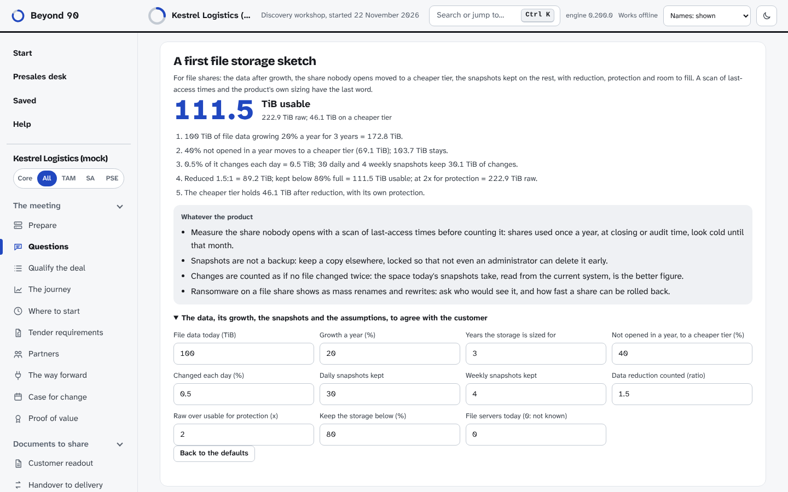

## What one machine costs

With cloud operations, a service provider's cloud or hybrid cloud in scope, **What one machine costs** works out the number behind "the cloud is cheaper", in the customer's own figures. It adds up a year of the estate:
- the hardware in use, written off over its life;
- licences and subscriptions, support, power and cooling, space;
- the people who run it.

It then divides the total among the machines running, typed in or taken from the inventory, and gives:
- **the cost of one machine a month, all in,** with each part's share;
- **what idle machines do to it:** the machines that really work cost more each, and reclaiming the idle ones makes room before buying hardware;
- **a comparable machine in a public cloud**, side by side, a machine a month and across the estate in a year;
- **for a service provider, a standard tenant:** what it costs to run, and the margin its price leaves.

The notes say what makes the number trusted: every element agreed with finance, showback before chargeback, a like-for-like cloud price, an owner's decision to reclaim. "Copy for finance" gives the table and the arithmetic. It is not a quote; it is kept with the workshop, in the meeting summary and in the handover to delivery.

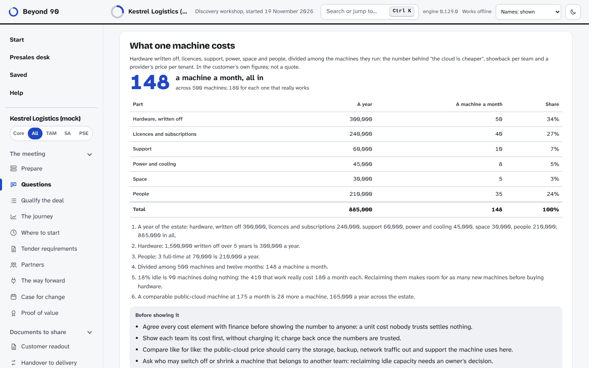

## A plan in waves

From the same inventory, **A plan in waves** proposes how the move would run: a test wave first, from the cluster that teaches the most for the least risk, then cluster by cluster, the least risky first (fewest machines past support, smallest). Clusters move whole, so machines that talk to each other inside one stay together; dependencies across clusters still have to be checked with the application owners.

The settings are agreed with the customer: the date of the first wave (two weeks out by default), the most machines in one wave, the days between waves, how many machines the test wave takes, and whether powered-off machines move or are left to retire. Each wave shows its date, cluster, machines, vCPU, memory and how many run operating systems past support, so tools and agents can be checked for them first.

Each wave also shows **the data it copies ahead** of its cutover and how long that copy takes over the link the customer names (a setting: 1,000 Mbit/s by default, counting on 70% of it, since the link also carries the traffic already on it). The data comes from the inventory, cluster by cluster: the space used, or what is provisioned when the export has no used column, shared over a cluster's waves by machines. One line gives the total, the largest wave and its copy time. When the copy of a wave takes longer than the days between waves, the copies would pile up: the line and the wave say so, with the three ways out (more bandwidth, more days between waves, smaller waves). It is an order of magnitude: compression, deduplication and the migration tool's own pace change it, and the change rate during the copy adds to it.

Every wave goes through the same steps. Before: owners named and the change approved, a performance baseline, data copied ahead, the rollback written down, backup and monitoring ready. On the day: go or no-go, cutover inside the window, each owner testing against the baseline, sign-off or rollback by the agreed time. After: labels and policies checked on every moved machine, lessons into the next wave's runbook, old machines kept off for an agreed period, then removed.

**Add the waves to a calendar** downloads one event per wave, each with the data to copy ahead. The pace said in the meeting ("they can move 30 machines a weekend, a wave every two weeks, over a 10 Gbit link between the data centres", or in Italian "25 macchine per ondata, un'ondata ogni 15 giorni") is offered under Heard something for the plan in waves: **Use it in the sketch** puts it in the settings, and the plan follows. The plan is in the meeting summary, and in the customer readout under "How the move would run". Only totals and cluster names are used.

## The case for change

**Case for change** puts what staying costs beside what moving costs, month by month over one to seven years, in the customer's own figures:
- **Staying:** what the current platform costs a year, the rise expected at the next renewal and when it comes, and a hardware refresh due if nothing changes.
- **Moving:** what the new platform would cost a year, the one-off cost of the move, and hardware bought for it (nothing if servers are reused).
- **Running it:** hours a month on routine work today and after, and the cost of an hour.
- **Downtime:** the cost of an hour down, with hours down a year today and after.

A figure the customer put on what is at stake in the workshop, per hour or per day, is offered as the cost of an hour down.

It shows the total each way, the difference, the month the move is paid back if it is, a chart of both lines, a table by cost line, and the arithmetic in words so anyone can check it. Blanks count as nothing. **Copy for finance** copies it as Markdown. It is in the meeting summary, and in the customer readout only when "Show it in the customer readout" is ticked.

Every figure comes from the conversation. The page prices nothing and quotes nothing.

## Handover to delivery

When the deal moves to delivery, **Handover to delivery** writes the note the delivery team reads before the kickoff:
- what the proof of value showed, criterion by criterion with its evidence;
- what the customer asked us to prove, and whether it was;
- what still has to be made true, with who and by when;
- the numbers it rests on: inventory, sizing sketch, plan in waves, case for change, and the recovery, backup, GPU and edge designs and the cost per machine when their lines are in scope;
- what the bid committed to, when there was a tender: its mandatory requirements answered met or partly, with how;
- who to keep involved;
- what is still open.

It ends with the **promises to keep after go-live**:
- the tests passed, which must stay true in production;
- the conditions we agreed to make true, alone or together with the customer;
- the concerns the customer raised that are not proven yet.

**Keep them as commitments** turns the promises into the customer's commitments, never twice. After the sale they show with the customer's other promises, so what presales promised is still followed after the deal. The note can be copied or downloaded as Markdown, through the same check on names as every export.

## How "still missing" is counted

For each line, a real gap counts 1, nobody knows 0.6 (not knowing is itself a finding), partly 0.5 and solved 0; answers to business-value questions count double. What is still missing is that sum over the most it could be for the questions answered. The line to start with is the one with the most still missing, weighted a little by how much of it was explored, so a line heard about twice does not beat one explored in eight questions.

## Privacy

A workshop is a customer fact, like a proof of value: it is kept in this browser's store, sealed under a random slot when you set a passphrase, erased with the customer from *Saved*, and carried between devices only in the workspace file, where it is checked field by field on import. The calendar file is made in the page and only downloaded: it holds the customer's name and the dated conditions, nothing else. Its identifier holds a date and a random suffix, never the prospect's name. The questions are built into the page at release time; nothing is fetched or sent.

## Why "what would need to be true"

Presales engineers are trained to look for limits, and a list of gaps can read as a list of reasons not to start. The journey keeps the same rigour (every risk named, its impact in the customer's words, a step to address it and a test that proves it) but asks a different question: not "can we?" but "what would need to be true for us to do this?". Each discovery question in the profiles carries both: the question to ask, and the condition it tests with a first step towards it.

## Presenting and housekeeping

**Present**, on the journey and on the estate, shows the view alone and larger, full screen where the browser allows, for a shared screen; Esc or the button brings the app back. **Delete this workshop**, under The meeting, removes a workshop and everything in it from this browser after a confirmation.
