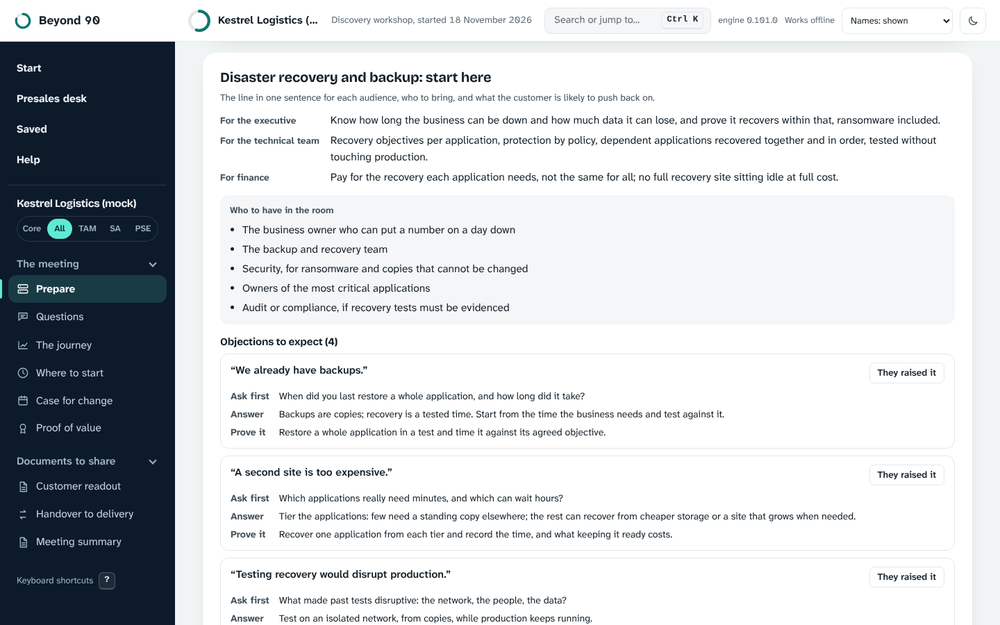
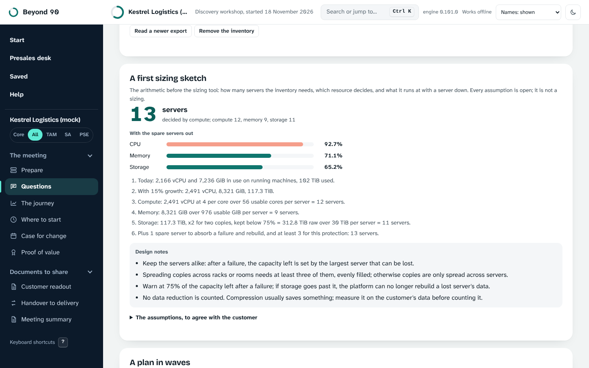
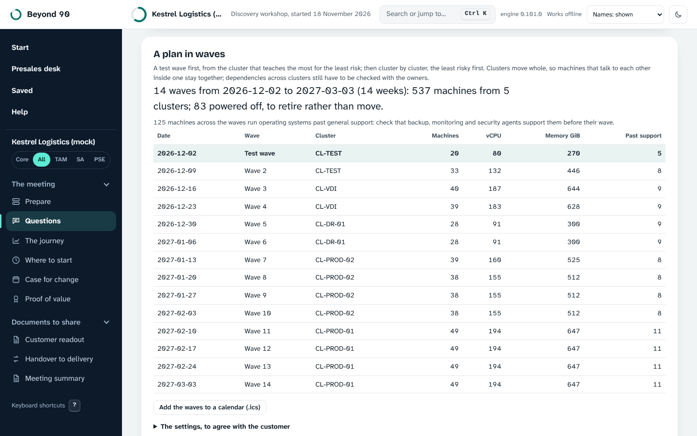
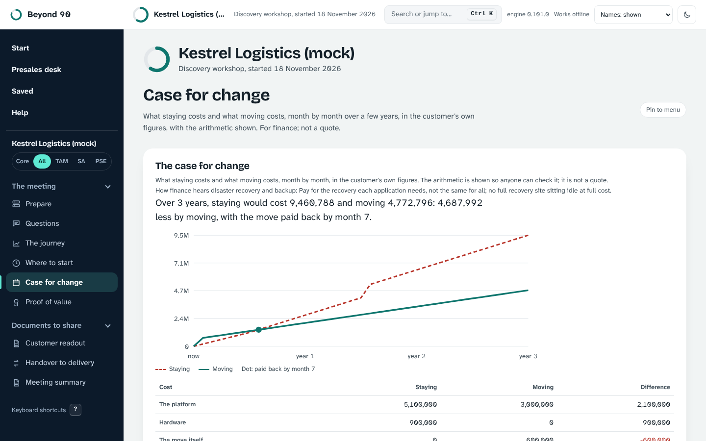

# Discovery workshop: before there is any data

The rest of Beyond 90 reads what a customer runs. The first meetings with a prospect have nothing to read yet: what you have is the conversation. The discovery workshop turns that conversation into the same picture, from the start page, with no files.

## How it works

1. **Start a discovery workshop** on the start page (or, from an estate, on a line the customer does not run yet), or **See a filled-in example** (an invented logistics company leaving its virtualisation platform, with its inventory, owners and dates, the concerns it raised and its case for change) to show the method in thirty seconds. Give the prospect a name (and yours, to sign the readout) and choose the product lines in scope, or start from a conversation (resilience and ransomware, leaving a virtualisation platform, modernising applications, securing the cloud) that sets the usual lines for you: platform, databases, disaster recovery, object storage, file storage, Kubernetes platform, or the security lines (cloud, identity, SaaS, monitoring, endpoint, AI).
2. **Ask the questions.** Each line has eight discovery questions from its profile: two about business value, the others tied to a stage (connected, seen, switched on, decided), each with why it matters. Record what the customer says in one click (**Solved**, **Partly**, **A real gap**, **Nobody knows**) and, if you like, their words in a short note. After each answer the next question is selected, so the keys 1 to 4 keep up with the conversation. On a business-value question you can also put a figure on what is at stake, counted per hour, day, week, month, year or incident; it heads the journey and the readout.
3. **Where to start** updates as you go:
   - **Start here:** the line that hurts most, once at least three questions were answered on it, with the questions and the customer's own words that point there.
   - **The map:** each line in scope filled by how much is still missing there; lines not discussed yet are dashed; dashed links show where the first line leads.
   - **Then:** the path after the first line, from the links between kinds of product ("immutable copies need a target that an administrator cannot delete from"), and the other lines where pain was heard.
   - **Find out before the next meeting:** every question nobody in the room could answer. Often that is the real gap.
   - **The next meeting:** an agenda from what is still open: what slipped, the questions nobody could answer, the concerns to prove and how, what is due soon, and who it helps to have in the room. Copy it, or download an invitation (.ics) for the chosen day that carries it.
4. **The journey.** "Yes, this is possible": the answers turned into a path from where the customer is today to where it could be. Every gap and every "nobody knows" becomes a condition, *what would need to be true*, with where the customer is today (in their words when you noted them) and the first step towards it. The steps are in order: agree what success looks like (the business-value questions), prove it on the first line (validated by that line's proof-of-value criteria), then each line it leads to and why. What is already true is shown too, and what is at stake, from the customer's own notes, heads the page. Each condition can be given an owner (us, the customer, or together) and a date, so the journey becomes a plan both sides can hold each other to; the owners and dates travel to the readout and the summary. Dated conditions are listed by month under **The plan by date**, and **Add to a calendar** downloads them as an .ics file (one all-day event each) for Outlook, Google Calendar or Apple Calendar.

   

5. **Start the proof of value** in one click: a plan for the prospect with the first line's own success criteria and how to test each, a problem statement made from the gaps heard, and the readiness checklist. From there it is the same [proof of value](app.md) as for any customer: sessions, results, the mutual plan.
6. **Customer readout:** a page for the customer, in their language (no scores, no stage codes): what would need to be true, where they are today, the first steps, how each step would be proven, what we heard and what to settle at the next meeting. Download it to send or print, or show it on screen. It loads nothing and has no scripts; everything typed is escaped.
7. **Meeting summary:** what was heard line by line, the journey as a checklist (each condition with its first step and where the customer is today, what is already true ticked, how each step is validated), and the open questions. Copy it into the follow-up email or the CRM.

## Prepare: the message, the people, the objections

**Prepare** gives each line in scope, the line to start with first:

- **The line in one sentence for each audience:** the executive (what changes for the business), the technical team (how it works and is run), and finance (what it costs and saves, and when).
- **Who to have in the room:** the roles whose work, budget or risk the line touches.
- **The objections to expect,** each with the question to **ask first** (an objection is often about something else: an investment just made, a team's role, a test that went badly), the **answer**, and how to **prove** it.

When the customer raises one, mark it. It goes to the customer readout under "What you asked us to prove", to the meeting summary under "Concerns they raised", and into the proof of value as a success criterion when it starts from the workshop. The meeting summary also tells the first line's story for each audience, for the account team.

The messages, people and objections come with the product profiles (`story.json`) and are written for kinds of product, with no vendor named. Which objections were raised is kept with the workshop, like the answers.

## Their inventory

In a conversation about moving off a virtualisation platform, the first numbers come from an inventory export. Under **Their inventory**, read the CSV of the sheet that lists one virtual machine per row (the vInfo sheet of a common inventory tool saved as CSV, or a hand-made sheet with columns such as name, vcpus, memory_gb, disk_gb, os, cluster). Columns are matched by name and units read from them (MiB or GiB); templates are left out.

It shows the machines and how many run, vCPU and memory in use, storage used or provisioned, hosts and clusters, the largest clusters, machines powered off (candidates to retire rather than move), operating systems past general support, and a first wave: a small cluster with the least past support, which teaches the most for the least risk. It also brings the migration line into scope and puts what the export says under the questions it answers, and into the journey, the readout ("Where you start from") and the summary.

It is a starting point for a sizing tool, not a sizing. The file is read in the page and not kept: only totals and cluster names are stored with the workshop, never machine names. "Try it with an invented export" loads a made-up one.

## A first sizing sketch

Once the inventory is read, **A first sizing sketch** turns it into a server count with assumptions agreed in the meeting: growth over the platform's life, vCPU per physical core, memory overcommit, how data is protected, the share of data no longer written to, data reduction counted, how full storage may get, spare servers, and what one server holds. Each step of the arithmetic is shown, with what decided the count (compute, memory or storage) and how full each would be with the spare servers out.

How data is protected follows the rules of distributed storage:

| Protection | Raw capacity per usable TiB | Survives | At least |
|---|---|---|---|
| Two copies | 2x | one failure | 3 servers |
| Three copies | 3x | two failures | 5 servers |
| Erasure coding, 4 data + 1 parity on cold data, two copies on the rest | 1.25x on cold data | one failure | 6 servers |
| Erasure coding, 4 data + 2 parity on cold data, three copies on the rest | 1.5x on cold data | two failures | 8 servers |

Erasure coding applies only to data that is no longer written to, so its cost is blended with the share of cold data; a parity strip needs one server more than its width, so it can be rebuilt after a failure. Storage is kept below 75% of the capacity left after losing a server by default: that is where a platform should warn, well before it would stop accepting writes.

Design notes follow the assumptions: keep the servers alike (the capacity left after a failure is set by the largest one), spread copies across racks only with at least three of them, evenly filled, measure data reduction on the customer's own data before counting it, and check a high vCPU ratio against the CPU ready time the current platform shows.

It is a sketch, to agree the order of magnitude and the assumptions with the customer, not a sizing: the vendor's sizing tool, with the measured workload, has the last word. The assumptions are kept with the workshop and shown in the meeting summary.

## A first recovery design

With disaster recovery in scope, **A first recovery design** takes the protected data (from the inventory, or typed in), how much of it is written each day, how much busier the busiest hour is, and the round trip between the sites. For three tiers of applications, each with its share of the data, recovery point and recovery time, it gives:
- **the replication the recovery point calls for:** synchronous with a witness in a third place for zero data loss, which needs sites closer than about 5 ms (the design says so when they are not); near-continuous for a few minutes; scheduled snapshots otherwise;
- **the bandwidth it needs** to keep up with its busiest hour, and the total between the sites before compression;
- **a retention to agree:** recent points close together, older ones further apart.

Notes that hold whatever the product: recover dependent applications together and in order, test on an isolated network, keep a copy nobody can delete, write the power-on order when the recovery time is short. The replication product's own calculator has the last word.

## A first backup capacity sketch

With object storage in scope, **A first backup capacity sketch** works out what a retention scheme holds:
- one full, the daily points, the weekly and the monthly fulls (each kept full adds only what changed since the one before, as with synthetic fulls);
- then the data reduction counted, room to grow, how full the store may get, and the protection overhead (erasure coding about 1.3x to 1.5x, three copies 3x);
- the result in usable and raw TiB, and the bandwidth the nightly window needs.

Notes that hold whatever the product: lock the backups for as long as an attack could go unnoticed, time a full restore of the largest system, measure a high reduction on the customer's own backups, and ask what rule asks for years of monthly copies. The backup product's own calculator, on the customer's data, has the last word.

## A first GPU sketch

With AI on the customer's own infrastructure in scope, **A first GPU sketch** works out how many GPUs serving a model takes:
1. the memory for the weights (parameters × bits per weight);
2. the memory for the conversations in flight (tokens kept per request × the cache per token from the model card × requests in flight);
3. how many GPUs one copy of the model takes (1, 2, 4 or 8 in one server, leaving at least a fifth for conversations);
4. how many copies the load needs, and, if there is a measured figure, the speed each user should see;
5. at least two copies, for availability.

What decided the count is said, and every step is written out. The notes say what to check before relying on it: tokens per second measured on the customer's own prompts, a copy's GPUs in one server, the answers checked on the customer's tasks at fewer bits.

It is a starting point for a benchmark, not a sizing. The assumptions are kept with the workshop, in the meeting summary and in the handover to delivery.

## A plan in waves

From the same inventory, **A plan in waves** proposes how the move would run: a test wave first, from the cluster that teaches the most for the least risk, then cluster by cluster, the least risky first (fewest machines past support, smallest). Clusters move whole, so machines that talk to each other inside one stay together; dependencies across clusters still have to be checked with the application owners.

The settings are agreed with the customer: the date of the first wave (two weeks out by default), the most machines in one wave, the days between waves, how many machines the test wave takes, and whether powered-off machines move or are left to retire. Each wave shows its date, cluster, machines, vCPU, memory and how many run operating systems past support, so tools and agents can be checked for them first.

Every wave goes through the same steps. Before: owners named and the change approved, a performance baseline, data copied ahead, the rollback written down, backup and monitoring ready. On the day: go or no-go, cutover inside the window, each owner testing against the baseline, sign-off or rollback by the agreed time. After: labels and policies checked on every moved machine, lessons into the next wave's runbook, old machines kept off for an agreed period, then removed.

**Add the waves to a calendar** downloads one event per wave. The plan is in the meeting summary, and in the customer readout under "How the move would run". Only totals and cluster names are used.

## The case for change

**Case for change** puts what staying costs beside what moving costs, month by month over one to seven years, in the customer's own figures:
- **Staying:** what the current platform costs a year, the rise expected at the next renewal and when it comes, and a hardware refresh due if nothing changes.
- **Moving:** what the new platform would cost a year, the one-off cost of the move, and hardware bought for it (nothing if servers are reused).
- **Running it:** hours a month on routine work today and after, and the cost of an hour.
- **Downtime:** the cost of an hour down, with hours down a year today and after.

A figure the customer put on what is at stake in the workshop, per hour or per day, is offered as the cost of an hour down.

It shows the total each way, the difference, the month the move is paid back if it is, a chart of both lines, a table by cost line, and the arithmetic in words so anyone can check it. Blanks count as nothing. **Copy for finance** copies it as Markdown. It is in the meeting summary, and in the customer readout only when "Show it in the customer readout" is ticked.

Every figure comes from the conversation. The page prices nothing and quotes nothing.

## Handover to delivery

When the deal moves to delivery, **Handover to delivery** writes the note the delivery team reads before the kickoff:
- what the proof of value showed, criterion by criterion with its evidence;
- what the customer asked us to prove, and whether it was;
- what still has to be made true, with who and by when;
- the numbers it rests on: inventory, sizing sketch, plan in waves, case for change;
- who to keep involved;
- what is still open.

It ends with the **promises to keep after go-live**:
- the tests passed, which must stay true in production;
- the conditions we agreed to make true, alone or together with the customer;
- the concerns the customer raised that are not proven yet.

**Keep them as commitments** turns the promises into the customer's commitments, never twice. After the sale they show with the customer's other promises, so what presales promised is still followed after the deal. The note can be copied or downloaded as Markdown, through the same check on names as every export.

## How "still missing" is counted

For each line, a real gap counts 1, nobody knows 0.6 (not knowing is itself a finding), partly 0.5 and solved 0; answers to business-value questions count double. What is still missing is that sum over the most it could be for the questions answered. The line to start with is the one with the most still missing, weighted a little by how much of it was explored, so a line heard about twice does not beat one explored in eight questions.

## Privacy

A workshop is a customer fact, like a proof of value: it is kept in this browser's store, sealed under a random slot when you set a passphrase, erased with the customer from *Saved*, and carried between devices only in the workspace file, where it is checked field by field on import. The calendar file is made in the page and only downloaded: it holds the customer's name and the dated conditions, nothing else. Its identifier holds a date and a random suffix, never the prospect's name. The questions are built into the page at release time; nothing is fetched or sent.

## Why "what would need to be true"

Presales engineers are trained to look for limits, and a list of gaps can read as a list of reasons not to start. The journey keeps the same rigour (every risk named, its impact in the customer's words, a step to address it and a test that proves it) but asks a different question: not "can we?" but "what would need to be true for us to do this?". Each discovery question in the profiles carries both: the question to ask, and the condition it tests with a first step towards it.

## Presenting and housekeeping

**Present**, on the journey and on the estate, shows the view alone and larger, full screen where the browser allows, for a shared screen; Esc or the button brings the app back. **Delete this workshop**, under The meeting, removes a workshop and everything in it from this browser after a confirmation.
