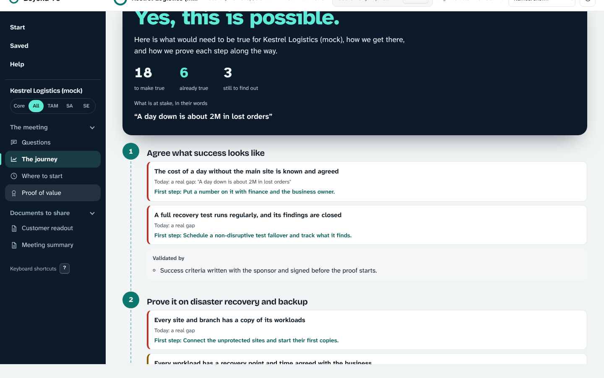
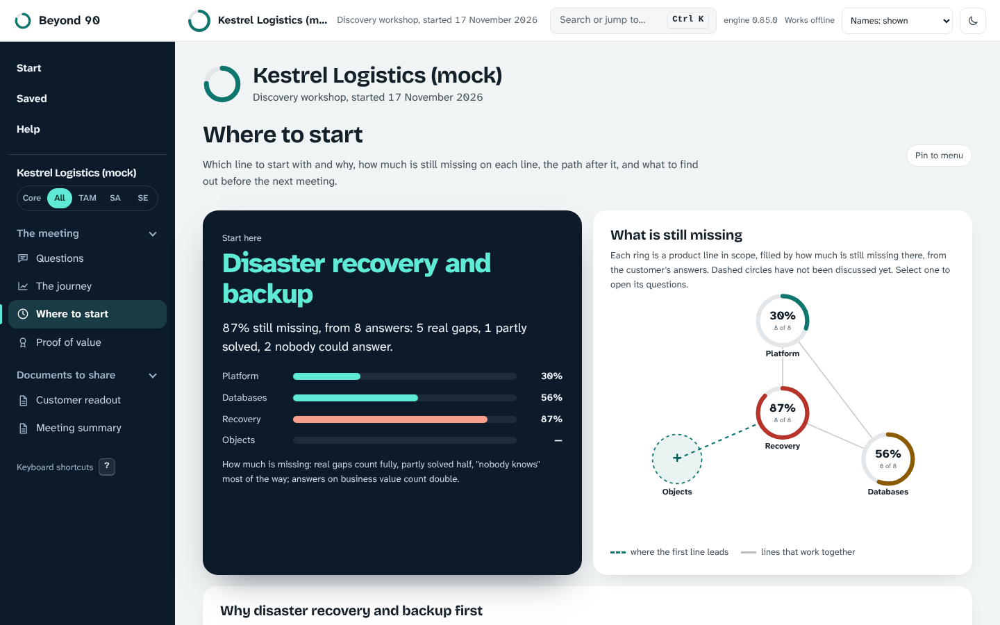

# Discovery workshop: before there is any data

The rest of Beyond 90 reads what a customer runs. The first meetings with a prospect have nothing to read yet: what you have is the conversation. The discovery workshop turns that conversation into the same picture, from the start page, with no files.

## How it works

1. **Start a discovery workshop** on the start page. Give the prospect a name and choose the product lines in scope: platform, databases, disaster recovery, object storage, file storage, Kubernetes platform, or the security lines (cloud, identity, SaaS, monitoring, endpoint, AI).
2. **Ask the questions.** Each line has eight discovery questions from its profile: two about business value, the others tied to a stage (connected, seen, switched on, decided), each with why it matters. Record what the customer says in one click (**Solved**, **Partly**, **A real gap**, **Nobody knows**) and, if you like, their words in a short note. After each answer the next question is selected, so the keys 1 to 4 keep up with the conversation. On a business-value question you can also put a figure on what is at stake, counted per hour, day, week, month, year or incident; it heads the journey and the readout.
3. **Where to start** updates as you go:
   - **Start here:** the line that hurts most, once at least three questions were answered on it, with the questions and the customer's own words that point there.
   - **The map:** each line in scope filled by how much is still missing there; lines not discussed yet are dashed; dashed links show where the first line leads.
   - **Then:** the path after the first line, from the links between kinds of product ("immutable copies need a target that an administrator cannot delete from"), and the other lines where pain was heard.
   - **Find out before the next meeting:** every question nobody in the room could answer. Often that is the real gap.
4. **The journey.** "Yes, this is possible": the answers turned into a path from where the customer is today to where it could be. Every gap and every "nobody knows" becomes a condition, *what would need to be true*, with where the customer is today (in their words when you noted them) and the first step towards it. The steps are in order: agree what success looks like (the business-value questions), prove it on the first line (validated by that line's proof-of-value criteria), then each line it leads to and why. What is already true is shown too, and what is at stake, from the customer's own notes, heads the page.

   

5. **Start the proof of value** in one click: a plan for the prospect with the first line's own success criteria and how to test each, a problem statement made from the gaps heard, and the readiness checklist. From there it is the same [proof of value](app.md) as for any customer: sessions, results, the mutual plan.
6. **Customer readout:** a page for the customer, in their language (no scores, no stage codes): what would need to be true, where they are today, the first steps, how each step would be proven, what we heard and what to settle at the next meeting. Download it to send or print, or show it on screen. It loads nothing and has no scripts; everything typed is escaped.
7. **Meeting summary:** what was heard line by line, the journey as a checklist (each condition with its first step and where the customer is today, what is already true ticked, how each step is validated), and the open questions. Copy it into the follow-up email or the CRM.

## How "still missing" is counted

For each line, a real gap counts 1, nobody knows 0.6 (not knowing is itself a finding), partly 0.5 and solved 0; answers to business-value questions count double. What is still missing is that sum over the most it could be for the questions answered. The line to start with is the one with the most still missing, weighted a little by how much of it was explored, so a line heard about twice does not beat one explored in eight questions.

## Privacy

A workshop is a customer fact, like a proof of value: it is kept in this browser's store, sealed under a random slot when you set a passphrase, erased with the customer from *Saved*, and carried between devices only in the workspace file, where it is checked field by field on import. Its identifier holds a date and a random suffix, never the prospect's name. The questions are built into the page at release time; nothing is fetched or sent.

## Why "what would need to be true"

Presales engineers are trained to look for limits, and a list of gaps can read as a list of reasons not to start. The journey keeps the same rigour (every risk named, its impact in the customer's words, a step to address it and a test that proves it) but asks a different question: not "can we?" but "what would need to be true for us to do this?". Each discovery question in the profiles carries both: the question to ask, and the condition it tests with a first step towards it.
